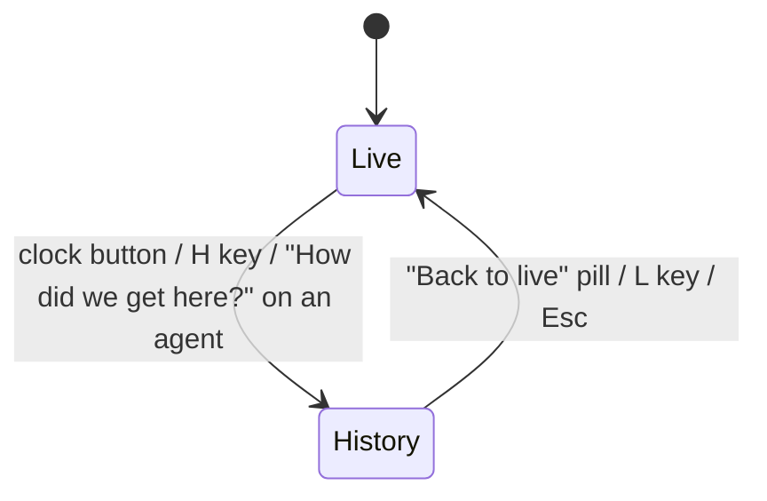
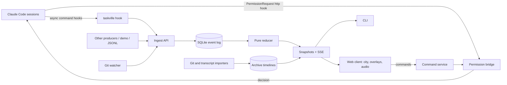
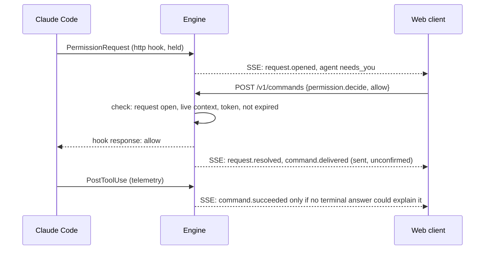

# Taskville architecture

Status: proposed architecture, revision 3 (October 30, 2026). It describes a system to build; nothing here exists yet. Revision 2 made live mode the center of the product, added stuck-agent interaction and the first fun features, and simplified history. Revision 3 is a technology review: versions were checked against current releases, two components were switched, and a few gaps were filled (section 5.1). Section 16 lists what changed and why.

Governing principles: [constitution](.specify/memory/constitution.md) v1.2.0. Visual reference: [UI models](docs/ui/README.md).

## 1. Product intent

Taskville is a quiet, live 3D city where block-shaped agents visibly work, hand off tasks, and ask for help. It is meant to sit on a second monitor. A glance answers three questions: who is working, who is waiting, and who needs me. When an agent is stuck it stops, pulses red, and pipes up with a speech bubble. Click it and you can deal with it on the spot.

**Live is the default and the priority.** History is a secondary mode one click away, with an obvious way back to live.

First release scope:

- Live 3D city with block buildings and block humanoid agents that walk between work areas.
- Four themes: cyberpunk, steampunk, solarpunk, Frutiger Aero.
- Stuck agents: blinking red hue, selectable glow, built-in quips and emotes in chat bubbles.
- Answer Claude Code permission prompts (allow or deny) from the city, and jump to an agent's session.
- Day/night lighting from the viewer's local time zone, with a setting to turn the cycle off.
- Small celebrations for completions, handoffs, and merges.
- Optional soundscape with a needs-you chime, off by default.
- History mode: replay what the city recorded. Git and transcript imports follow right after the first release.
- A headless engine that works with no browser, plus a CLI.
- Local, single user, multiple projects, multiple viewer tabs.

Out of the first release: typed replies to agents (planned next, see 9.4), AI-written quips, weather, a growing skyline, idle wandering, mascots, hosted multi-user operation, arbitrary third-party overlay code. Taskville observes agents and relays a few explicit commands. It is not a scheduler or an orchestrator.

## 2. Live experience


The image is the visual reference, not a pixel specification.

### 2.1 City vocabulary

| Element | Meaning | Behavior |
| --- | --- | --- |
| City | Project | Stable layout across sessions and themes |
| Building | Work area | Dispatch, Workshop, Test Lab, Review, Security, Archives; click for its queue |
| Block person | Agent | Stable color and label; subagents are smaller and spawn from their parent's building; teammates are full-size with a team scarf (section 2.9) |
| Carried cube | Task handoff | Appears only during a recorded handoff |
| Street | Navigation | Connects work areas; not proof of a dependency |

Work areas are presentation destinations, not workflow stages. A mapping table turns activity into a destination (section 8.3) and is user-configurable.

Default camera: fixed orthographic isometric, optional orbit and zoom with a reset control. Procedural geometry only, soft shadows, generous spacing, no dense scenery.

### 2.2 Agent states and how they look

Three attention levels, deliberately different in color and in shape so they never depend on color alone:

| Level | Triggered by (Claude Code) | Look | Clickable action |
| --- | --- | --- | --- |
| **Needs you** | `PermissionRequest` held by the bridge (answerable); otherwise `Notification` of type `permission_prompt`, `Elicitation`, or an explicit input request (open-session only) | Agent stops where it is (a safe point on the street or at its workstation). Red hue pulses about once per second. Red rim glow. "!" emote. Quip bubble. | Yes: action card |
| **Trouble** | `StopFailure`, three or more consecutive tool failures, or "running but silent" beyond a threshold (heuristic) | Amber, slow pulse, sweat-drop or "?" emote, occasional quip | Opens details |
| **Waiting** | Turn ended (`Stop`), `Notification` of type `idle_prompt` | No hue. Sits at the workstation, small "..." or "zzz" emote | Opens details |

Heuristic trouble is labeled as such ("quiet for 12 min") because the constitution forbids presenting guesses as facts. It depends on elapsed time, so it is computed by a selector with an injected clock (wall clock in live, replay clock in history) and never stored in reducer state.

**One prompt, one red state.** A single permission prompt can produce a `PermissionRequest` and, a few seconds later, a `Notification` of type `permission_prompt`. The reducer merges them into one attention record keyed by session and tool. Only a request held by the permission bridge (section 8.1) is answerable from the city; a needs-you state known only from telemetry offers "Open session" alone, so a forged telemetry event can turn an agent red but can never create something to approve.

Normal working states use small loops at the workstation: hammering at the Workshop, beaker at the Test Lab, flipping pages in the Archives. Status labels update the instant an event arrives, even while the agent is still walking.

**Glow means "you can click me."** Hovering any agent adds a soft rim glow. Needs-you agents keep a red glow until handled. Selecting an agent keeps a marker on it and fades buildings that occlude it.

**Blink safety.** The pulse is a smooth sine, at most 1 Hz, and never above 3 flashes per second. With reduced motion turned on, the pulse becomes a steady red ring and the bubbles appear without animation. After 10 minutes unhandled, the pulse slows to keep the scene comfortable, but the red ring stays.

### 2.3 Quips and emotes

Bubbles pop over the agent's head with a short built-in line, then fade after about 4 seconds. They repeat every 45 to 90 seconds while the state lasts; the jitter is seeded from the same hash as the line choice.

- Built-in phrase sets per state and per theme, for example needs-you: "Little help here?", "Need a yes on this one", "Permission to proceed, boss?"; steampunk: "Requesting authorization, guv'nor!"; cyberpunk: "Access denied. Need your override."
- A bubble can include one short fact from the event, such as the tool name ("Needs OK: Bash"). Agent-supplied text is never placed in a bubble; it appears only, escaped, in the action card.
- Line selection is deterministic: a hash of agent ID and event ID picks the line, so replay shows the same quips as live.
- At most three bubbles on screen. Priority: needs-you by longest wait, then trouble, then the selected agent.
- Emotes are small billboard icons: "!", "?", "...", sweat drop, sparkle, "zzz".
- Phrase sets are plain data files, so adding lines or a new theme's voice needs no code.

### 2.4 Action card

Clicking a needs-you agent opens one compact card (the single sidebar slot):

- Who, what, and how long: agent, project, session, waiting time.
- For a permission request: tool name, the exact command or input (escaped, monospace, scrollable, never truncated), and the working directory. The exact input comes from the bridge's in-memory held request, not from the event log, which stores only a redacted copy. Values that look like secrets are masked with click-to-reveal, and Allow stays disabled until every masked part has been revealed, so you never approve something you have not seen.
- Buttons: **Allow once**, **Deny** (optional note to the agent), **Open session**. For needs-you states that the bridge did not hold (elicitations, input requests, prompts seen only through notifications), the card shows the reason and **Open session** only.
- No "always allow" in the first release. It would write permission rules, which is too much power for a click on an ambient display.
- If the request was already answered in the terminal or expired, the card says so and the buttons disable.

Open session: copies the session ID and working directory, and runs a user-configured opener if one is set (for example a terminal or editor URL scheme). The default is copy-only, because resuming a live session from a second process may fork it. The opener is configured only in the config file or through the CLI, never from the web settings, and runs via `execFile` with an argument array, never through a shell.

### 2.5 Day and night

Lighting follows the viewer's local clock in the browser's time zone (`Intl.DateTimeFormat().resolvedOptions().timeZone`). Sun angle, sky color, and ambient intensity interpolate through dawn, day, dusk, and night. Window emissives and street lamps switch on at dusk. Each theme supplies a night palette, so cyberpunk gets brighter neon at night and solarpunk gets warm lanterns.

Settings: **cycle on** (default), **always day**, **always night**. In history mode the lighting follows the replayed timestamp, so a replay of 2 a.m. looks like 2 a.m. Cost: a hemisphere light, one directional light, and one shared uniform for the emissives. No post-processing.

### 2.6 Celebrations

| Event | Celebration |
| --- | --- |
| Task completed | Small confetti pop over the agent (at most 40 pooled particles, 1.2 s) and a sparkle emote |
| Handoff | The two agents high-five as the cube changes hands |
| Merge observed (Git) | A bigger burst over Archives, a lamp flourish along the street |
| Tests green after red | Brief green shimmer on the Test Lab roof, only for recorded `test.result` events, never for a guessed test run |

Rate-limited to one burst per two seconds per city. Reduced motion shows a sparkle icon only. Replay plays celebrations at 1x and 10x and suppresses them at faster speeds.

### 2.7 Soundscape

Off by default. Browsers block audio until the user enables it, so it is turned on with a click in settings.

- A quiet ambient loop per theme: low city hum, gears and clock ticks, birds and wind, soft synth pads.
- A gentle chime once when an agent enters needs-you (not on every pulse), a soft tick on completion, a pop on handoff.
- Master volume, mute, and a "chime only" mode.
- Web Audio API. Loops are small bundled files under a permissive license or self-made, under 500 KB each, lazy-loaded per theme.

### 2.8 Other viewer behavior

- Header: compact counts ("3 active · 1 needs you"), theme switcher, history button. The needs-you count, tab title, chime, and "Back to live" badge come from a global attention feed across all projects (section 10), so an agent stuck in another project's city is never invisible. The header names the other project and switches to it on click.
- Switching themes never changes task state, identity, selection, camera, or history position.
- If the browser tab is hidden, animation pauses and the presentation is rebuilt on return. A needs-you event while the tab is hidden updates the tab title ("(1) Taskville") and can raise an optional desktop notification.
- An accessible agent list (keyboard and screen reader) mirrors the scene and is the fallback for larger teams.

### 2.9 Subagents and agent teams

Claude Code has two ways for one agent to bring in others, and the city shows them differently because they behave differently.

| | Subagent | Agent-team teammate |
| --- | --- | --- |
| What it is | A short-lived helper inside one session, spawned with the Agent tool | A full, independent Claude Code session, named, working alongside a lead for the life of the team |
| In the city | A **smaller** bot that walks out of the parent's door | A **full-size** bot with a name tag and the team's shared scarf color |
| Lifetime | Appears on start, walks back with a result cube on stop, hands it to the parent, fades out at the door | Stays in the city while the team exists; goes to its workstation and sits ("zzz") when idle |
| Identity | One bot per run (each run has its own `agent_id`); body color from `agent_type`, trim color from the parent | Stable per `teammate_name` within the team |
| Can have | Its own subagents (each generation smaller; below two levels shown as a count on the parent) | Its own subagents; teammates cannot spawn teammates |

**The lead** of a team stands at Dispatch wearing a small hard hat. The team's shared task list (from `TaskCreated` and `TaskCompleted` hooks) appears as the Dispatch building's queue. When a teammate claims a task, it walks from Dispatch to the matching work area.

**Messages between teammates** (the `SendMessage` tool, seen through `PreToolUse`) appear as a small paper envelope that flies from sender to recipient. Hovering the envelope shows who wrote to whom; clicking it opens the message in the sender's feed.

**Parent while waiting.** A parent waiting on its subagents sits at its workstation with a "..." emote, which looks different from waiting on you. A lead with teammates in flight shows a tiny progress pip per teammate above Dispatch.

**Crowding.** Up to three subagents per parent get their own bot. Beyond that, a "+N crew" marker stands by the building; clicking it fans the bots out briefly and opens the parent's crew list.

**Stuck subagents and teammates.** Hook inputs fired inside a subagent carry `agent_id` and `agent_type`, so a permission request from a subagent turns that subagent red, and its parent gets a small red dot so the family is easy to find. The docs say teammate permission prompts surface in the lead's session. Until spike S-2 confirms how they are attributed, a teammate prompt shows red on the teammate when the payload identifies it, and otherwise on the lead with "for: <teammate>" in the card when that can be determined.

**Talking to teammates.** Claude Code documents no external way to message a teammate. The card offers Open session (the lead's session, where teammates can be selected) and nothing more.

Agent teams are experimental in Claude Code. Taskville reads only hook inputs, never the undocumented files in `~/.claude/teams/` or `~/.claude/tasks/`, and keeps all team mapping inside the Claude Code adapter so format changes stay contained there.

### 2.10 Agent panel and live code feed

Clicking any agent opens the agent panel in the single sidebar slot. It always works the same way, whether the agent is a top-level session, a subagent, a teammate, or a lead.

**Header.** A breadcrumb shows the family (`Lead › reviewer #2`), followed by name, type, status, elapsed time, and the file it is touching right now. Clicking any crumb selects that agent.

**Live tab (default).** A follow-scrolling feed of what the agent is doing at the code level, one card per tool call, newest at the bottom:

| Card | Shows | Expands to |
| --- | --- | --- |
| Edited `src/city/path.ts` +4 −2 | The exact replaced fragment as a mini diff | Full fragment diff, syntax highlighted, with an "Open in editor" link |
| Wrote `docs/x.md` (new, 120 lines) | First lines of the content | Full content. No diff, because the previous file contents are not known |
| Ran `pnpm test` ✓ 0.8 s | Command and the last lines of output | Full captured output |
| Read 3 files / Searched "attention" | Grouped file chips and the query | The list of files |
| Spawned reviewer / Sent message to Pip | Child or recipient chip | Selects that agent |
| Needs you: Bash | The pending request | The action card |

Behavior details:

- A pending call shows as "running..." (from `PreToolUse`) and fills in when its `PostToolUse` arrives.
- Scrolling up pauses the follow; a "Jump to latest" chip resumes it.
- Keys: `F` toggles follow; `[` and `]` step between family members.
- File chips link to the editor through a URL scheme (`vscode://file/...` or a configured equivalent). These are plain links; nothing is executed by the engine.

**Files tab.** Every file the agent touched this session with per-file edit counts, newest first; clicking one shows all its edits in order.

**Crew tab** (on parents and leads). Lists subagents and teammates with status dots, current activity, and elapsed time. While the crew tab is open, the family is highlighted in the city: the rest of the scene dims slightly, family members get an outline in the parent's trim color, and faint dotted tethers run from the parent to each child. Hovering a row makes that bot bounce once; clicking a row selects it, and the camera eases over without changing zoom. Finished subagents stay in the list, collapsed, with their result summary.

**In the city**, the selected agent shows a tiny floating screen above its workstation with the current file name, so you can glance between the panel and the scene.

**Honesty rules** (constitution IV):

- Edit cards show only the fragment Claude Code sent (`old_string` to `new_string`), with no invented line numbers.
- Write cards show content, not a fabricated diff.
- Output shows what the hook reported, nothing reconstructed.
- When a field is missing from a payload, the card says "not reported".

**Privacy.** Code is only visible while the panel is open; the city itself never shows code. A privacy setting hides code bodies entirely, leaving file names and counts, for screen sharing or an office wall display. Secret-looking values are masked, as in the action card.

## 3. History experience

History is one click away and always one click back.



- **Entry points:** a clock button in the header; the H key; and "How did we get here?" on any agent card, which opens history at the start of that agent's current task.
- **Clear mode signal:** the city desaturates slightly with a theme-matched tint (sepia for steampunk, cool scanlines for cyberpunk), and a chip shows "HISTORY · Tue 3:42 PM".
- **Timeline strip** along the bottom: day markers, an event-density sparkline, red ticks for needs-you moments, green ticks for completions, commits as small dots. Controls: play/pause, speed (1x, 10x, 60x, 600x), next or previous moment, agent filter.
- **Back to live:** a pill fixed at the top center. If something needs you live while you browse history, the pill turns red and shows a count ("Back to live · 1 needs you"), and the chime plays if sound is on.
- **Read-only:** cards in history show what happened but have no action buttons. Historical permission requests are displayed, never answerable.
- Live ingestion continues while history is open. Returning to live loads the current snapshot immediately, with no catch-up animation.

## 4. System boundaries



- Dependencies flow inward to `protocol` and `domain`. The engine never imports React, Three.js, DOM, or overlay code.
- Rendering cannot change authoritative state.
- The command service is the only path to side effects. Replay has no reference to it, and the engine rejects commands carrying a history context.
- One process, one port: the engine also serves the built web client, so the browser talks to the same origin and no CORS is needed.

## 5. Stack and repository layout

- **Language and tooling:** TypeScript 7 (the native compiler, `tsc`) for typechecking; erasable syntax only, so Node runs the sources directly with type stripping. pnpm workspace. Biome 2 for lint and format.
- **Engine:** Node.js 26; Hono 4 on `@hono/node-server` for routing, middleware (Host, credential, and Origin checks), Zod request validation, and SSE; `node:sqlite` (`Database` and `Statement`, WAL, explicit `BEGIN`/`COMMIT`) for the event log and evidence; pino for structured logs. Zod 4 schemas in `protocol`, with `z.toJSONSchema()` for adapter authors.
- **Web:** Vite 8, React 19, React Three Fiber 9 and Drei on three.js WebGL2, Zustand for client state. Per-frame animation runs imperatively in `useFrame` against refs; React re-renders only on state changes, not on every frame.
- **Web UI:** React Aria Components for accessible panels, tabs, dialogs, listboxes, and tooltips; CSS Modules with CSS custom properties, where each theme publishes one token set shared by the DOM and the 3D materials; TanStack Virtual for the code feed; jsdiff for edit fragments; Shiki (JavaScript regex engine, languages loaded on demand) for highlighting.
- Speech bubbles and labels are a DOM layer positioned from projected world anchors each frame. Text stays crisp and accessible, and there are never more than about a dozen.
- **Tests:** Vitest 5 (unit, integration, and Browser Mode for React and R3F components in a real browser), fast-check for reducer properties, Playwright for end-to-end flows.

```text
apps/
  engine/        HTTP, SSE, storage + migrations, ingest, command service, permission bridge, git watcher, static web hosting
  web/           React app: city/, overlays/, history/, audio/, quips/ (phrase data), themes/
  cli/           taskville binary: serve, status, events, demo, hook, install, import
packages/
  protocol/      Event and API schemas, versioned
  domain/        Pure reducer, selectors, attention rules, stable hashing
  adapters/      Pure mappers from source formats (Claude Code hook JSON, transcripts, Git) to events
  demo/          Seeded six-agent scenario producer
fixtures/        Event logs, Claude Code hook payloads, small Git repos, transcripts
specs/           Spec-kit feature specs
```

Six units. `protocol`, `domain`, and `adapters` must be importable without Node built-ins (the web client and tests reuse them). Storage lives inside the engine until a second consumer needs it.

### 5.1 Technology review (revision 3)

Checked against current releases on October 30, 2026.

| Area | Decision | Why |
| --- | --- | --- |
| HTTP framework | **Switch** from a hand-written `node:http` router to **Hono 4** | Middleware gives one tested place for the Host, credential, and Origin checks that security depends on; Zod validators and the typed client remove hand-written plumbing. `streamSSE` handles client aborts. Its writes wait for the client but have no cap, so the engine keeps its own bounded queue per subscriber (section 10). Hono 5 is a release candidate, so stay on 4. |
| Evidence bodies | **Switch** from a content-addressed directory to **SQLite** (a separate `evidence.db`) | Bodies are capped at 64 KB, a size where SQLite blobs are efficient. One transactional store makes eviction, backup, and project deletion single queries, with no orphaned files. |
| Typechecking | **Upgrade** to TypeScript 7 | Stable since July 2026 and much faster; supports `erasableSyntaxOnly`. Its missing programmatic API does not matter here. |
| UI primitives and styling | **Add** React Aria Components, CSS Modules, CSS custom properties | The architecture requires an accessible agent list, panels, and tabs but named no way to build them. React Aria is actively released and accessibility-first. Theme tokens as CSS variables keep DOM and 3D colors in sync. |
| Code feed helpers | **Add** TanStack Virtual, jsdiff, Shiki | A virtualized list, fragment diffs, and lazy highlighting were required but unnamed. |
| Logging | **Add** pino | The engine needs structured logs for debugging and retros. |
| Component tests | **Use** Vitest 5 Browser Mode | Stable; R3F and React Aria behave correctly only in a real browser, unlike jsdom. |
| Claude Code cost and tokens | **Add later** an OTLP receiver (ticket M5.12) | Claude Code's OpenTelemetry export reports tokens and cost per session, and per subagent through `agent_id` and `parent_agent_id`. Hooks remain the primary source, since OpenTelemetry has no permission prompts and no pre-tool events. |
| Other runtimes | **Plan** Codex through hooks and OpenTelemetry (post-release spike M8.05) | The Codex CLI now has both, so a second adapter is realistic. |
| Kept | Node 26, `node:sqlite`, Zod 4, React Three Fiber 9 on WebGL2, Vite 8, Zustand, SSE, Biome 2, pnpm, Playwright | `node:sqlite` is a release candidate in Node 26 and passed a local WAL and transaction test; use the new `Database` and `Statement` names (the `*Sync` names are deprecated aliases) and pin a recent Node 26. |
| Rejected or deferred | Bun; WebGPU and React Three Fiber 10 (alpha); LiveStore (0.5 beta, would replace the core); Tauri (revisit after M6); Node single-executable packaging (still in active development, M7 decides); Turborepo (unnecessary at six packages); WebSockets | Each either adds risk to the core or solves a problem Taskville does not have yet. |

New dependencies are justified here per constitution VII.

## 6. Domain model

| Entity | Key fields |
| --- | --- |
| Project | ID, name, repository roots, layout ID |
| Agent | ID, source identity `(sourceId, sourceAgentId)`, display name, role, kind (`session`, `subagent`, `lead`, `teammate`), parent agent ID (subagents), team ID (leads and teammates), connection |
| Team | ID, lead agent ID, member agent IDs, started/ended |
| ToolCall | ID, agent, session, tool name, phase (`running`, `succeeded`, `failed`), file paths, short summary, evidence ID, started at, duration |
| Session | ID, agent ID, source, start/end, working directory |
| Task | ID, title, status, assigned agents, related tasks |
| AgentActivity | agent, session, task, activity, since, latest evidence, open session count |
| Attention | agent, level (`needs_you`, `trouble`, `waiting`), kind, reason, since, `requestId?`, `heuristic: boolean` |
| PendingRequest | ID, agent, session, kind (`permission`, `elicitation`, `input`), tool name, bounded input preview, opened at, expires at, state |
| Command | ID, type, target request, payload, status, idempotency key |

Task states: queued, assigned, running, blocked, awaiting_input, reviewing, completed, failed, cancelled, unknown. Activities: idle, implementing, testing, reviewing, researching, documenting, dispatching, handing_off, waiting, unknown. Anything unrecognized is kept as `unknown` with the original value preserved.

PendingRequest states: `open`, `answered_here`, `answered_elsewhere`, `expired`. Command states: requested, delivered, succeeded, failed, expired, unsupported. Acknowledgment is not completion.

PendingRequest and Command are projections of `request.*` and `command.*` events, like everything else; there are no mutable request tables. Lifecycle rules:

- A telemetry-only request closes as `answered_elsewhere` on the next event from the same session (`PostToolUse`, `PostToolUseFailure`, `Stop`, `UserPromptSubmit`) if Taskville did not answer it.
- A bridge-held permission request does not follow that rule (decision #116, spike S-1 recommendations 1 and 2). A hook connection closed before any city answer, and before the hook `timeout`, is recorded as answered in the terminal (deny); a close at the hook `timeout` means the engine missed its own hold window and is recorded as `expired`, never as a deny. Exactly one unambiguous matching `PostToolUse` (same session, prompt, tool name and input, with no duplicate request in that prompt) closes it as answered in the terminal (allow). A later `UserPromptSubmit` or `Stop` from the same session closes it as `answered_elsewhere`. Other same-session events, such as a parallel sibling's `PreToolUse` or `PostToolUse`, and Notifications never close it.
- A decision sent from the city is recorded as sent, unconfirmed, once it is written to the still-open hook response (decision #116), because writing to an open response does not prove the decision applied: after a terminal Yes the hook stays open and a later city answer is ignored (spike S-1, exp3). Telemetry that a terminal answer could equally explain, such as a matching `PostToolUse` after a city Allow, never upgrades it to succeeded. If the hold window ended first, the command fails as `expired` and the card says so.
- On engine start, every request still `open` gets a `request.expired` event, because its hook connection died with the old process.

Connection is separate from activity. A disconnected agent keeps its last task; nothing fails automatically. Identity is never merged on name similarity.

## 7. Events, ordering, and storage

### 7.1 Envelope

```ts
interface EventEnvelope<T> {
  schemaVersion: 1;
  eventId: string;          // engine-assigned
  projectId: string;
  sourceId: string;         // e.g. "claude-code", "demo:42", "git:<repo>"
  sourceEventId: string;    // idempotency key within the source
  sourceSequence?: number;
  occurredAt: string;
  receivedAt: string;       // engine-assigned
  ingestSequence: number;   // engine-assigned, gap-free per project
  agentId?: string; sessionId?: string; taskId?: string; correlationId?: string;
  type: string;
  payload: T;
  evidenceIds: string[];
  provenance: 'live' | 'imported' | 'demo';
}
```

Families: project, agent (registered, connected, disconnected), session, task (created, assigned, status_changed, handoff), activity, input and permission requests (opened, resolved), test results, Git observations (commit, ref moved, merge), command lifecycle.

### 7.2 Ingest

Validate, normalize, deduplicate on `(projectId, sourceId, sourceEventId)`. Same key and same content is a duplicate and returns the original acknowledgment. Same key with different content is a conflict. Each batch commits in one transaction: events, new head, and the updated projection together. Only then is anything acknowledged or broadcast. Per-event results report accepted, duplicate, conflict, or rejected with a reason.

### 7.3 Ordering, simplified

The live city has one order: ingest sequence. Live sources report in near real time, so ingest order is the honest record of what Taskville knew and when, and it is what history replays.

Imported history (Git history, past transcripts) does **not** merge into the live timeline. Each import becomes its own read-only **archive timeline**, ordered by occurrence time, then source sequence, then event ID. History mode can open the live recording or an archive. This removes revision 1's timeline revisions, checkpoint invalidation, and per-entity watermarks from the first releases. A merged "everything" view can come later if it proves worth it.

### 7.4 Storage

SQLite tables: projects, events (insert-only), projections (state JSON plus reducer version, head, state hash), checkpoints, archives, pending_requests, commands, settings. A projection whose reducer version is stale is rebuilt from events at startup, before the server listens.

**Checkpoints** make seeking cheap, but they are added only when measured seeks miss the 300 ms target. At six agents a full replay of a day's log will likely be fast enough. When needed: store the reducer state every 500 events, load the nearest checkpoint at or before the target, and apply the rest. Checkpoints are disposable caches tagged with reducer version and state hash.

Evidence bodies (tool inputs and outputs for the code feed, transcript excerpts) go to a separate SQLite database, `evidence.db`, keyed by content hash. Each body is capped at 64 KB (larger ones are truncated and marked so), and the per-project evidence store has a size cap (default 1 GB) beyond which the oldest bodies are evicted. ToolCall records and the event log are never pruned automatically, so the feed always shows that a call happened even when its body has been evicted ("details no longer stored").

## 8. Sources

### 8.1 Claude Code (first adapter)

Claude Code hooks provide everything needed to observe sessions and answer permission prompts. Verified against the [hooks reference](https://code.claude.com/docs/en/hooks) on October 30, 2026. Exact fields are confirmed again in the integration spike.

**Telemetry: async command hooks.** `taskville install claude-code` adds hooks for `SessionStart`, `SessionEnd`, `UserPromptSubmit`, `PreToolUse`, `PostToolUse`, `PostToolUseFailure`, `Notification`, `Stop`, `StopFailure`, `SubagentStart`, `SubagentStop`, `TeammateIdle`, `TaskCreated`, `TaskCompleted`, and `Elicitation`, each with `"async": true`. The hook runs a tiny shim (a shell script using `curl`, not the full Node CLI, so a tool call does not start a Node process). The shim:

- generates a UUID as `sourceEventId` and keeps it with the payload, so retries and spool replays deduplicate;
- posts the raw hook JSON to `POST /v1/sources/claude-code/hooks` with a one-second timeout;
- on failure, appends the payload and its ID to a local spool file, which the engine ingests on its next start.

Spooled events are marked `late`. They update history and agent records but never open a needs-you state, since the prompt they describe is long gone. Being async, none of this slows the agent.

The engine, not the hook, maps raw payloads to envelopes: it resolves `projectId` from the working directory through the configured repository roots, then calls the pure mapper in `packages/adapters`. For this source `projectId` is engine-assigned.

Rejected alternative: HTTP hooks for telemetry. They run synchronously, so every tool call would wait on Taskville.

**Permission bridge: one HTTP hook.** `PermissionRequest` is configured as an `http` hook pointing at `POST /v1/bridge/claude-code/permission`, with the bridge token passed through `allowedEnvVars`. The engine creates a PendingRequest, the agent turns red, and the request is held open.

- If the user clicks Allow or Deny, the engine answers the held request with `{"hookSpecificOutput": {"hookEventName": "PermissionRequest", "decision": {"behavior": "allow"}}}` (or `deny` with the user's message).
- If no viewer is connected, or nobody answers within the hold window (default 90 s, configurable, independent of whether a viewer is focused; decision #116), the engine returns an empty 2xx and Claude Code falls back to its normal prompt. The agent stays red until a later event shows the request was answered elsewhere.
- If Taskville is down, the hook fails without blocking and Claude Code behaves as if the hook did not exist.
- The hook's `timeout` is set to the hold window plus 5 s, so the engine always answers before Claude Code gives up on the hook.

**Spike S-1 (before building the bridge):** confirm whether the terminal prompt appears while a PermissionRequest hook is pending, how a terminal answer is reported back, and whether an empty response falls through cleanly. If the terminal prompt is suppressed while the hook waits, the default hold window drops to a few seconds unless a viewer is actively focused. Resolved in M1 ([findings](docs/spikes/S-1-permission-bridge.md)): the terminal prompt stays visible, so the hold is focus-independent (decision #116).

**Mapping.** `session_id` maps to Session. The main session is an agent, named from the session name or the project directory. `agent_id` and `agent_type` on any hook input identify the subagent that fired it; `SubagentStart` creates the child agent with a parent link and `SubagentStop` closes it. `teammate_name` and `agent_id` on `TeammateIdle`, `TaskCreated`, and `TaskCompleted` identify teammates; an Agent tool call with a `name` while agent teams are enabled marks the caller as a lead. `PreToolUse` and `PostToolUse` pairs, matched by `tool_use_id`, become ToolCall records whose inputs and outputs are stored as evidence for the code feed. The working directory maps to a project through configured repository roots; unknown directories go to an "Unsorted" project rather than being guessed. Tool names map to activities (Edit and Write to implementing, Read, Grep, and WebFetch to researching, agent spawns to dispatching). A Bash command that looks like a test run maps to testing and is flagged as heuristic.

**Spike S-2 (before M2 is closed):** with agent teams enabled, confirm that teammates run hooks from user settings, whether each teammate has its own `session_id`, how teammate permission prompts are attributed in `PermissionRequest`, whether `MessageDisplay` fires inside subagents (which would add the agent's narration to the feed), and the actual `tool_response` shapes for Edit, Write, and Bash.

**Installing.** `taskville install claude-code --scope user|project` shows the exact settings diff and asks before writing. `taskville uninstall claude-code` removes only Taskville's entries.

### 8.2 Git watcher (live)

For each configured repository root, the engine polls `git for-each-ref` and `git log` read-only every few seconds (or on a filesystem change in `.git/refs`) and emits commit, ref-moved, and merge events. Merges trigger the celebration. A merge proves graph structure, not review approval.

### 8.3 Activity to work area

| Activity | Work area |
| --- | --- |
| dispatching | Dispatch |
| implementing | Workshop |
| testing | Test Lab |
| reviewing (and reviewer-type subagents) | Review |
| security review (security-type subagents) | Security |
| researching, documenting | Archives |

The table is data, so users can change it.

### 8.4 Other sources

The generic JSONL and HTTP batch ingest stays for the demo, tests, and future adapters (Codex, other runtimes). Each adapter declares its capabilities: telemetry, permission answers, replies.

## 9. Command service

### 9.1 Flow



### 9.2 Rules

- Commands are a separate authenticated route. They can never be disguised as telemetry.
- `permission.decide` is accepted only from a paired browser session (section 13). Hook, bridge, and CLI tokens can never authorize a command. The supervised agent runs as the same OS user and can read any file the CLI can, so a file-token path would let an agent approve its own prompt. The CLI can list pending requests (`taskville requests`) but cannot answer them. This is the security-driven exception to the constitution's "CLI path for every capability" rule, approved by the owner and recorded in constitution v1.2.0 (principle I).
- Every command targets an open PendingRequest by ID. A command for an expired or already-answered request fails with a clear status.
- Idempotency key per click. A double click does not double-answer.
- Commands with history context are rejected by the engine, and the history UI has no command path.
- First release command types: `permission.decide` (allow or deny with optional message) and `session.open` (runs the user-configured local opener).

### 9.3 Audit

Every command and its outcome is an event, so history shows who allowed what and when.

### 9.4 Next: typed replies

Claude Code supports pushing messages into a running session through [channels](https://code.claude.com/docs/en/channels), MCP servers enabled per session with `--channels` and a sender allowlist. A Taskville channel plugin would let you type a reply to an agent that asked a question. This is planned for the release after the first, behind a spike. The local inbox socket documented for cross-session messaging is not used, because its use by unrelated processes is not documented.

## 10. Headless API

| Endpoint | Purpose |
| --- | --- |
| `POST /v1/events/batch` | Validated, idempotent ingest |
| `GET /v1/projects` | List projects |
| `GET /v1/projects/:id/snapshot` | State plus atomic resume cursor |
| `GET /v1/projects/:id/events?after=N` | Resumable SSE stream (backlog, then live) |
| `GET /v1/projects/:id/timelines` | Live recording plus archive timelines |
| `GET /v1/timelines/:id/state?at=...` | State at a position (checkpoint + replay) |
| `GET /v1/timelines/:id/events?from=&to=` | Paged events for the timeline strip |
| `GET /v1/attention/events` | SSE feed of needs-you and trouble changes across all projects |
| `POST /v1/sources/claude-code/hooks` | Raw Claude Code hook payloads from the shim |
| `GET /v1/agents/:id/feed?after=N` | SSE code feed for one agent (ToolCalls with evidence), backlog then live |
| `GET /v1/agents/:id/crew` | Subagents and teammates of an agent |
| `GET /v1/evidence/:id` | One evidence body, escaped as text |
| `POST /v1/bridge/claude-code/permission` | Held PermissionRequest hook endpoint |
| `POST /v1/commands`, `GET /v1/commands/:id` | Commands and their status |
| `POST /v1/imports`, `GET /v1/imports/:id` | Configured Git or transcript import |
| `POST /v1/otlp/v1/logs`, `POST /v1/otlp/v1/metrics` | OTLP/HTTP JSON receiver for Claude Code tokens and cost (M5.12, optional) |
| `GET /health` | Process and storage health |

Viewers take a snapshot at cursor N, then stream after N. An unservable cursor gets a `resnapshot` frame. Slow consumers (a full per-subscriber queue of 1,000 frames) are cut off with a recovery instruction. On disconnect the client keeps its last view and marks it stale.

## 11. Rendering and performance

- Navigation: a small street graph with fixed workstation slots outside each building. Paths are planned between anchors, slots are reserved, and simple spacing prevents overlap. New work cancels or replans a walk. Needs-you agents stop at the nearest safe point.
- Presentation states: arriving, walking, working, waiting, idle, departing, stuck. They are derived on the client and never written back.
- Walking is always interpolation, never a recorded fact. The status label always shows the recorded state ("Testing", "Needs you"), and an agent still walking shows a small "on the way" mark. In history, the timeline marks only recorded events.
- Instanced geometry for repeated parts (windows, lamps, trees). Shared materials per theme. Device pixel ratio capped at 2. No post-processing; the glow is an inverted-hull rim mesh, not a bloom pass.
- Confetti and emotes come from pooled objects. Nothing is allocated per frame.
- The code feed streams only for the selected agent. The list is virtualized, and the syntax highlighter (Shiki) loads lazily the first time a card expands.
- Target: smooth at 60 fps with six agents on an integrated laptop GPU, and under 5% CPU when idle on the second monitor (frame rate drops to 20 fps when nothing is moving). A larger fixture is measured before any capacity claim.

## 12. Overlay host

Overlays are bundled React components in the first release, listed in a registry so they can be swapped without touching the engine or the city:

```ts
interface OverlayDefinition {
  id: string;
  slot: 'header' | 'sidebar' | 'timeline' | 'world-labels' | 'bubbles';
  modes: Array<'live' | 'history'>;
  Component: React.ComponentType<OverlayProps>;
}
```

`OverlayProps` provides read-only selectors, selection, world anchors, a mode-aware intent interface (commands still go through the command service), and namespaced local settings. A framework-neutral `mount()` contract for third-party overlays is deferred until someone needs it. The host owns stacking, one sidebar slot, label and bubble collision, and pointer routing: transparent regions pass clicks through to the city.

Built-in overlays: counts header, agent labels, quip bubbles, action card, agent panel (live code feed, files, crew), crew highlight and tethers, task queue, history timeline, accessible agent list, settings (theme, day/night, sound, reduced motion, code privacy).

Presets: **Ambient** (counts, labels, bubbles), **Operations** (adds queue and details), **History** (timeline and evidence). Switching presets keeps state, selection, camera, theme, and history position.

## 13. Security

Answering permission prompts from a browser is effectively remote code execution if anyone else can reach it, so local access is locked down:

- Bind `127.0.0.1` only. Reject any request, read or write, whose `Host` header is not the loopback host and port, which blocks DNS rebinding. Reads require authentication too.
- **Browser pairing.** `taskville serve` prints a one-time URL carrying a pairing code in the URL fragment (never sent in request logs). The page exchanges it for a session secret kept in the origin's `localStorage` (scoped by port, unlike cookies) and sent as an `X-Taskville-Session` header on every request. No cookies are used, because browsers share cookies across ports and any other local server could pick one up. The SSE streams are read with `fetch` streaming so they can carry the header. State-changing routes also require a matching `Origin`. A pairing survives reloads; `taskville unpair` revokes all of them.
- The CLI and the telemetry shim use a token in `$TASKVILLE_HOME/token` (mode 0600). The permission bridge uses a separate token. Neither can authorize commands (section 9.2).
- Threat model limit: any process running as the same OS user can already do a lot, such as editing Claude Code settings. Taskville's job is not to add a cheap new path, especially not one where an agent approves its own prompts.
- Import paths come only from configured repository roots.
- Code-feed evidence is rendered as escaped text inside a highlighter, never as HTML or Markdown. Editor links are built from a fixed URL-scheme template with the path encoded; the engine never opens them itself.
- Transcripts, tool output, and file content are evidence, never instructions. They are escaped when rendered, stored as bounded excerpts, and credentials or sensitive environment values are stripped at ingest. Quip bubbles never show agent-supplied text.
- No "always allow". No bulk approval.
- Staging, per the parent development-directory rules: isolated database, evidence, and credentials; synthetic or read-only sources; access-controlled with signed-out denial verified; never connected to real agents' permission bridges. Production promotion promotes the exact reviewed artifact.

## 14. Delivery sequence

Each milestone ships something usable and is cut into GitHub issues on the project board when work starts.

| # | Milestone | Done when |
| --- | --- | --- |
| M1 | Headless foundation ([spec 001](specs/001-headless-foundation/spec.md)) | CLI ingests a fixture, shows status, follows SSE gap-free; seeded demo is deterministic |
| M2 | Claude Code telemetry | Real sessions, subagents, and teammates appear in `taskville status` with correct parents within a second; ToolCalls recorded; engine downtime loses nothing (spool) |
| M3 | Live city | Six demo agents walk, work, hand off, and complete in four themes; day/night follows local time; celebrations play |
| M4 | Stuck and interaction | Needs-you agents stop, pulse red, quip; spike S-1 resolved; Allow and Deny from the card reach Claude Code; Open session works; soundscape optional |
| M5 | Crews and code feed | Subagents and teammates appear as in 2.9 (spike S-2 resolved); clicking any agent opens the live code feed with under one second of lag; the crew tab highlights the family in the city |
| M6 | History | Clock button opens the live recording; timeline strip, speeds, "Back to live" with live needs-you badge; subagent runs shown as bars under their parent; seeks under 300 ms |
| M7 | Private staging | Packaged engine and client, isolated and access-controlled, release identity shown, signed-out denial verified |
| M8 | Imports (after first release) | Git history and Claude Code transcripts import as archive timelines; Git-only facts stay visibly distinct |

M1 through M7 are the first release. Imports and typed replies (9.4) are the first post-release features.

Spec 001 predates this revision and must be aligned before its tasks are cut: the attention model (`needs_you`, `trouble`, `waiting`), the request and command event names, the `dispatching` activity, parent agents, session working directory, read authentication, and the Host check.

Required checks across milestones: duplicate and conflict ingest, crash-after-commit recovery, gap-free resume, reducer determinism, checkpoint equivalence (seek equals full replay), history command rejection, Host and Origin rejection, bridge timeout fallthrough, quip determinism between live and replay, correct parent and team attribution from recorded subagent and teammate hook fixtures, and PreToolUse/PostToolUse pairing (including a missing PostToolUse) in the code feed.

Visual acceptance: in Ambient mode, from across the room, you can tell which agent needs you without opening anything, and the scene is still comfortable to leave open all day.

## 15. Design options considered

| Decision | Chosen | Alternatives and why not |
| --- | --- | --- |
| Renderer | React Three Fiber with imperative per-frame animation | Plain Three.js: less boilerplate for animation, but overlays and settings are React-shaped. PixiJS 2.5D sprites: cheaper, but loses the real 3D city the owner asked for. Babylon.js: capable, heavier, smaller React story. |
| Delivery | Browser tab served by the engine | Tauri desktop app: always-on-top window and tray badge are attractive; revisit after M5. Electron: too heavy for an ambient display. |
| Live transport | SSE plus POST commands | WebSockets: bidirectional is not needed; SSE resumes natively and works with curl. |
| HTTP framework | Hono 4 on Node | Hand-written `node:http` router (revision 2): fewer dependencies, but security checks and validation would be hand-rolled. Fastify: capable, heavier plugin model. |
| Storage | SQLite event log with JSON projections and checkpoints; evidence in a separate SQLite file | JSONL files: simple, but no atomic projection plus cursor and slow seeks. Postgres: unnecessary for single-user local. |
| Claude Code telemetry | Async command hooks plus spool | HTTP hooks: synchronous, would slow agents. Transcript tailing: no permission or notification signals, format not a stable contract. |
| Answering prompts | PermissionRequest HTTP hook held by the engine | Keystroke injection into the terminal: fragile and unsafe. Agent SDK-managed sessions: would turn Taskville into a runtime. |
| Replies | Channels plugin (next release) | Cross-session inbox socket: use by unrelated processes is not documented. |
| History model | Live recording plus separate archive timelines | Single merged timeline with revisions (revision 1): correct but costly; deferred until needed. |
| Bubbles | DOM overlay layer | Canvas text sprites: blurrier and not accessible. One Drei `Html` element per agent: more expensive with many agents. |
| Glow | Rim mesh | Bloom post-processing: costs GPU on an always-on display. |
| Quips | Built-in phrase data | AI-written: chosen against for cost and privacy; could be an opt-in later. |

## 16. Changes

Revision 3 (technology review): switched to Hono and SQLite evidence storage, upgraded to TypeScript 7, and added React Aria Components, CSS Modules with theme tokens, TanStack Virtual, jsdiff, Shiki, pino, and Vitest Browser Mode. Planned an OpenTelemetry cost receiver and a Codex spike. See section 5.1.

Revision 2:

- Live mode is the explicit priority. History is secondary, with a defined entry, a visual mode signal, and a "Back to live" pill that shows live needs-you events.
- Added stuck-agent presentation (red pulse, glow, quips, emotes), the action card, the permission bridge, and the command types for the first release.
- Claude Code is the first adapter, chosen now because its hooks provide exactly the needs-you signals. The generic adapter remains for tests and the demo.
- History simplified: live replays in ingest order; imports become separate archive timelines. Timeline revisions and watermarks are deferred.
- One process serves the web client: no CORS, stricter origin rules, Host header validation.
- Added day/night, celebrations, and soundscape.
- Package layout reduced; storage folds into the engine; adapters become pure mappers.
- Added subagents and agent teams (2.9), the agent panel with a live code feed and crew highlighting (2.10), spike S-2, and milestone M5.
- Hardened after an independent review: decisions only from a paired browser session, cookie-free pairing, Host checks on every route, exact input shown before Allow, request lifecycle as events, a global attention feed across projects, a curl shim for telemetry, and checkpoints and imports deferred until needed.

## 17. Decisions left to implementation

Exact dependency versions, geometry dimensions, animation timings within the stated limits, checkpoint cadence tuning, phrase-set wording, and sound assets. The hold window for the permission bridge was set by spike S-1 (90 s, decision #116). Remote hosting is chosen at M7 from measured requirements.
