# Taskville

A little city where your agents get to work.

Taskville is a minimal 3D city for watching your coding agents work, live. Each agent is a small block person who walks between buildings as it works. When one gets stuck it stops, pulses red, and asks for help in a speech bubble. Click it to allow, deny, or jump to its session. History replay is one click away. It is meant to sit on a second monitor: a glance tells you who is working, who is waiting, and who needs you.

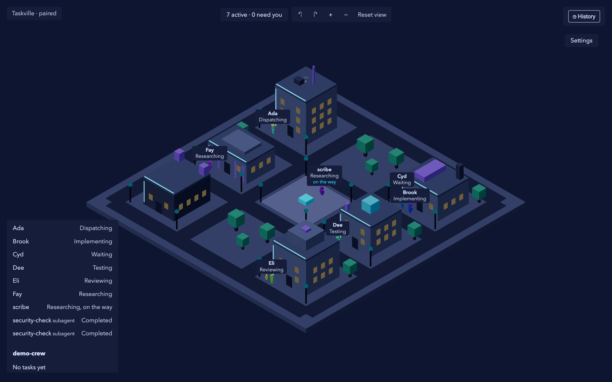

Under the city is a headless event engine, so independent clients and swappable UI overlays can watch the same agents. Taskville observes agents and relays a few explicit commands. It is not a scheduler or an orchestrator. It is local and single user, with multiple projects and multiple viewer tabs.

**Status:** pre-release. Milestones M1 to M4 (engine, Claude Code telemetry, live city, stuck agents and interaction) are merged, with M4 waiting on owner review at gate G4. M5 (crews and code feed) and M6 (history) are in progress, and staging and release (M7) have not started. There is no installer or hosted version yet, and the web client is below its frame-rate budget on an integrated GPU (see [STATUS](docs/STATUS.md) and issue #268). Screenshots below come from the seeded demo and from replaying recorded Claude Code hook streams.

## Features

### A live city

- **A city per project**, with a stable layout across sessions and themes. Buildings are work areas (Dispatch, Workshop, Test Lab, Review, Security, Archives), and agents walk the streets between them as their activity changes.
- **Block agents** with a stable color and a name label that updates the instant an event arrives, even mid-walk. Hover any agent for a glow; click to select it and fade the buildings in the way.
- **Subagents and agent teams.** A subagent is a smaller bot that walks out of its parent's door. A teammate is a full-size bot working beside its lead. See [Crews](#crews-and-the-agent-panel) below.
- **Camera controls:** a fixed isometric view with turn, zoom, and reset buttons.
- **An accessible agent list** (keyboard and screen reader) mirrors the scene and is the fallback for larger teams.
- **A header with counts** ("6 active, 1 needs you"). The needs-you count, the tab title, and the chime come from a feed across all projects, so an agent stuck in another project is never invisible.

### Stuck agents and answering from the city

Attention is shown by color and by shape, so it never depends on color alone.

- **Needs you:** the agent stops where it is, pulses red (at most 1 Hz, never above 3 flashes per second), and shows a speech bubble. The pulse slows after 10 minutes and becomes a steady ring with reduced motion.
- **Quips and emotes:** short built-in lines per state and per theme ("Little help here?"). Line choice is deterministic, so replay shows the same quips as live. Agent-supplied text is never placed in a bubble.
- **Action card:** click a needs-you agent to see who, what, and how long, plus the exact command or input in monospace and the working directory. **Allow once** and **Deny** (with an optional note to the agent) answer the held Claude Code permission prompt. **Open session** copies the session and working directory. Secret-looking values are masked.
- A needs-you state known only from telemetry offers **Open session** and nothing else. A forged event can turn an agent red but can never create something to approve. If the prompt was already answered in the terminal or expired, the card says so and disables its buttons.

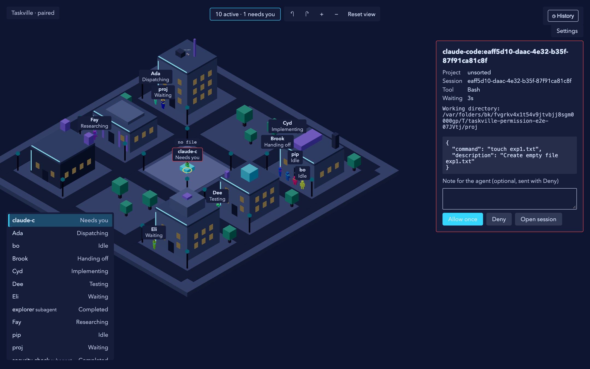

### Crews and the agent panel

Selecting an agent opens a panel with up to three tabs.

- **Live:** the agent's recent tool calls, with status, timing, and the recorded input and output. Code is rendered with syntax highlighting (Shiki, loaded lazily), with editor links and masked secrets.
- **Files:** the files the agent touched, grouped with edit counts, and the recorded input and output for each edit (plain text).
- **Crew:** the lead's subagents and teammates, with a highlight on the whole family in the city.
- **Privacy:** "Hide code in the city" keeps file names and counts and hides code bodies, for screen sharing or an office display. Recorded paths are bounded and gated.

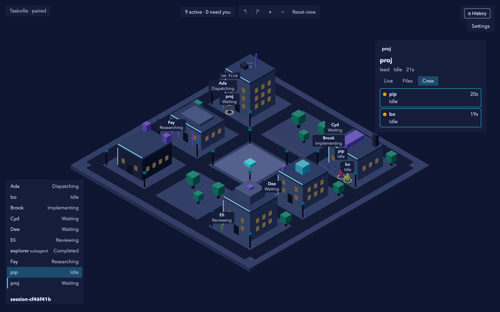

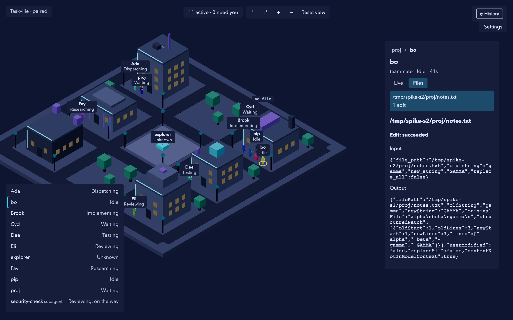

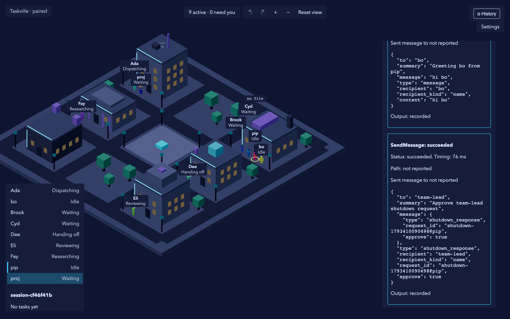

### History

History is one click away from the clock button in the header (or the `H` key), and Back to live is always visible.

- Scrub a timeline of recorded moments, step to the previous or next moment, play, and pick a playback speed.
- The city, the quips, the lighting, and the list all follow the replayed moment. If something needs you live while you browse, the Back to live pill turns red with a count.
- History is read-only: historical permission requests are displayed, never answerable. Live ingestion continues underneath.

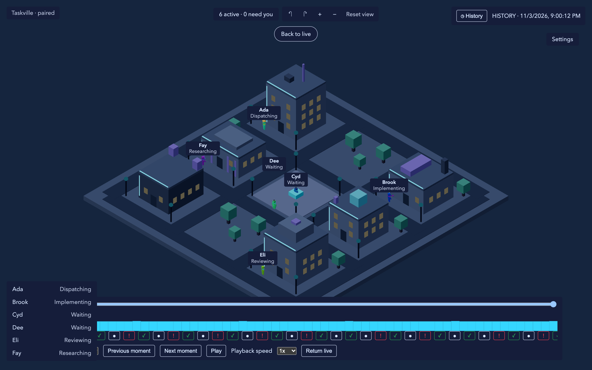

### Themes, light, sound, and comfort

Four themes, switchable at any time without changing task state, selection, camera, or history position.

| Cyberpunk | Steampunk |
| --- | --- |
|  | 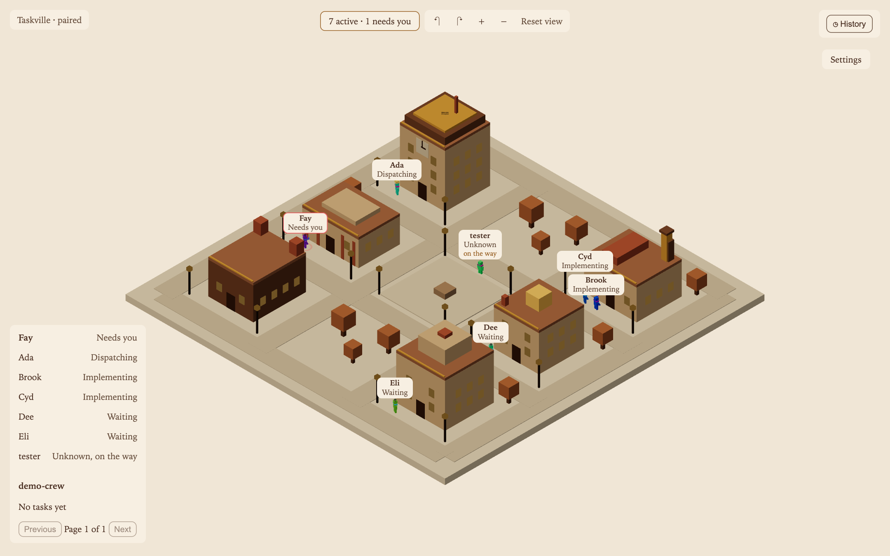 |
| **Solarpunk** | **Frutiger Aero** |
| 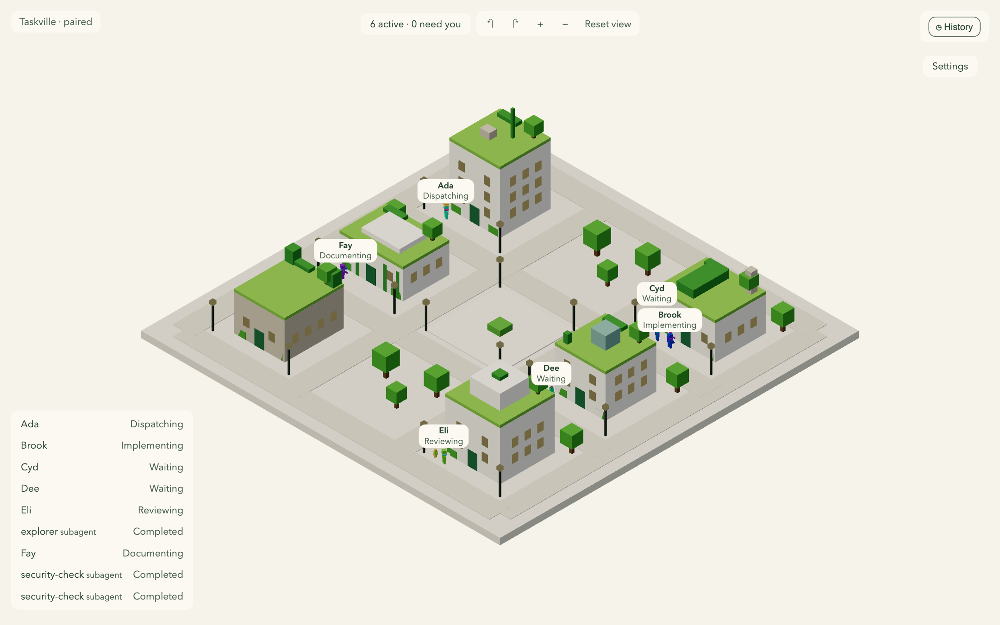 | 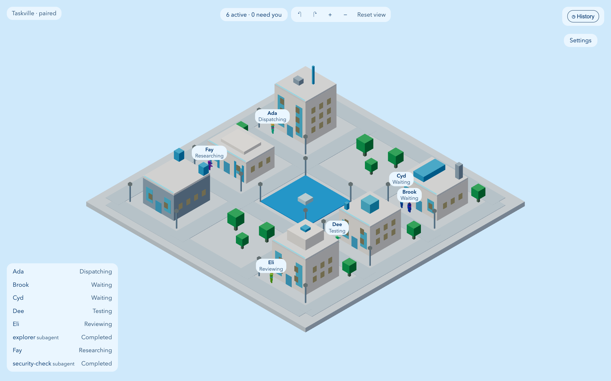 |

- **Day and night** follow your local clock (or stay always day or always night). Windows and street lamps switch on at dusk, and each theme has a night palette. In history, the light follows the replayed time.

  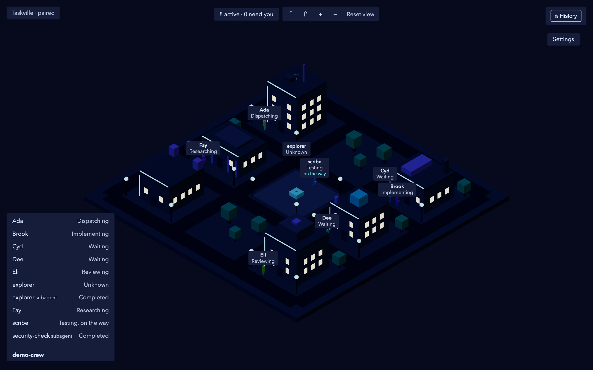

- **Celebrations:** small confetti for completed tasks, high-fives on handoffs, a bigger burst on an observed merge. Rate-limited, and reduced to a sparkle with reduced motion.
- **Soundscape,** off until you enable it: a quiet ambient loop per theme, a chime when an agent first needs you, soft ticks and pops. Volume, mute, and a chime-only mode.
- **Comfort:** reduced motion (follow the system, force on, or force off), optional desktop notifications, and a hidden-tab mode that pauses animation and updates the tab title.

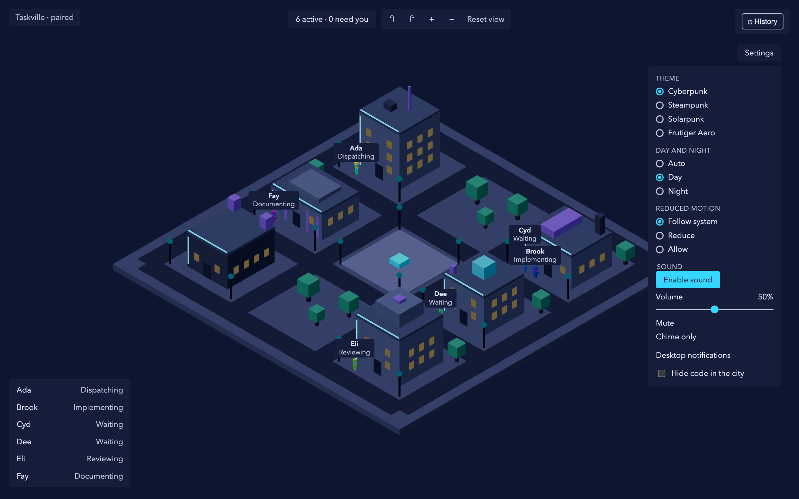

### The engine and the CLI

- **Headless engine** on `127.0.0.1` only, with a SQLite event log, projections, snapshots, and resumable server-sent event streams. It works with no browser.
- **Claude Code telemetry** through an installed hook shim: sessions, tool calls, notifications, subagents, agent teams, a live Git watcher, and a spool that catches up after a restart. Secrets are redacted before anything is stored.
- **Permission bridge:** a held `PermissionRequest` hook is what makes Allow and Deny possible. If no viewer is connected, or the hold window runs out, the hook falls through and Claude Code asks in the terminal as usual.
- **Pairing:** a browser pairs with a one-time link that `serve` prints on the terminal (press `p` for a new one). Paired browsers survive a restart, and `taskville unpair` revokes them all.
- **Seeded demo producer** for six agents, so you can see the city without a real session.
- **CLI:** `serve`, `project`, `status` (agents as a tree), `events ingest` and `events follow`, `requests`, `unpair`, `install` and `uninstall` for Claude Code, and `demo`. Commands that report data, such as `status` and `requests`, take `--json`.

## Try it

Requirements: Node 26.8.x and pnpm 12.

```sh
pnpm bootstrap     # checks Node and pnpm, installs, builds the web client, offers a `taskville` command
taskville start    # runs the engine and opens the browser to pair (without the link: pnpm taskville start)

# In a Git repository you want to watch:
taskville init     # adds the repository as a project and offers the Claude Code hooks
```

No real session handy? `taskville demo` plays a seeded crew so you can see agents. If something is off, `taskville doctor` checks each piece and prints the command that fixes it.

`taskville init` runs the hook install for you. To do it by hand, or at user scope, install the hook shim. It edits Claude Code's settings, so look at it first with `--dry-run`:

```sh
pnpm taskville install claude-code --scope user --dry-run
pnpm taskville install claude-code --scope user
pnpm taskville uninstall claude-code --scope user   # to remove it again
```

Taskville state lives in `~/.taskville` (override with `--home` or `$TASKVILLE_HOME`).

Run the project checks with `pnpm check` (typecheck, lint, and unit tests).

## Documentation

- [Architecture](ARCHITECTURE.md)
- [UI models and mockup archive](docs/ui/README.md)
- [Constitution](.specify/memory/constitution.md)
- [Feature specs](specs/)
- [Roadmap](docs/ROADMAP.md) and [project board](https://github.com/users/jfvorwald/projects/2)
- [Status](docs/STATUS.md), [working rules](CLAUDE.md)
- [Milestone retros](docs/retros/README.md) and [lessons learned](docs/LESSONS.md)

The screenshots in `docs/screenshots/` were captured with Playwright against a real engine: the seeded demo for the city, themes, settings, and history; a recorded Claude Code agent-team session ([fixtures](fixtures/claude-code/team/README.md)) for the crew and file views; and the permission e2e harness for the held request.
