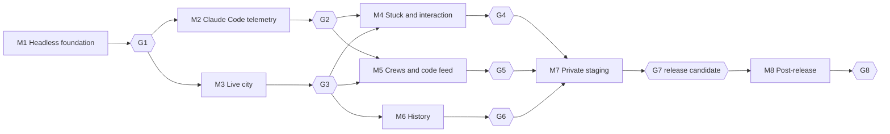

# Taskville roadmap

How the work in [ARCHITECTURE.md](../ARCHITECTURE.md) is cut into tickets. The live state is the [project board](https://github.com/users/jfvorwald/projects/2); this page explains its shape.

## Waves and review gates

Each milestone ends at a **review gate**: an issue assigned to the owner. Work behind a gate does not start until the owner closes it. Agents never close gates. Each gate also waits on its milestone's retrospective ticket (`M<n>.RT`), which produces a visual report in [retros/](retros/) and updates [LESSONS.md](LESSONS.md).

| Wave | Runs in parallel | Gate(s) |
| --- | --- | --- |
| 1 | M1 (including spikes S-1 and S-2) | G1 |
| 2 | M2 and M3 | G2, G3 |
| 3 | M4, M5, M6 (M6.04 to M6.07 also wait on single M4/M5 tickets) | G4, G5, G6 |
| 4 | M7 | G7 (release candidate; production only on explicit request) |
| Post-release | M8 | G8 |

## Parallel batches inside each milestone

A batch can start when every ticket it depends on is closed. Tickets in the same batch never depend on each other. Lanes and the **Owns** paths in each ticket keep parallel work out of each other's files. The last batch of every milestone is its retrospective.

### M1 Headless foundation

Wave 1. Protocol, domain, engine, CLI, demo, and the two Claude Code spikes. Ends at review gate G1.

| Batch | Tickets |
| --- | --- |
| 1 | [#1](https://github.com/jfvorwald/taskville/issues/1) M1.01 Align spec 001 with architecture revision 2 *(Docs)*, [#2](https://github.com/jfvorwald/taskville/issues/2) M1.02 Scaffold pnpm workspace, quality gate, and CI *(Infra)*, [#3](https://github.com/jfvorwald/taskville/issues/3) M1.03 Spike S-1: Claude Code PermissionRequest hook behavior *(Research)*, [#4](https://github.com/jfvorwald/taskville/issues/4) M1.04 Spike S-2: subagent and agent-team hook attribution *(Research)* |
| 2 | [#5](https://github.com/jfvorwald/taskville/issues/5) M1.05 Protocol v1: event envelope, event types, API and SSE schemas *(Domain)*, [#6](https://github.com/jfvorwald/taskville/issues/6) M1.06 Canonical JSON and stable state hashing *(Domain)*, [#7](https://github.com/jfvorwald/taskville/issues/7) M1.10 Engine HTTP core, auth, and browser pairing *(Engine)*, [#8](https://github.com/jfvorwald/taskville/issues/8) M1.11 Config file and Taskville home *(Engine)*, [#94](https://github.com/jfvorwald/taskville/issues/94) M1.19 Retro tooling: milestone report generator *(Infra)*, [#24](https://github.com/jfvorwald/taskville/issues/24) M1.20 Secret redaction module (moved from M2.05) *(Adapter)* |
| 3 | [#9](https://github.com/jfvorwald/taskville/issues/9) M1.07 Domain reducer: agents, sessions, tasks, activity, teams *(Domain)*, [#10](https://github.com/jfvorwald/taskville/issues/10) M1.08 Domain attention, requests, and commands *(Domain)*, [#11](https://github.com/jfvorwald/taskville/issues/11) M1.09 Engine storage: SQLite event log and projections *(Engine)*, [#12](https://github.com/jfvorwald/taskville/issues/12) M1.17 Event fixtures and golden tests *(Domain)* |
| 4 | [#13](https://github.com/jfvorwald/taskville/issues/13) M1.12 Ingest pipeline: validate, dedupe, sequence, commit *(Engine)*, [#14](https://github.com/jfvorwald/taskville/issues/14) M1.15 Seeded six-agent demo producer *(Domain)* |
| 5 | [#15](https://github.com/jfvorwald/taskville/issues/15) M1.13 Snapshots and resumable SSE streams *(Engine)* |
| 6 | [#16](https://github.com/jfvorwald/taskville/issues/16) M1.14 CLI: serve, status, events, requests *(CLI)*, [#17](https://github.com/jfvorwald/taskville/issues/17) M1.18 Security review: engine HTTP, auth, pairing, ingest *(Review)* |
| 7 | [#18](https://github.com/jfvorwald/taskville/issues/18) M1.16 CLI demo commands *(CLI)* |
| 8 | [#103](https://github.com/jfvorwald/taskville/issues/103) M1.21 Performance and soak checks: latency and 8-hour memory *(Engine)* |
| 9 | [#95](https://github.com/jfvorwald/taskville/issues/95) M1.RT Retrospective and lessons for M1 Headless foundation *(Review)* |

Gate: [#19](https://github.com/jfvorwald/taskville/issues/19) Review gate G1: M1 Headless foundation

### M2 Claude Code telemetry

Wave 2, parallel with M3. Real Claude Code sessions, subagents, and teams flow into the engine. Ends at review gate G2.

| Batch | Tickets |
| --- | --- |
| 1 | [#20](https://github.com/jfvorwald/taskville/issues/20) M2.01 Claude Code telemetry hook shim with spool *(Adapter)*, [#21](https://github.com/jfvorwald/taskville/issues/21) M2.02 Claude Code source endpoint and project resolution *(Engine)*, [#22](https://github.com/jfvorwald/taskville/issues/22) M2.03 Adapter: sessions, tool calls, notifications *(Adapter)*, [#23](https://github.com/jfvorwald/taskville/issues/23) M2.04 Adapter: subagents and agent teams *(Adapter)*, [#27](https://github.com/jfvorwald/taskville/issues/27) M2.06 Evidence store and ToolCall bodies *(Engine)*, [#25](https://github.com/jfvorwald/taskville/issues/25) M2.09 Live Git watcher *(Engine)* |
| 2 | [#28](https://github.com/jfvorwald/taskville/issues/28) M2.07 Spool ingest on start with late semantics *(Engine)*, [#29](https://github.com/jfvorwald/taskville/issues/29) M2.08 taskville install and uninstall claude-code *(CLI)* |
| 3 | [#34](https://github.com/jfvorwald/taskville/issues/34) M2.10 End-to-end: real Claude Code session to status *(Adapter)*, [#35](https://github.com/jfvorwald/taskville/issues/35) M2.11 Security review: hook ingestion, redaction, installer *(Review)* |
| 4 | [#96](https://github.com/jfvorwald/taskville/issues/96) M2.RT Retrospective and lessons for M2 Claude Code telemetry *(Review)* |

Gate: [#40](https://github.com/jfvorwald/taskville/issues/40) Review gate G2: M2 Claude Code telemetry

### M3 Live city

Wave 2, parallel with M2. The 3D city driven by the demo: themes, movement, day/night, celebrations. Ends at review gate G3.

| Batch | Tickets |
| --- | --- |
| 1 | [#26](https://github.com/jfvorwald/taskville/issues/26) M3.01 Web app scaffold served by the engine *(Web city)* |
| 2 | [#30](https://github.com/jfvorwald/taskville/issues/30) M3.02 Client data layer: snapshot, stream, store *(Web UI)*, [#31](https://github.com/jfvorwald/taskville/issues/31) M3.03 Overlay host and DOM anchor layer *(Web UI)*, [#32](https://github.com/jfvorwald/taskville/issues/32) M3.04 City layout, procedural buildings, street graph *(Web city)*, [#33](https://github.com/jfvorwald/taskville/issues/33) M3.05 Block agents: model, identity colors, labels, work loops *(Web city)* |
| 3 | [#36](https://github.com/jfvorwald/taskville/issues/36) M3.06 Navigation and presentation state machine *(Web city)*, [#37](https://github.com/jfvorwald/taskville/issues/37) M3.07 Theme system and cyberpunk theme *(Web city)*, [#38](https://github.com/jfvorwald/taskville/issues/38) M3.11 Camera, selection, hover glow, occlusion fade *(Web city)*, [#39](https://github.com/jfvorwald/taskville/issues/39) M3.15 Settings panel *(Web UI)* |
| 4 | [#41](https://github.com/jfvorwald/taskville/issues/41) M3.08 Steampunk theme *(Web city)*, [#42](https://github.com/jfvorwald/taskville/issues/42) M3.09 Solarpunk theme *(Web city)*, [#43](https://github.com/jfvorwald/taskville/issues/43) M3.10 Frutiger Aero theme *(Web city)*, [#44](https://github.com/jfvorwald/taskville/issues/44) M3.12 Day and night lighting from local time *(Web city)*, [#45](https://github.com/jfvorwald/taskville/issues/45) M3.13 Celebrations *(Web city)*, [#46](https://github.com/jfvorwald/taskville/issues/46) M3.14 Accessibility and comfort *(Web UI)*, [#47](https://github.com/jfvorwald/taskville/issues/47) M3.16 Performance budget and smoke suite *(Web city)* |
| 5 | [#97](https://github.com/jfvorwald/taskville/issues/97) M3.RT Retrospective and lessons for M3 Live city *(Review)* |

Gate: [#48](https://github.com/jfvorwald/taskville/issues/48) Review gate G3: M3 Live city

### M4 Stuck and interaction

Wave 3, parallel with M5 and M6. Red stuck state, quips, action card, permission bridge, soundscape. Ends at review gate G4.

| Batch | Tickets |
| --- | --- |
| 1 | [#49](https://github.com/jfvorwald/taskville/issues/49) M4.08 Session opener *(Interaction)* |
| 2 | [#50](https://github.com/jfvorwald/taskville/issues/50) M4.01 Global attention feed and cross-project alerts *(Interaction)*, [#51](https://github.com/jfvorwald/taskville/issues/51) M4.02 Permission bridge *(Interaction)*, [#52](https://github.com/jfvorwald/taskville/issues/52) M4.03 Command service *(Interaction)*, [#53](https://github.com/jfvorwald/taskville/issues/53) M4.05 Stuck visuals: red pulse, glow, emotes *(Web city)*, [#54](https://github.com/jfvorwald/taskville/issues/54) M4.06 Quip and emote bubbles *(Web UI)*, [#55](https://github.com/jfvorwald/taskville/issues/55) M4.09 Soundscape *(Web UI)* |
| 3 | [#61](https://github.com/jfvorwald/taskville/issues/61) M4.04 Bridge and command integration, installer hook *(Interaction)*, [#62](https://github.com/jfvorwald/taskville/issues/62) M4.07 Action card *(Web UI)* |
| 4 | [#69](https://github.com/jfvorwald/taskville/issues/69) M4.10 End-to-end: answer a real permission prompt from the city *(Interaction)*, [#70](https://github.com/jfvorwald/taskville/issues/70) M4.11 Security review: bridge, commands, action card, opener *(Review)* |
| 5 | [#98](https://github.com/jfvorwald/taskville/issues/98) M4.RT Retrospective and lessons for M4 Stuck and interaction *(Review)* |

Gate: [#75](https://github.com/jfvorwald/taskville/issues/75) Review gate G4: M4 Stuck and interaction

### M5 Crews and code feed

Wave 3, parallel with M4 and M6. Subagents, agent teams, agent panel with live code feed. Ends at review gate G5.

| Batch | Tickets |
| --- | --- |
| 1 | [#56](https://github.com/jfvorwald/taskville/issues/56) M5.01 Agent feed, crew, and evidence APIs *(Engine)*, [#57](https://github.com/jfvorwald/taskville/issues/57) M5.02 Subagent visuals *(Web city)*, [#58](https://github.com/jfvorwald/taskville/issues/58) M5.03 Teammate and lead visuals *(Web city)*, [#59](https://github.com/jfvorwald/taskville/issues/59) M5.05 Agent panel shell *(Web UI)*, [#104](https://github.com/jfvorwald/taskville/issues/104) M5.12 OpenTelemetry receiver for Claude Code tokens and cost *(Engine)* |
| 2 | [#63](https://github.com/jfvorwald/taskville/issues/63) M5.04 Teammate message envelopes *(Web city)*, [#64](https://github.com/jfvorwald/taskville/issues/64) M5.06 Live code feed tab *(Web UI)*, [#65](https://github.com/jfvorwald/taskville/issues/65) M5.07 Files tab *(Web UI)*, [#66](https://github.com/jfvorwald/taskville/issues/66) M5.08 Crew tab and family highlight *(Web UI)*, [#67](https://github.com/jfvorwald/taskville/issues/67) M5.10 Stuck attribution for subagents and teammates *(Web city)* |
| 3 | [#71](https://github.com/jfvorwald/taskville/issues/71) M5.09 Code rendering, editor links, privacy mode *(Web UI)*, [#72](https://github.com/jfvorwald/taskville/issues/72) M5.11 End-to-end: real crews and live feed *(Web UI)* |
| 4 | [#99](https://github.com/jfvorwald/taskville/issues/99) M5.RT Retrospective and lessons for M5 Crews and code feed *(Review)* |

Gate: [#76](https://github.com/jfvorwald/taskville/issues/76) Review gate G5: M5 Crews and code feed

### M6 History

Wave 3, parallel with M4 and M5. History mode over the live recording with a clean way back to live. Ends at review gate G6.

| Batch | Tickets |
| --- | --- |
| 1 | [#60](https://github.com/jfvorwald/taskville/issues/60) M6.01 Timeline API and seek performance *(Engine)* |
| 2 | [#68](https://github.com/jfvorwald/taskville/issues/68) M6.02 Client history mode and replay clock *(Web UI)* |
| 3 | [#73](https://github.com/jfvorwald/taskville/issues/73) M6.03 History UI: entry, tint, timeline strip *(Web UI)*, [#74](https://github.com/jfvorwald/taskville/issues/74) M6.06 Replay fidelity: lighting, celebrations, quips *(Web city)* |
| 4 | [#77](https://github.com/jfvorwald/taskville/issues/77) M6.04 Back-to-live pill with live needs-you badge *(Web UI)*, [#78](https://github.com/jfvorwald/taskville/issues/78) M6.05 "How did we get here?" entry from the agent panel *(Web UI)*, [#79](https://github.com/jfvorwald/taskville/issues/79) M6.07 Subagent run bars on the timeline *(Web UI)* |
| 5 | [#100](https://github.com/jfvorwald/taskville/issues/100) M6.RT Retrospective and lessons for M6 History *(Review)* |

Gate: [#80](https://github.com/jfvorwald/taskville/issues/80) Review gate G6: M6 History

### M7 Private staging

Wave 4. Packaged release, isolated access-controlled staging, runbook. Ends at release-candidate gate G7.

| Batch | Tickets |
| --- | --- |
| 1 | [#81](https://github.com/jfvorwald/taskville/issues/81) M7.01 Spike: staging and hosting shape for a local-first app *(Release)*, [#82](https://github.com/jfvorwald/taskville/issues/82) M7.07 User docs: install, hooks, pairing, privacy *(Docs)* |
| 2 | [#83](https://github.com/jfvorwald/taskville/issues/83) M7.02 Release packaging with release identity *(Release)* |
| 3 | [#84](https://github.com/jfvorwald/taskville/issues/84) M7.03 Isolated staging environment *(Release)*, [#85](https://github.com/jfvorwald/taskville/issues/85) M7.05 Runbook: backup, compatibility, rollback, promotion *(Docs)* |
| 4 | [#86](https://github.com/jfvorwald/taskville/issues/86) M7.04 Staging access control and verification *(Release)* |
| 5 | [#87](https://github.com/jfvorwald/taskville/issues/87) M7.06 Push-tier full suite and release security review *(Review)* |
| 6 | [#101](https://github.com/jfvorwald/taskville/issues/101) M7.RT Retrospective and lessons for M7 Private staging *(Review)* |

Gate: [#88](https://github.com/jfvorwald/taskville/issues/88) Review gate G7: M7 Private staging

### M8 Post-release: imports and replies

After the first release. Git and transcript imports, typed-replies spike. Ends at review gate G8.

| Batch | Tickets |
| --- | --- |
| 1 | [#89](https://github.com/jfvorwald/taskville/issues/89) M8.01 Git history import as archive timeline *(Engine)*, [#90](https://github.com/jfvorwald/taskville/issues/90) M8.02 Claude Code transcript import as archive timeline *(Adapter)*, [#91](https://github.com/jfvorwald/taskville/issues/91) M8.04 Spike: typed replies through a Claude Code channel *(Research)*, [#105](https://github.com/jfvorwald/taskville/issues/105) M8.05 Spike: Codex CLI adapter through hooks and OpenTelemetry *(Research)* |
| 2 | [#92](https://github.com/jfvorwald/taskville/issues/92) M8.03 Archive timelines in history UI *(Web UI)* |
| 3 | [#102](https://github.com/jfvorwald/taskville/issues/102) M8.RT Retrospective and lessons for M8 Post-release: imports and replies *(Review)* |

Gate: [#93](https://github.com/jfvorwald/taskville/issues/93) Review gate G8: M8 Post-release: imports and replies

## Conventions

- Ticket titles start with their key, for example `[M1.05]`. Pull requests use the same key, follow the PR template, and close the issue.
- Status flow: Triage, Backlog, Ready, In progress, Review, Blocked, Done. Ready means every blocker is closed.
- Each ticket's **Done when** list is the definition of done; `pnpm check` (also `.claude/check.sh`) is the shared fast gate.
- Testing follows the task tier for tickets and the push tier once per wave (see M7.06 for the release run).
- Lessons are recorded as they happen: in each PR's Lessons section, then in [LESSONS.md](LESSONS.md). Every milestone gets a generated visual retro in [retros/](retros/) before its gate.
