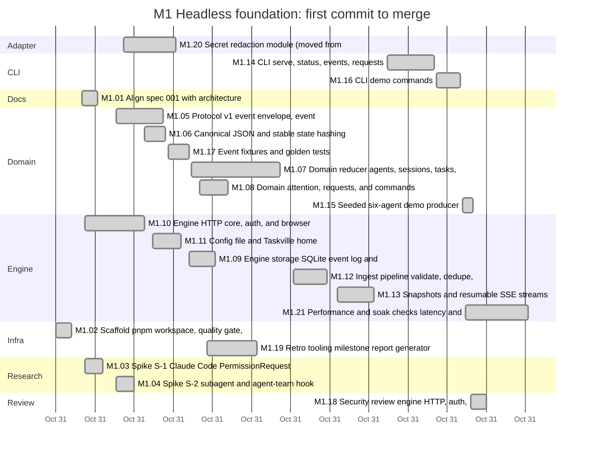
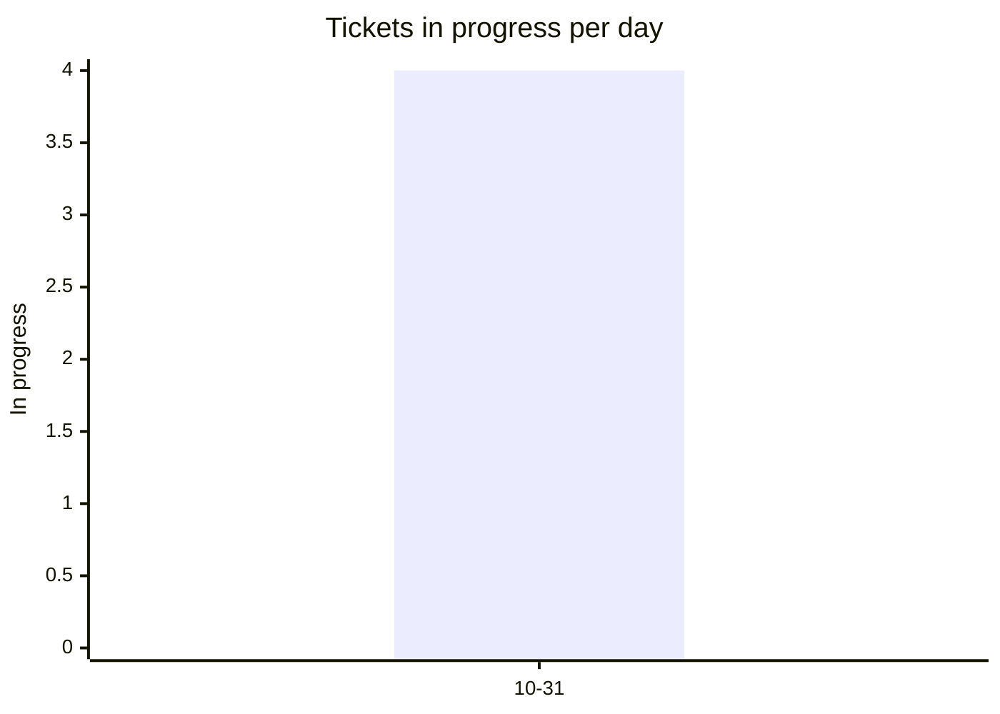
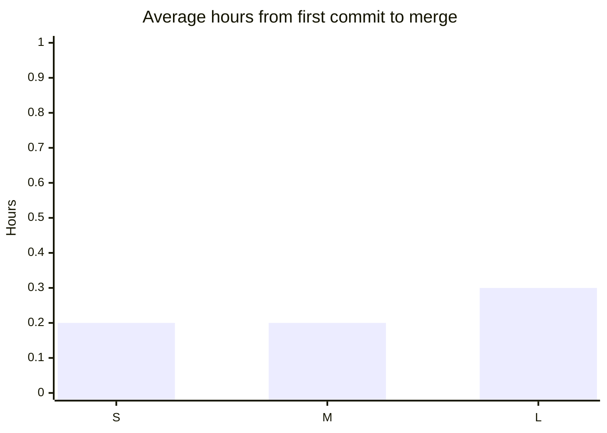
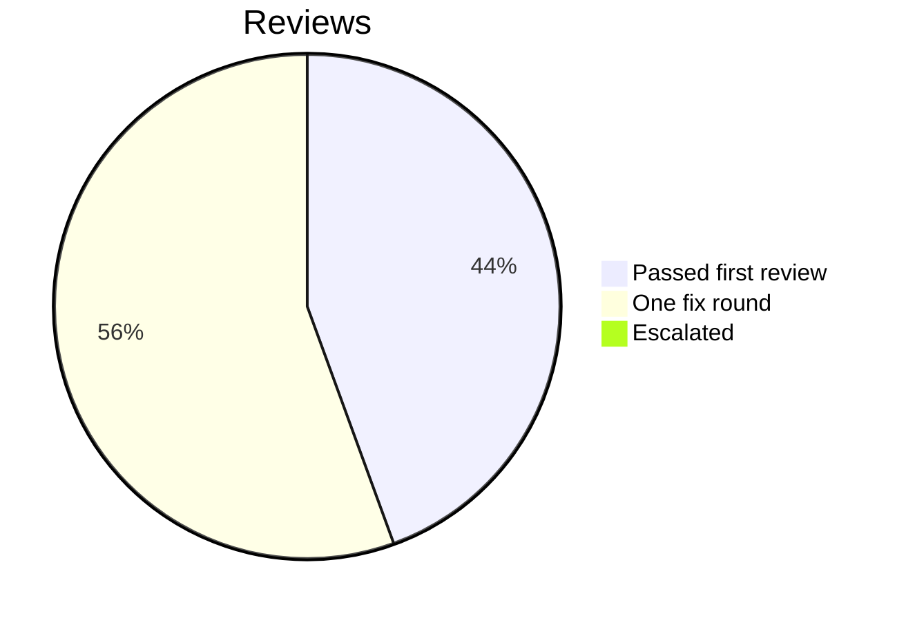

# Retro: M1 Headless foundation

Generated 2026-10-31T04:21Z by `pnpm retro M1` from GitHub data. Charts and numbers are generated; the sections marked *written* are filled in by the lead.

## At a glance

| Tickets planned | Added | Done | Dropped | Calendar days | Peak parallel | First-pass reviews | Flakes | NOT RUN |
| --- | --- | --- | --- | --- | --- | --- | --- | --- |
| 22 | 0 | 21 | 0 | 1 | 4 | 22% | 0 | not measured |

## Timeline by lane



Times are UTC. Start is the first commit on the ticket's branch, end the merge; tickets in progress run to the generation time. Not started: M1.RT.

## Burn-down

```mermaid
xychart-beta
  title "Open tickets per day"
  x-axis ["10-31"]
  y-axis "Open tickets" 0 --> 22
  line [1]
  line [22]
```

## Parallelism



Most in progress at one moment: 4 (2026-10-31T01:41 UTC).

## Cycle time by size



Average over merged tickets with a size on the board.

## Review outcomes



From the roborev field of each merged ticket's task report: a medium or higher finding fixed before merge is one fix round. More than one fix round (not in the chart): M1.01, M1.03, M1.07, M1.14, M1.15, M1.16, M1.19, M1.20, M1.21. Not measured: M1.10, M1.11, M1.18 (the report does not say).

## Quality signals

| CI failures | Re-runs | Flakes | Tests NOT RUN | Security findings (high / medium / low) |
| --- | --- | --- | --- | --- |
| 1 | 0 | 0 | not measured | not measured / not measured / not measured |

## Plan versus actual

| | Tickets | Keys |
| --- | --- | --- |
| Planned | 22 | M1.01, M1.02, M1.03, M1.04, M1.05, M1.06, M1.07, M1.08, M1.09, M1.10, M1.11, M1.12, M1.13, M1.14, M1.15, M1.16, M1.17, M1.18, M1.19, M1.20, M1.21, M1.RT |
| Added mid-milestone | 0 |  |
| Split | not measured | |
| Dropped | 0 |  |
| Done | 21 | M1.01, M1.02, M1.03, M1.04, M1.05, M1.06, M1.07, M1.08, M1.09, M1.10, M1.11, M1.12, M1.13, M1.14, M1.15, M1.16, M1.17, M1.18, M1.19, M1.20, M1.21 |
| Still open | 1 | M1.RT |

Planned tickets were created by the first commit of the milestone (2026-10-31T01:15 UTC); added ones after it. Splits are not recorded in GitHub data. Dropped means closed as not planned.

## What went well *(written)*

- **Every planned ticket shipped, none dropped or added.** 21 of 22 tickets merged in about three hours of wall time, with four teammates working at once at the peak. The headless engine runs end to end: the spec 001 quickstart was run by hand on main on 2026-10-31 and every step behaved as specified (two stale expectations in the doc were corrected, [L-42](../LESSONS.md)).
- **Test first held.** Every code PR landed its failing tests in a separate commit before the code, and most teammates also made and reverted deliberate mutations of each safety rule (security checks, file modes, event log triggers, stream guards) to prove the tests bite. Surviving mutations exposed real gaps in M1.13 ([L-35](../LESSONS.md)).
- **Reviews found real bugs, not style.** roborev caught a dedupe hash taken after truncation (M1.01), a FIFO hang and a token-write race (M1.10), a forged-telemetry path onto an answerable card (M1.08), lone surrogates crashing a batch (M1.12), open requests not expired at boot (M1.13), and secrets in engine-written events (M1.14). None of these would have been caught by the type checker or lint.
- **Hard invariants are enforced below the code.** The event log is insert-only and gap-free through SQLite triggers for every connection (M1.09), so ingest (M1.12) and streams (M1.13) inherit it.
- **The spikes paid off before any adapter code.** S-1 showed the terminal prompt is never hidden, which removes the focus-dependent hold window; S-2 showed split-pane teammates never reach the permission bridge. Both are now owner decisions (#116, #120) instead of surprises in M2 or M4.
- **Decisions never stopped the wave.** Twelve decision tickets were opened with defaults and the team built on the defaults; none blocks M1.

## What hurt *(written)*

- **Review rounds on the redactor.** M1.20 needed three review rounds (7 high findings) and the F3 fix six more (12 high), each from a new input shape that an exemption or a precise parse let through ([L-17](../LESSONS.md), [L-40](../LESSONS.md)). This is now decision #160 on the strategy.
- **Free-text review records.** The generator above counts only 4 of 21 merged tickets as passing first review, and cannot classify M1.10, M1.11 and M1.18 because their reports give no severities ([L-27](../LESSONS.md)). The chart's "Escalated: 0" is also too low: one finding raised three times on M1.07 was routed to decision #138 under the same-finding-twice rule ([L-30](../LESSONS.md)), and one F3 finding needed two fix attempts.
- **Numbers the generator cannot see.** It reports 0 flakes and security findings "not measured". From the task reports and #17: one flake (F-1, a 250 ms timing bound in M1.20 under parallel load, [L-19](../LESSONS.md)); security review #17 found 0 critical, 0 high, 3 medium, 3 low, all fixed and merged (#152, #158, #164). The one CI failure was PR #153's first run on a merge ref after #152 changed `bootEngine` ([L-37](../LESSONS.md)).
- **Git and permission friction.** Force-push after a rebase was denied for two teammates, PR #139 sat with a conflicted head that CI never ran on, and one teammate asked the lead three times to run the denied push; the lead declined and had it push without force ([L-28](../LESSONS.md)). A stray uncommitted edit in the lead's main checkout broke `pnpm check` there once ([L-26](../LESSONS.md)).
- **Spikes touched user-level state.** Interactive spike sessions added folder-trust entries to `~/.claude.json`, and one S-2 session ran the owner's user hooks once ([L-11](../LESSONS.md)). Nothing under `~/.claude/` was edited; the entries are left for the owner.
- **The read-only security reviewer could not run or post anything.** Its shell allowed only read-only git, so findings are code traces and the lead posted the review; each fix PR then reproduced its finding with a failing test ([L-44](../LESSONS.md)).
- **SC-006 missed.** Engine RSS grew 14.1% and then 26.6% from hour 1 to hour 8 of the accelerated soak (target under 10%), while heap after GC stayed flat; projection state also grows without bound ([L-43](../LESSONS.md), #166, #167, decision #168).
- **The burn-down and per-day charts say little for M1**: everything happened within one UTC day, so each has a single point. Peak parallelism (4 at 01:41 UTC) is the meaningful number.

## Lessons from this milestone *(written)*

All recorded in [LESSONS.md](../LESSONS.md) as they happened: L-3 to L-44. The ones that should change how M2 and M3 are built:

- Contracts move under tickets in flight; re-read them after every rebase ([L-12](../LESSONS.md)), and review a contract-alignment docs PR as a design change ([L-7](../LESSONS.md)).
- Producer-supplied IDs and text are hostile input everywhere: prototype-named keys ([L-24](../LESSONS.md), [L-29](../LESSONS.md)), lone surrogates ([L-31](../LESSONS.md)), masking that lengthens fields ([L-32](../LESSONS.md)), engine-authored events built from user input ([L-38](../LESSONS.md)), numbers that overflow to `Infinity` ([L-39](../LESSONS.md)).
- Trusted and untrusted sources merging needs a direction test ([L-25](../LESSONS.md)); reaching an open hook response does not prove a permission decision took effect ([L-8](../LESSONS.md)).
- Write the bounded-state contract before coding a bounded projection ([L-30](../LESSONS.md)), and run a realistic soak early ([L-43](../LESSONS.md)).
- Mask to a robust boundary rather than parsing ever more precisely ([L-40](../LESSONS.md)).
- Timing bounds in tests separate linear from quadratic; they never measure speed ([L-19](../LESSONS.md)).
- After a PR exists, update by merging main and pushing normally; check `mergeStateStatus`, since CI does not run on a conflicted PR ([L-28](../LESSONS.md), [L-37](../LESSONS.md)).
- New from this retro: [L-44](../LESSONS.md), a read-only review agent cannot post or run probes; plan who posts and who reproduces.

## Changes for the next milestone *(written)*

Applied now:

1. Teammate brief: no rebase or force-push once a PR exists (merge `origin/main`, push normally, check `mergeStateStatus`), and confirm every edit is under the teammate's own worktree. Applied 2026-10-30 to the team brief after [L-26](../LESSONS.md) and [L-28](../LESSONS.md).
2. The lead runs the spec quickstart by hand before every gate and corrects the doc if it drifted. Done for M1 in PR #170 ([L-42](../LESSONS.md)).
3. Security review findings are reproduced by a failing test in each fix PR, and the lead posts the review when the reviewer is read-only. Done for M1 on #17.

Proposed to the owner in the G1 summary:

4. Add a structured `**Review outcome:** first pass | one fix round | escalated` line and finding counts by severity to the `docs/tasks/README.md` format, so `pnpm retro` can measure review outcomes and security findings instead of parsing prose ([L-27](../LESSONS.md)). The generator already reads the line.
5. Spikes that drive Claude Code pass `--setting-sources project,local` on every run, and the spike plan states up front that folder-trust entries will be added to `~/.claude.json` ([L-11](../LESSONS.md)).
6. Give the security review ticket a reviewer that can run the engine tests and loopback probes (or pair the read-only reviewer with a teammate who reproduces each finding before the review is posted) ([L-44](../LESSONS.md)).
7. Schedule the M1 follow-ups before or early in M2 and M3: #143 (attention ordering with `Date.parse` feeds `stateHash`), #167 (unbounded projection state), and #166 once decision #168 settles what SC-006 measures.
8. For milestones that finish within a day, let `pnpm retro` bucket the burn-down and parallelism charts by hour (the template and README currently specify days).
