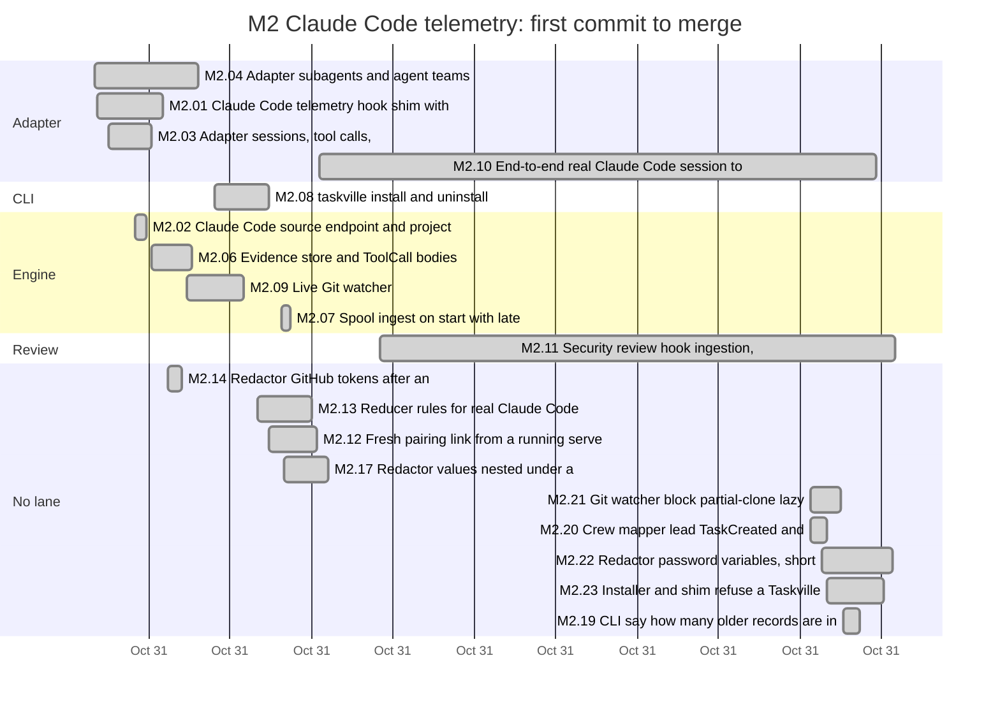
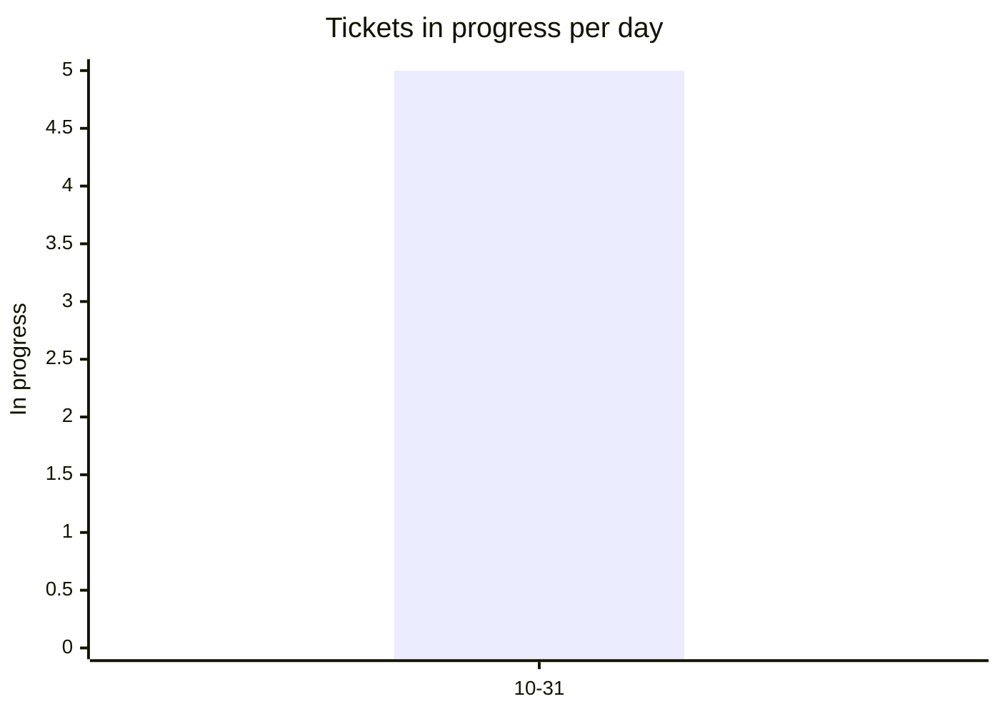
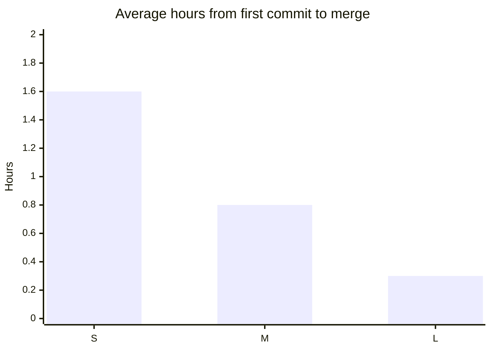
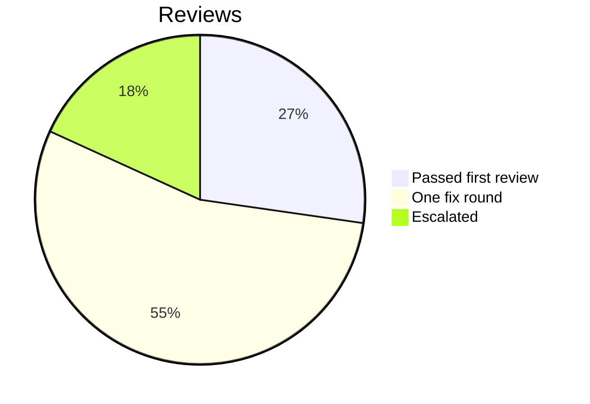

# Retro: M2 Claude Code telemetry

Generated 2026-10-31T20:12Z by `pnpm retro M2` from GitHub data. Charts and numbers are generated; the sections marked *written* are filled in by the lead.

## At a glance

| Tickets planned | Added | Done | Dropped | Calendar days | Peak parallel | First-pass reviews | Flakes | NOT RUN |
| --- | --- | --- | --- | --- | --- | --- | --- | --- |
| 12 | 8 | 19 | 0 | 1 | 5 | 17% | 0 | 18 |

## Timeline by lane



Times are UTC. Start is the first commit on the ticket's branch, end the merge; tickets in progress run to the generation time. Not started: M2.RT.

## Burn-down

```mermaid
xychart-beta
  title "Open tickets per day"
  x-axis ["10-31"]
  y-axis "Open tickets" 0 --> 20
  line [1]
  line [20]
```

## Parallelism



Most in progress at one moment: 5 (2026-10-31T19:38 UTC).

## Cycle time by size



Average over merged tickets with a size on the board.

## Review outcomes



From the roborev field of each merged ticket's task report: a medium or higher finding fixed before merge is one fix round. More than one fix round (not in the chart): M2.02, M2.03, M2.06, M2.09, M2.12, M2.13, M2.23. Not measured: M2.22 (the report does not say).

## Quality signals

| CI failures | Re-runs | Flakes | Tests NOT RUN | Security findings (high / medium / low) |
| --- | --- | --- | --- | --- |
| 0 | 0 | 0 | 18 | not measured / not measured / not measured |

## Plan versus actual

| | Tickets | Keys |
| --- | --- | --- |
| Planned | 12 | M2.01, M2.02, M2.03, M2.04, M2.06, M2.07, M2.08, M2.09, M2.10, M2.11, M2.12, M2.RT |
| Added mid-milestone | 8 | M2.13, M2.14, M2.17, M2.19, M2.20, M2.21, M2.22, M2.23 |
| Split | not measured | |
| Dropped | 0 |  |
| Done | 19 | M2.01, M2.02, M2.03, M2.04, M2.06, M2.07, M2.08, M2.09, M2.10, M2.11, M2.12, M2.13, M2.14, M2.17, M2.19, M2.20, M2.21, M2.22, M2.23 |
| Still open | 1 | M2.RT |

Planned tickets were created by the first commit of the milestone (2026-10-31T15:10 UTC); added ones after it. Splits are not recorded in GitHub data. Dropped means closed as not planned.

## What went well *(written)*

## What hurt *(written)*

## Lessons from this milestone *(written)*

Links to the [LESSONS.md](../LESSONS.md) entries recorded during the milestone, plus any new ones from this retro.

## Changes for the next milestone *(written)*

Each change is either applied now (with a link to the commit or ticket) or proposed to the owner in the gate summary.
