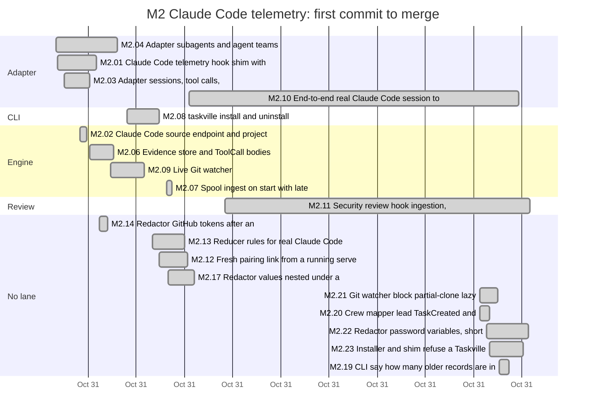
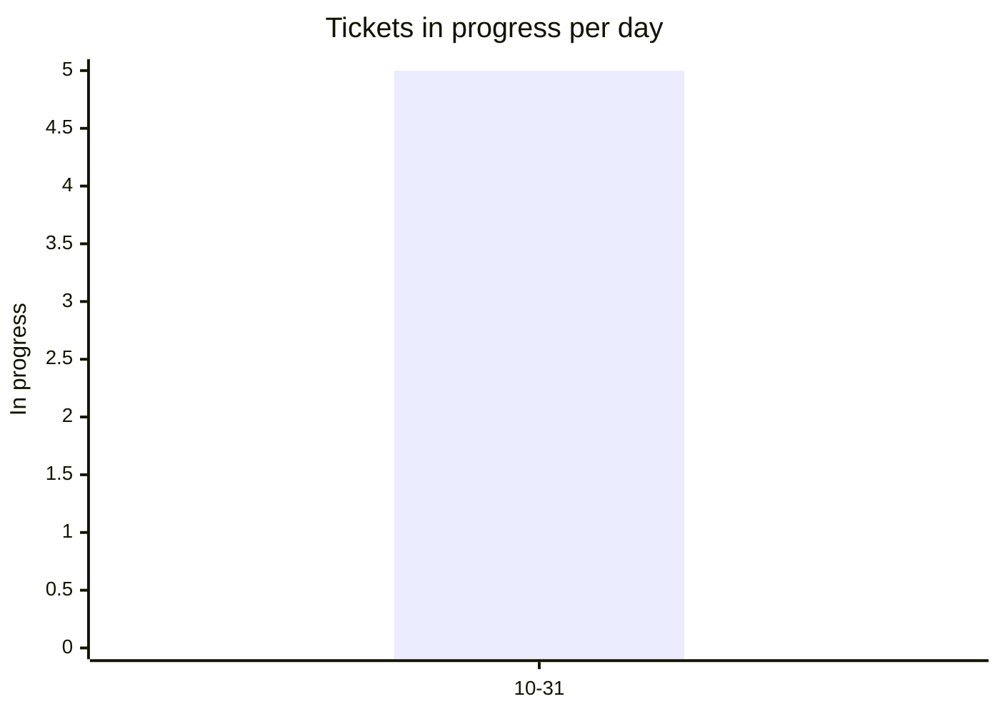
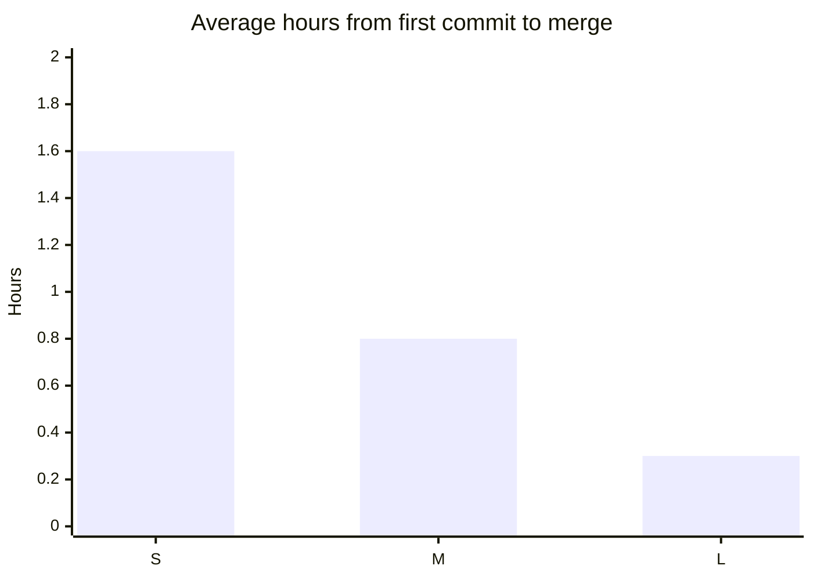
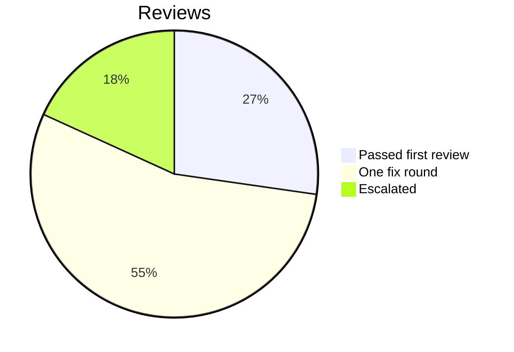

# Retro: M2 Claude Code telemetry

Generated 2026-10-31T20:12Z by `pnpm retro M2` from GitHub data. Charts and numbers are generated; the sections marked *written* are filled in by the lead.

## At a glance

| Tickets planned | Added | Done | Dropped | Calendar days | Peak parallel | First-pass reviews | Flakes | NOT RUN |
| --- | --- | --- | --- | --- | --- | --- | --- | --- |
| 12 | 8 | 19 | 0 | 1 | 5 | 17% | 0 | 18 |

## Timeline by lane



Times are UTC. Start is the first commit on the ticket's branch, end the merge; tickets in progress run to the generation time. Not started: M2.RT.

## Burn-down

```mermaid
xychart-beta
  title "Open tickets per day"
  x-axis ["10-31"]
  y-axis "Open tickets" 0 --> 20
  line [1]
  line [20]
```

## Parallelism



Most in progress at one moment: 5 (2026-10-31T19:38 UTC).

## Cycle time by size



Average over merged tickets with a size on the board.

## Review outcomes



From the roborev field of each merged ticket's task report: a medium or higher finding fixed before merge is one fix round. More than one fix round (not in the chart): M2.02, M2.03, M2.06, M2.09, M2.12, M2.13, M2.23. Not measured: M2.22 (the report does not say).

## Quality signals

| CI failures | Re-runs | Flakes | Tests NOT RUN | Security findings (high / medium / low) |
| --- | --- | --- | --- | --- |
| 0 | 0 | 0 | 18 | not measured / not measured / not measured |

## Plan versus actual

| | Tickets | Keys |
| --- | --- | --- |
| Planned | 12 | M2.01, M2.02, M2.03, M2.04, M2.06, M2.07, M2.08, M2.09, M2.10, M2.11, M2.12, M2.RT |
| Added mid-milestone | 8 | M2.13, M2.14, M2.17, M2.19, M2.20, M2.21, M2.22, M2.23 |
| Split | not measured | |
| Dropped | 0 |  |
| Done | 19 | M2.01, M2.02, M2.03, M2.04, M2.06, M2.07, M2.08, M2.09, M2.10, M2.11, M2.12, M2.13, M2.14, M2.17, M2.19, M2.20, M2.21, M2.22, M2.23 |
| Still open | 1 | M2.RT |

Planned tickets were created by the first commit of the milestone (2026-10-31T15:10 UTC); added ones after it. Splits are not recorded in GitHub data. Dropped means closed as not planned.

## What went well *(written)*

- **Real Claude Code telemetry reaches status end to end.** M2.10's recorded real sessions (a session, two subagents, an agent team, StopFailure, elicitation, an engine outage) replay against a real `serve`: 7 of 7 checks pass on main 44f5af1, including the team task the crew mapper used to split (fixed in M2.20, #217). Agents appeared 24 to 239 ms after the first hook in the original live run; 11 hooks spooled during downtime replayed as late with no needs-you records.
- **The security review found real paths and every medium is fixed.** M2.11 (#35) found 0 critical, 0 high, 3 medium, 2 low, each reproduced with a probe. F1 (repository config running commands through a lazy fetch) is closed by environment kill switches, with tests for five program paths (#218); F2 redaction gaps by #219; F3 non-private homes by #220. Each fix landed its failing test first.
- **Performance held while ingest got heavier.** On main 44f5af1 with no workers running: SC-004 1,000-event batch p50 92.8 ms, max 99.5 ms (M1: 155.8 / 205.4 ms); SC-005 viewer max 12.2 ms idle and 10.2 ms with the demo (M1: 15.1 / 44.9 ms). Both PASS.
- **The resume ran cheaply and fast.** With provider, model and effort named on every assignment (Sonnet medium for ordinary tickets, Sonnet high for security, Haiku low for the lessons copy), six tickets went from assignment to merge in about 35 minutes, at most four workers at a time with disjoint Owns paths.
- **Decisions never stopped the wave.** Every owner question became a decision ticket with a default (#174 to #206, plus #213 and #223); none blocks M2.
- **Recovery preserved all work.** The interrupted session's commits, worktrees and reports were reconciled from GitHub and refs before anything was reassigned; nothing was redone or lost.

## What hurt *(written)*

- **A usage-limit cutoff mid-wave.** The first lead session stopped with M2.10 unreported, M2.19 assigned but never started, a report correction unpushed, and STATUS seventeen merges behind; LESSONS had no M2 entries until this retro ([L-117](../LESSONS.md)).
- **Workers ran on the wrong model.** Generic teammates inherited the lead's Opus in the first wave, with Opus attribution hard-coded in the brief ([L-116](../LESSONS.md)).
- **SC-006 is still MISSED, and two of its numbers were invalid.** M2.18's 28.7% rerun overlapped M2.16's soak; the replacement reads 39.7% (98.9 to 138.2 MiB) on a machine that was not quiet. Run-to-run spread exceeds the 10% threshold, so code alone cannot settle it (decision #206, [L-113](../LESSONS.md)).
- **Redactor review again failed to converge.** M2.22's password-flag rules drew high findings in four rounds, each a new crafted shape, the third milestone in a row for this module (M1.20, M1.18 F3). The last four gaps also leak on main; they are #222 under decision #223 ([L-115](../LESSONS.md)).
- **Review-round caps were not held.** M2.23 ran seven pre-merge panels and M2.22 four; the roborev Stop hook keeps prompting fix sessions ([L-114](../LESSONS.md)). The generator's "first-pass 17%" reflects this.
- **Numbers the generator cannot see.** It reports 0 flakes and security findings "not measured". From the reports: one flake, F-2 (M2.10's replay under load 8 to 12 failed 1 then 3 checks after its timing check was tightened; 7/7 alone and on main, [L-112](../LESSONS.md)); security as above. The generator also lists M2.22's review outcome as not measured; it was more than one fix round. M2.15, M2.16 and M2.18 were planned follow-ups of M1 issues and show under their own keys.

## Lessons from this milestone *(written)*

Recorded in [LESSONS.md](../LESSONS.md): L-45 to L-110 copied from the merged PRs, and L-111 to L-117 from this retro. The ones that should change how M3 to M5 are built:

- Hook payloads are hostile input in new places: an installer diff is an output channel for secrets ([L-66](../LESSONS.md)), hook commands run in the agent's environment ([L-67](../LESSONS.md)), and repository config can run programs ([L-107](../LESSONS.md)).
- Mappers for the same agent must agree on identity fields ([L-60](../LESSONS.md), [L-62](../LESSONS.md)), and a stateless mapper can only join hooks by what both carry ([L-111](../LESSONS.md)).
- Prefer coarse rules that over-mask safely, scan to the real boundary, and budget back-scans ([L-105](../LESSONS.md), [L-106](../LESSONS.md), [L-115](../LESSONS.md)).
- A loop whose awaits never do I/O does not yield ([L-110](../LESSONS.md)); this is low finding F4 (#214) and matters once M4 relies on live needs-you.
- Perf numbers count only from a reserved machine ([L-113](../LESSONS.md)).

## Changes for the next milestone *(written)*

Applied now:

1. Every assignment names provider, model, effort and the reason, and commits carry the actual model's attribution ([L-116](../LESSONS.md)). Applied in the M2 resume brief.
2. Workers get a stop time and a required final handoff (branch, pushed HEAD, checks, roborev jobs, NOT RUN, blockers); the lead freezes the branch after it and is the only one who merges ([L-117](../LESSONS.md)). Applied in the M2 resume brief.

Proposed to the owner in the G2 summary:

3. Put the review-round cap in the worker brief as a hard stop: one pre-merge panel, one confirmation panel after fixes, then report to the lead; the roborev Stop-hook fix prompts do not extend it ([L-114](../LESSONS.md)).
4. Settle the redactor strategy before more rules are added (decision #223), then fix #222 and #215 in one ticket.
5. Schedule before M4's bridge work: #214 (spool drain blocks the loop, F4), the persisted-pairing residual (#113: one SQLite insert yields a session that could approve prompts once commands are wired), and a guard against forged PostToolUse hiding a pending bridge request (#116).
6. Teach `pnpm retro` to count flakes and security findings from the task reports' structured lines, and to read M2.22-style multi-round outcomes.
