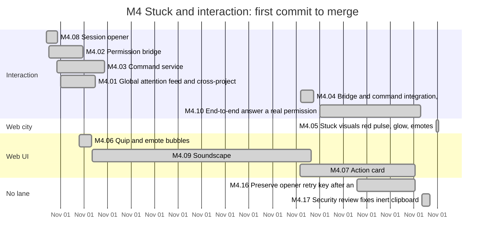
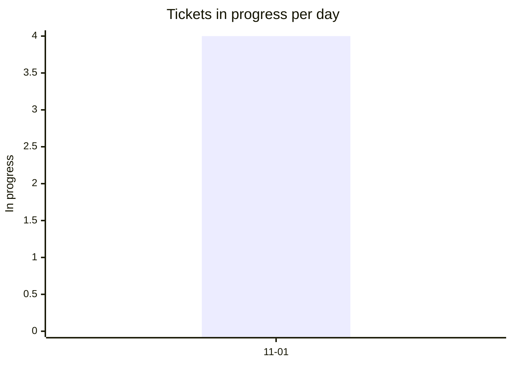
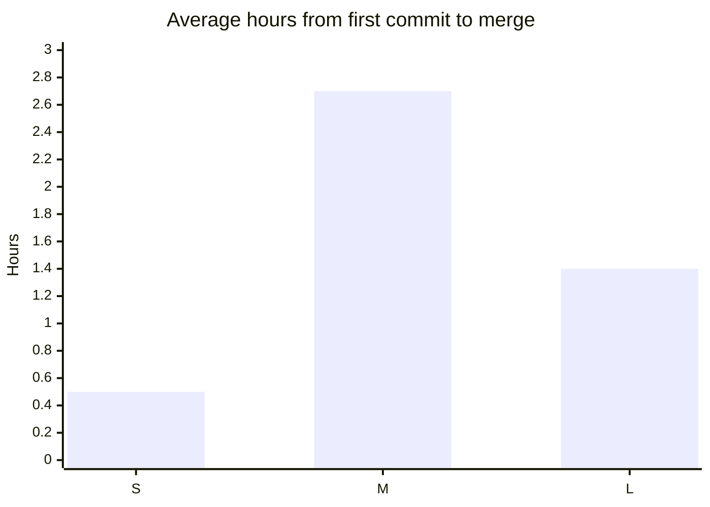
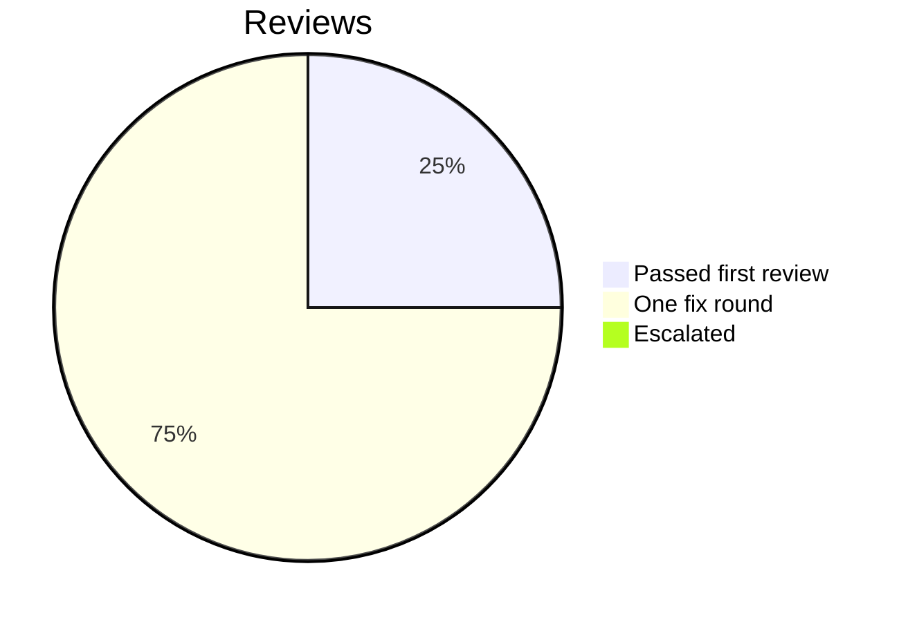

# Retro: M4 Stuck and interaction

Generated 2026-11-01T21:03Z by `pnpm retro M4` from GitHub data. Charts and numbers are generated; the sections marked *written* are filled in by the lead.

## At a glance

| Tickets planned | Added | Done | Dropped | Calendar days | Peak parallel | First-pass reviews | Flakes | NOT RUN |
| --- | --- | --- | --- | --- | --- | --- | --- | --- |
| 12 | 2 | 12 | 0 | 1 | 4 | 17% | 0 | not measured |

## Timeline by lane



Times are UTC. Start is the first commit on the ticket's branch, end the merge; tickets in progress run to the generation time. Not started: M4.RT. Closed without a merged PR (not drawn): M4.11.

## Burn-down

```mermaid
xychart-beta
  title "Open tickets per day"
  x-axis ["11-01"]
  y-axis "Open tickets" 0 --> 14
  line [2]
  line [14]
```

## Parallelism



Most in progress at one moment: 4 (2026-11-01T05:48 UTC).

## Cycle time by size



Average over merged tickets with a size on the board.

## Review outcomes



From the roborev field of each merged ticket's task report: a medium or higher finding fixed before merge is one fix round. More than one fix round (not in the chart): M4.01, M4.07. Not measured: M4.02, M4.03, M4.05, M4.06, M4.09, M4.11 (the report does not say).

## Quality signals

| CI failures | Re-runs | Flakes | Tests NOT RUN | Security findings (high / medium / low) |
| --- | --- | --- | --- | --- |
| 0 | 0 | 0 | not measured | not measured / not measured / not measured |

## Plan versus actual

| | Tickets | Keys |
| --- | --- | --- |
| Planned | 12 | M4.01, M4.02, M4.03, M4.04, M4.05, M4.06, M4.07, M4.08, M4.09, M4.10, M4.11, M4.RT |
| Added mid-milestone | 2 | M4.16, M4.17 |
| Split | not measured | |
| Dropped | 0 |  |
| Done | 12 | M4.01, M4.02, M4.03, M4.04, M4.05, M4.06, M4.07, M4.08, M4.09, M4.11, M4.16, M4.17 |
| Still open | 2 | M4.10, M4.RT |

Planned tickets were created by the first commit of the milestone (2026-11-01T04:24 UTC); added ones after it. Splits are not recorded in GitHub data. Dropped means closed as not planned.

## What went well *(written)*

- All M4 implementation tickets merged with test-first evidence, one PR per ticket, roborev panels and specialist reviews: M4.01 to M4.09, M4.12 to M4.17 (the generated table misses M4.12 to M4.15 because they carry no milestone). The permission round trip works end to end in the replay e2e (6 of 6, #308): a held request turns the agent red, Allow and Deny reach the held hook, fall-through and double clicks behave.
- The M4.11 cross-ticket security review found what per-ticket reviews missed (the copy-only paste vector, #198 becoming live) and every finding is either fixed (#309, merged as #310) or rests on an owner decision.
- Pin rounds after untested roborev fixes repeatedly caught real bugs before merge (M4.08 default execFile semantics, M4.07 masking edge cases).
- The debugger on Opus ended a two-round stall (M4.09 cue versus suspend) in one round.

## What hurt *(written)*

- Three Claude 5-hour usage limits stopped all workers (about 05:10, 09:00 and 11:00 EST). During the third, the owner ran the CTO session on Codex (gpt-6.1-sol) from about 11:00 to 15:00; that session ran Sol workers and held 10 ready PRs as "blocked" by the main-branch admin rule (#295) until Claude resumed and merged them under the owner's standing --admin order. This is a confound for experiment #231 and is recorded in the run B record.
- roborev produced new, valid findings on almost every round (7 rounds on M4.03); without the one-review-plus-confirm rule and follow-up tickets the loop would not have ended.
- Implementers cannot write tests, so most roborev fixes landed untested and needed separate pin rounds; this roughly doubled the rounds per ticket.
- Two resumed test-writers created shell worktrees when their harness worktree had been cleaned (recorded deviations).
- The wave run, made while several workers were running browser tests, produced 10 load flakes and hid nothing real except the Settings regression (#315), which came from the M5.07 sidebar composition.
- Performance is still unmeasured for M4's visuals; #268 (M3 budget shortfall) stays open and unmet.

## Lessons from this milestone *(written)*

Links to the [LESSONS.md](../LESSONS.md) entries recorded during the milestone, plus any new ones from this retro.

- L-182 to L-195 (fake adapters, pin rounds, T3 delegation and agent definitions, orchestrator port probes, re-surfacing deferred decisions, paste text as an execution surface, architecture rebuttals, roborev round limits, the debugger after two rounds, live e2e and user config, release-age policy, biome escapes, the admin merge path, load flakes).

## Changes for the next milestone *(written)*

Each change is either applied now (with a link to the commit or ticket) or proposed to the owner in the gate summary.

- Applied: a pin round is scheduled after every green phase that fixed review findings; briefs forbid workers from creating checkouts; resumed workers are told their worktree state.
- Applied: follow-ups instead of extra review rounds (merged already: #286 as M4.13, #293 as M4.15; still open: #279, #281, #285, #311, #312, #313, #314, #315).
- Applied: run the wave suite when workers are idle (L-195).
- Proposed to the owner (G4 summary): decide #198 now that sessions can approve; decide #289 for the live permission e2e; #284 and #271 remain on defaults.
