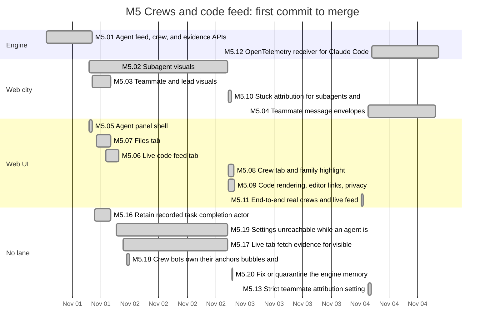
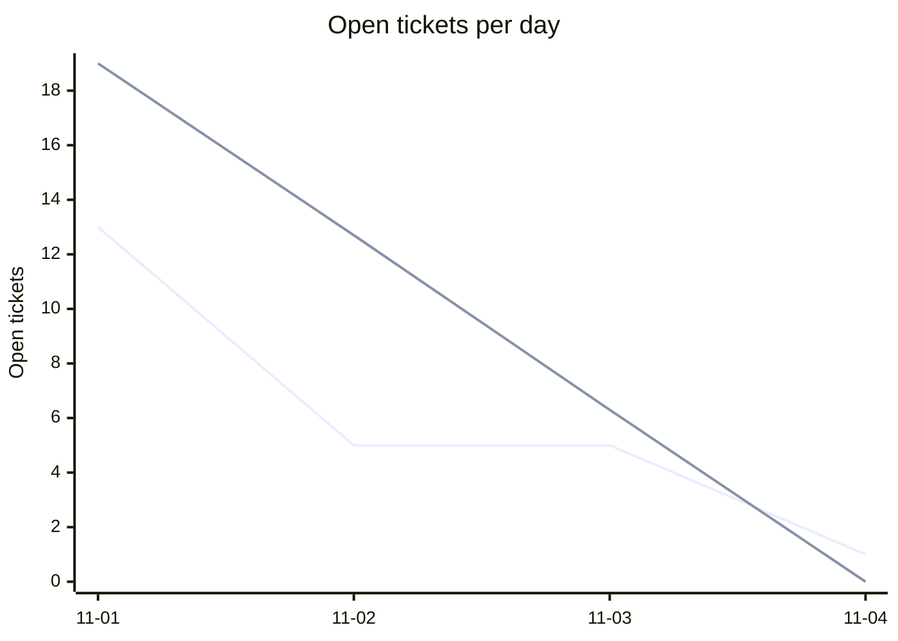
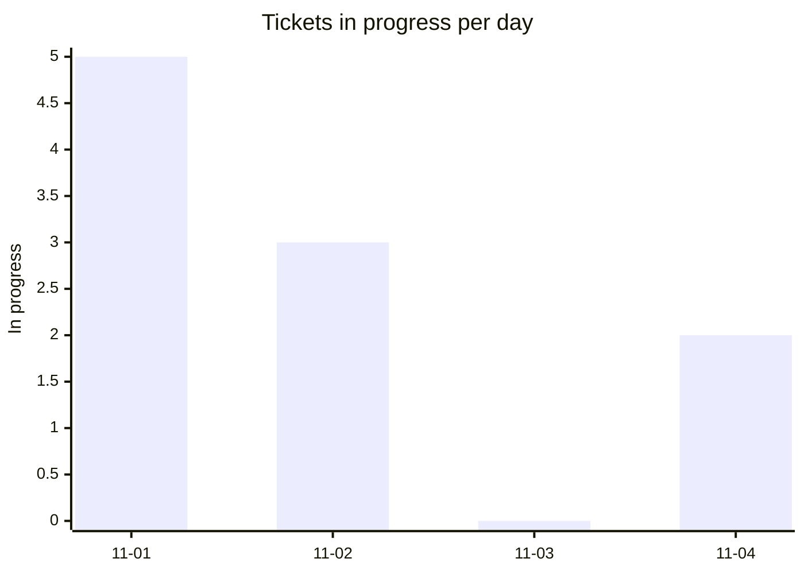
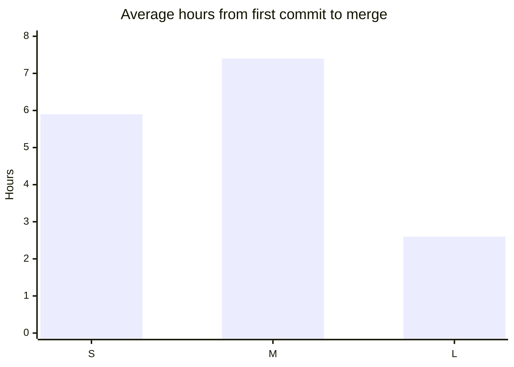
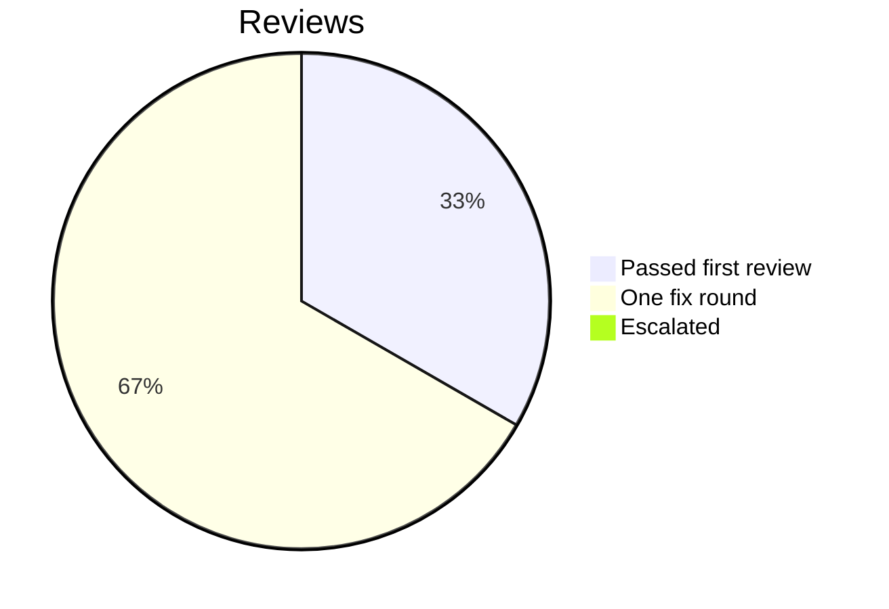

# Retro: M5 Crews and code feed

Generated 2026-11-04T16:32Z by `pnpm retro M5` from GitHub data. Charts and numbers are generated; the sections marked *written* are filled in by the lead.

## At a glance

| Tickets planned | Added | Done | Dropped | Calendar days | Peak parallel | First-pass reviews | Flakes | NOT RUN |
| --- | --- | --- | --- | --- | --- | --- | --- | --- |
| 14 | 5 | 18 | 0 | 4 | 5 | 13% | 0 | 18 |

## Timeline by lane

Times are UTC. Start is the first commit on the ticket's branch, end the merge; tickets in progress run to the generation time. Not started: M5.RT.

## Burn-down

## Parallelism

Most in progress at one moment: 5 (2026-11-01T19:03 UTC).

## Cycle time by size

Average over merged tickets with a size on the board.

## Review outcomes

From the roborev field of each merged ticket's task report: a medium or higher finding fixed before merge is one fix round. More than one fix round (not in the chart): M5.02, M5.04, M5.05, M5.08, M5.19. Not measured: M5.01, M5.06, M5.07, M5.09, M5.11, M5.12, M5.13, M5.16, M5.17, M5.18 (the report does not say).

## Quality signals

| CI failures | Re-runs | Flakes | Tests NOT RUN | Security findings (high / medium / low) |
| --- | --- | --- | --- | --- |
| 8 | not measured | not measured (many load flakes; see What hurt and #373) | 18 | not measured / not measured / not measured |

## Plan versus actual

| | Tickets | Keys |
| --- | --- | --- |
| Planned | 14 | M5.01, M5.02, M5.03, M5.04, M5.05, M5.06, M5.07, M5.08, M5.09, M5.10, M5.11, M5.12, M5.13, M5.RT |
| Added mid-milestone | 5 | M5.16, M5.17, M5.18, M5.19, M5.20 |
| Split | not measured | |
| Dropped | 0 |  |
| Done | 18 | M5.01, M5.02, M5.03, M5.04, M5.05, M5.06, M5.07, M5.08, M5.09, M5.10, M5.11, M5.12, M5.13, M5.16, M5.17, M5.18, M5.19, M5.20 |
| Still open | 1 | M5.RT |

Planned tickets were created by the first commit of the milestone (2026-11-01T06:38 UTC); added ones after it. Splits are not recorded in GitHub data. Dropped means closed as not planned.

## What went well *(written)*

- Every planned M5 ticket except the retro merged (M5.01 to M5.13), plus lead-added follow-ups M5.14 to M5.27 except M5.14, each test-first with one PR per ticket, a roborev pre_merge panel, a specialist code review and, where it touched input or secrets, a security review (the generated table omits lead-added tickets without a milestone field).
- Confirming reviews after the two-panel roborev cap caught real defects the panels missed or introduced: a lifetime fetch ledger that starved the live tail (M5.24), a privacy leak through the Crew tab summary (M5.25), a heuristic link shown as fact (M6.07 sits in M6 but shared the pattern), and the OTel helper sending the CLI token to any endpoint (M5.12).
- The debugger closed every stall in one round: the per-window budget (M5.24), the shim spool corruption that looked like a CI flake (M5.27, a real stale-lock race), the subset-fold equivalence work (M5.14).
- Owner decisions answered on 2026-11-03 (#333, #336, #198, #289) were applied the same session; the result summary (#342) shipped from #333.

## What hurt *(written)*

- Too many parallel workers each ran `pnpm check`: load average reached 150, timing tests failed under load on most tickets, and every flake cost a rerun and a judgement call. Later briefs told workers to skip `pnpm check` above load 20 and let CI decide.
- CI does not run the vitest browser suite, so browser regressions only show in the wave run (three files on main at the M5/M6 wave, see the G5 summary).
- The lead decided a feed frame scheme (M5.15 idless frames) without grepping the web consumers, which cost a full review round; the lead also asked for reducer redaction (M5.25) that ingest already did.
- Review findings kept arriving on lead-picked shortcuts: per-stream ledgers, subset folds, time-matched focus tokens. Each needed a decision to stop (descoping #368, holding M5.14 for #376).
- A 5-hour usage limit stopped two workers overnight; they resumed cleanly from their saved state.
- One roborev panel ran against the wrong branch because a background shell did not keep its `cd`; later runs passed `--repo` and `--branch` explicitly.

## Lessons from this milestone *(written)*

Links to the [LESSONS.md](../LESSONS.md) entries recorded during the milestone, plus any new ones from this retro.

- Recorded this milestone: L-206 to L-209 (timing pins measure the wait; check where a payload is masked; unknown counts get their own words; per-window fetch budgets).
- New from this retro: L-210 (grep every consumer before changing a wire format), L-211 (a subset fold needs an equivalence test against the full fold), L-212 (a capture-phase handler inherits the rules of everything it pre-empts), L-213 (a recurring CI failure in untouched code is a bug until proven a flake), L-214 (cap parallel `pnpm check` runs by load).

## Changes for the next milestone *(written)*

Each change is either applied now (with a link to the commit or ticket) or proposed to the owner in the gate summary.

- Applied: briefs tell workers to skip `pnpm check` above load average 20 and rely on CI; roborev runs use `--repo` and `--branch` explicitly.
- Applied: follow-ups instead of extra rounds after the two-panel cap: #341 (done as M5.24), #347, #348, #356, #361, #364, #365 (done as M5.27), #367, #368, #369, #373.
- Proposed to the owner (G5 summary): add the vitest browser suite to CI or a nightly job (#373 lists the load-sensitive ones); decide #374 (OTel credential), #376 (hold M5.14), #360 (OTLP payload source).
