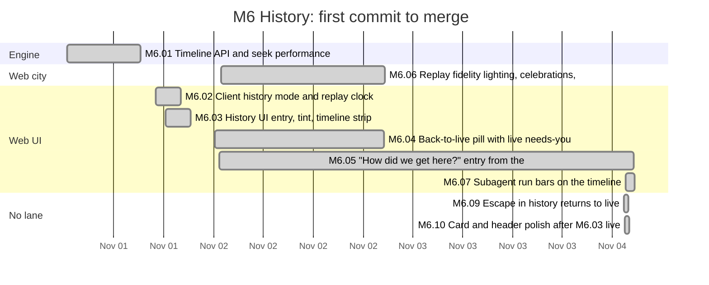
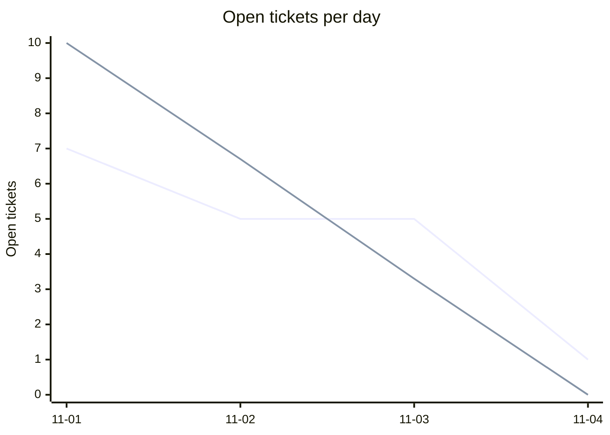
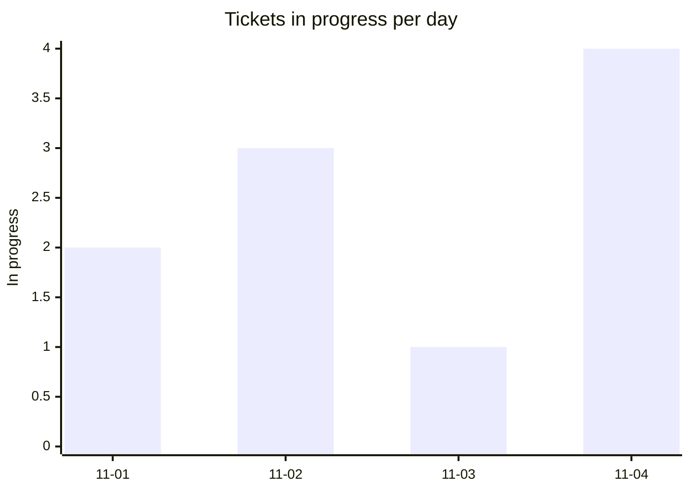
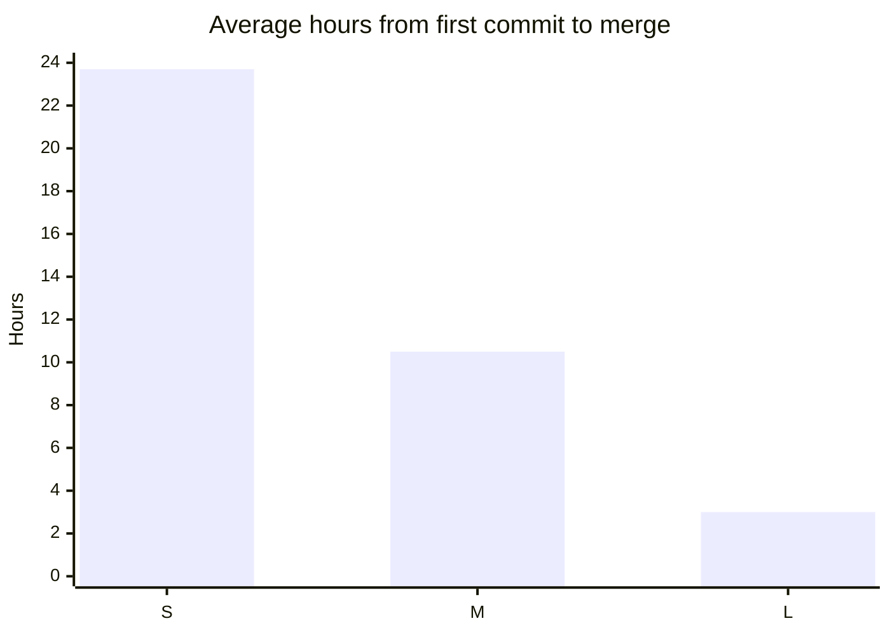
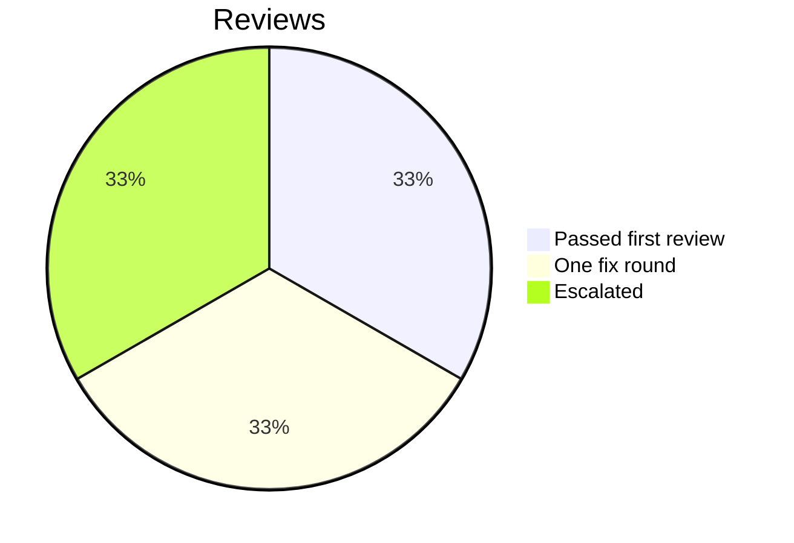

# Retro: M6 History

Generated 2026-11-04T16:33Z by `pnpm retro M6` from GitHub data. Charts and numbers are generated; the sections marked *written* are filled in by the lead.

## At a glance

| Tickets planned | Added | Done | Dropped | Calendar days | Peak parallel | First-pass reviews | Flakes | NOT RUN |
| --- | --- | --- | --- | --- | --- | --- | --- | --- |
| 8 | 2 | 9 | 0 | 4 | 4 | 25% | 0 | 9 |

## Timeline by lane

Times are UTC. Start is the first commit on the ticket's branch, end the merge; tickets in progress run to the generation time. Not started: M6.RT.

## Burn-down

## Parallelism

Most in progress at one moment: 4 (2026-11-04T01:39 UTC).

## Cycle time by size

Average over merged tickets with a size on the board.

## Review outcomes

From the roborev field of each merged ticket's task report: a medium or higher finding fixed before merge is one fix round. More than one fix round (not in the chart): M6.01. Not measured: M6.03, M6.04, M6.05, M6.07, M6.10 (the report does not say).

## Quality signals

| CI failures | Re-runs | Flakes | Tests NOT RUN | Security findings (high / medium / low) |
| --- | --- | --- | --- | --- |
| 5 | 0 | 0 | 9 | not measured / not measured / not measured |

## Plan versus actual

| | Tickets | Keys |
| --- | --- | --- |
| Planned | 8 | M6.01, M6.02, M6.03, M6.04, M6.05, M6.06, M6.07, M6.RT |
| Added mid-milestone | 2 | M6.09, M6.10 |
| Split | not measured | |
| Dropped | 0 |  |
| Done | 9 | M6.01, M6.02, M6.03, M6.04, M6.05, M6.06, M6.07, M6.09, M6.10 |
| Still open | 1 | M6.RT |

Planned tickets were created by the first commit of the milestone (2026-11-01T06:23 UTC); added ones after it. Splits are not recorded in GitHub data. Dropped means closed as not planned.

## What went well *(written)*

- Every planned M6 ticket except the retro merged (M6.01 to M6.10), plus lead-added follow-ups M6.11, M6.12 and M6.13, each test-first with one PR, a roborev pre_merge panel and a specialist review.
- Seek performance met the 300 ms target with room to spare: after a reboot, with no warm-up, the lively day (50,005 events) seeks in a worst p95 of 33.6 to 34.4 ms; the boot backfill takes about 2 s.
- The checkpoint cache became honest about failure: errors other than busy are logged as an allowlisted errcode, batches are bounded, a damaged row is replaced, and only cache writes are best effort (M6.11, M6.12).
- The deflake ticket (M6.13) found two timing tests that never waited, so they would have passed with the regression in place.

## What hurt *(written)*

- M6.07 (run bars) took four rounds plus a debugger round because crewRuns re-derived the domain's registration rules; it was fixed only by calling the domain's own applyRegistration.
- M6.10 took three rounds on a lookup bound, each round finding a new linear path; a follow-up (#361) still remains.
- Full-scene history browser tests (back-to-live, history-escape) time out under load identically on main, so they cannot judge a branch on a busy machine (#373).

## Lessons from this milestone *(written)*

Links to the [LESSONS.md](../LESSONS.md) entries recorded during the milestone, plus any new ones from this retro.

- Recorded this milestone: L-206 (timing pins), L-209 (fetch budgets); new from this retro: L-215 (call the domain's rule instead of copying it).

## Changes for the next milestone *(written)*

Each change is either applied now (with a link to the commit or ticket) or proposed to the owner in the gate summary.

- Applied: follow-ups #347 (done as M6.12), #356 (done as M6.13), #361, #364, #367, #373.
- Proposed to the owner (G6 summary): the browser suite in CI or nightly; the stale-lock lesson from M5.27 applied to any other lock in the engine.
