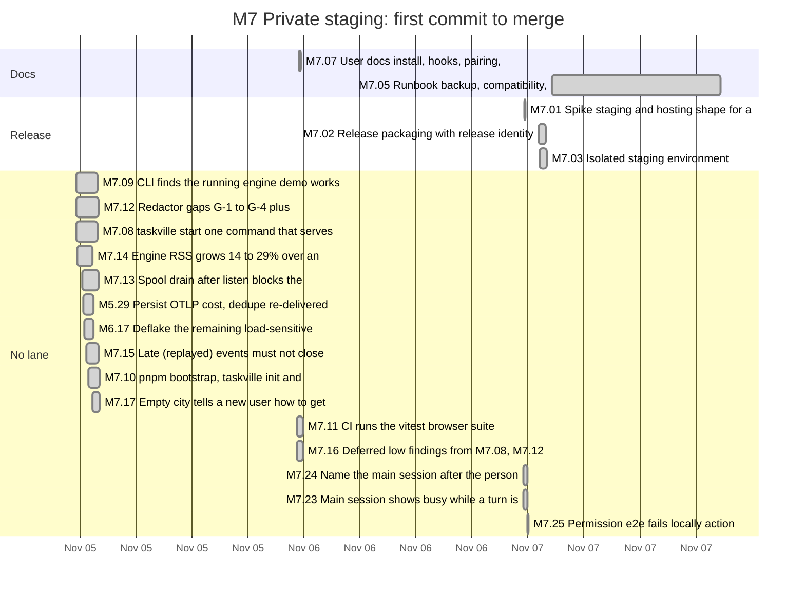
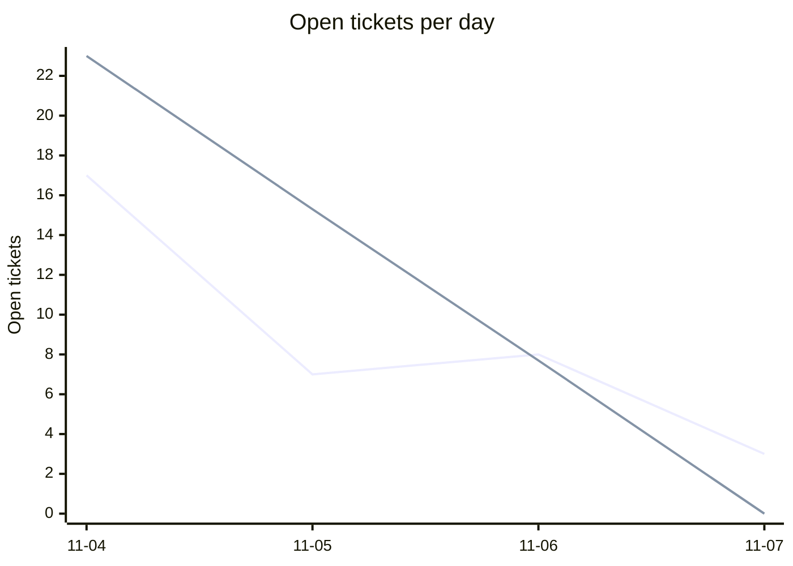
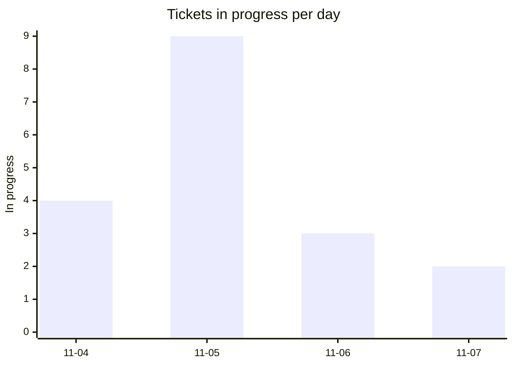
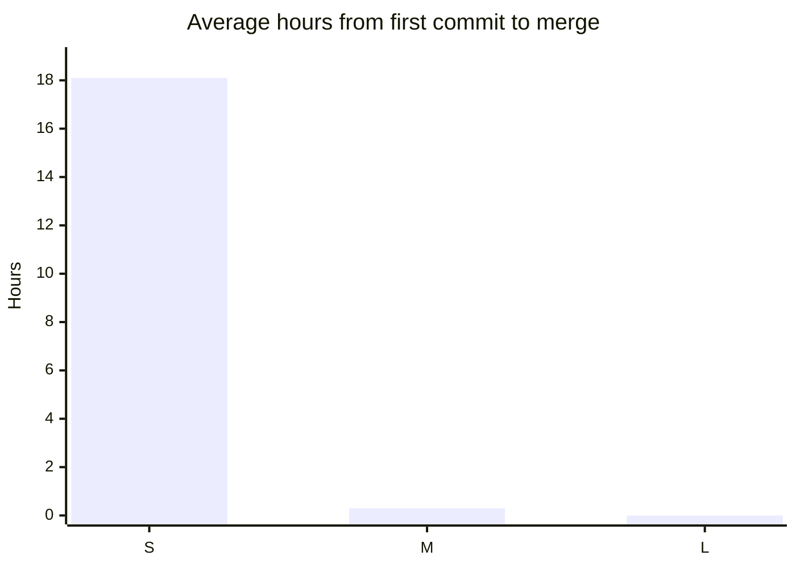
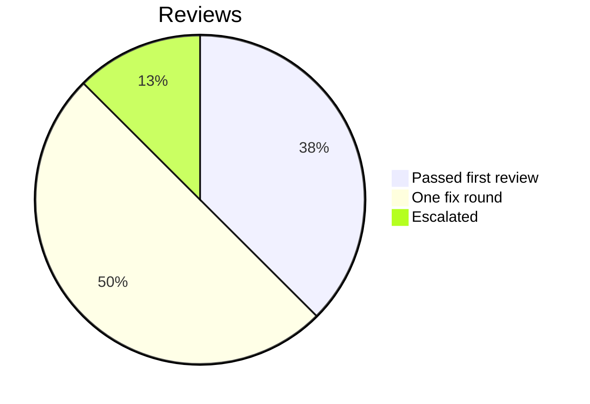

# Retro: M7 Private staging

Generated 2026-11-07T20:52Z by `pnpm retro M7` from GitHub data. Charts and numbers are generated; the sections marked *written* are filled in by the lead.

## At a glance

| Tickets planned | Added | Done | Dropped | Calendar days | Peak parallel | First-pass reviews | Flakes | NOT RUN |
| --- | --- | --- | --- | --- | --- | --- | --- | --- |
| 17 | 6 | 20 | 0 | 4 | 9 | 30% | 0 | not measured |

## Timeline by lane

Times are UTC. Start is the first commit on the ticket's branch, end the merge; tickets in progress run to the generation time. Not started: M7.04, M7.RT. Closed without a merged PR (not drawn): M7.06.

## Burn-down

## Parallelism

Most in progress at one moment: 9 (2026-11-05T00:52 UTC).

## Cycle time by size

Average over merged tickets with a size on the board. Not measured: L (no merged L tickets).

## Review outcomes

From the roborev field of each merged ticket's task report: a medium or higher finding fixed before merge is one fix round. More than one fix round (not in the chart): M7.01, M7.05. Not measured: M5.29, M6.17, M7.06, M7.07, M7.08, M7.10, M7.12, M7.13, M7.16, M7.17 (the report does not say).

## Quality signals

| CI failures | Re-runs | Flakes | Tests NOT RUN | Security findings (high / medium / low) |
| --- | --- | --- | --- | --- |
| 6 | 0 | 0 | not measured | not measured / not measured / not measured |

## Plan versus actual

| | Tickets | Keys |
| --- | --- | --- |
| Planned | 17 | M5.29, M6.17, M7.01, M7.02, M7.03, M7.04, M7.05, M7.06, M7.07, M7.08, M7.09, M7.10, M7.11, M7.12, M7.13, M7.14, M7.RT |
| Added mid-milestone | 6 | M7.15, M7.16, M7.17, M7.23, M7.24, M7.25 |
| Split | not measured | |
| Dropped | 0 |  |
| Done | 20 | M5.29, M6.17, M7.01, M7.02, M7.05, M7.06, M7.07, M7.08, M7.09, M7.10, M7.11, M7.12, M7.13, M7.14, M7.15, M7.16, M7.17, M7.23, M7.24, M7.25 |
| Still open | 3 | M7.03, M7.04, M7.RT |

Planned tickets were created by the first commit of the milestone (2026-11-04T23:32 UTC); added ones after it. Splits are not recorded in GitHub data. Dropped means closed as not planned.

## Tokens and cost

Tokens and cost: not measured (no OpenTelemetry data for this milestone).

## What went well *(written)*

- The local-setup batch (M7.07 to M7.25) delivered the owner's 2026-11-04 priority: a fresh clone reaches a working city with `pnpm bootstrap` and `taskville start`, and the session that builds Taskville now shows up in it.
- Packaging landed as one self-contained tarball with a content-derived release id (M7.02, M7.26), and the clean-machine install check (M7.28) runs it on a fresh runner in under a minute. That check became the release candidate once hosted staging was held.
- The local runbook rehearsal (M7.05) went from release `38c0d20bcd1aa799` to `89110d8d2ea2a377`, rolled back, and restored a backup with a byte-identical `status --json` at every step.
- The push tier ran sequentially in about 8 minutes with every suite green apart from one flake that passed alone (M7.06).

## What hurt *(written)*

- Hosted staging was built (M7.01 spike, M7.03 Worker) before the owner was asked whether they wanted a Cloudflare deploy at all. When the first deploy needed an Access token, the owner asked why Taskville was being deployed and held it (decision #432). M7.03's Worker code is merged but undeployed, and M7.04 is blocked.
- Review rounds on documentation ran long: the runbook took four roborev findings across three jobs, all about commands acting on the wrong home or binary (M7.05).
- The first push attempt of the local-setup wave hit the 1 hour background limit, and two background shells in this session (the cache keepalive and the live engine) were stopped or are bounded by the 30 minute default and 2 hour maximum.
- First-pass reviews stayed at 30%.

## Lessons from this milestone *(written)*

Links to the [LESSONS.md](../LESSONS.md) entries recorded during the milestone, plus any new ones from this retro.

- Recorded this milestone: L-216 to L-224.
- New from this retro: L-225 (pin the platform in lockfile fixtures), L-226 (`--home` picks the token, not the engine), L-227 (confirm a hosted deploy with the owner before building it), L-228 (background shell limits for long runs).

## Changes for the next milestone *(written)*

Each change is either applied now (with a link to the commit or ticket) or proposed to the owner in the gate summary.

- Applied: decision #432 (hosted staging held; local rehearsal, tarball push tier and tarball release candidate); follow-ups #434 (M7.30) and #435 (M7.31) for the release security review's low findings; #428 done as M7.29.
- Proposed to the owner (G7 summary): resume or drop hosted staging (#86, M7.03 Worker); publish the reviewed tarball as a GitHub release only on request; a cross-browser config if Firefox and WebKit matter for local users.
