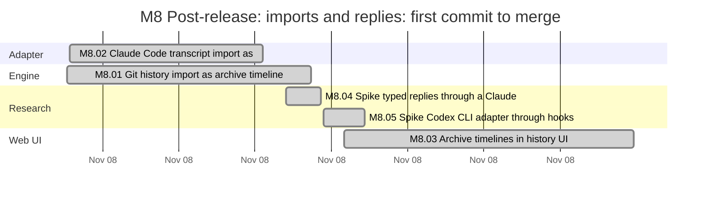
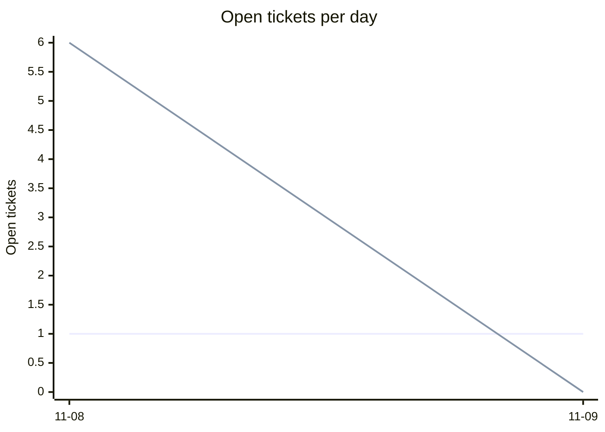
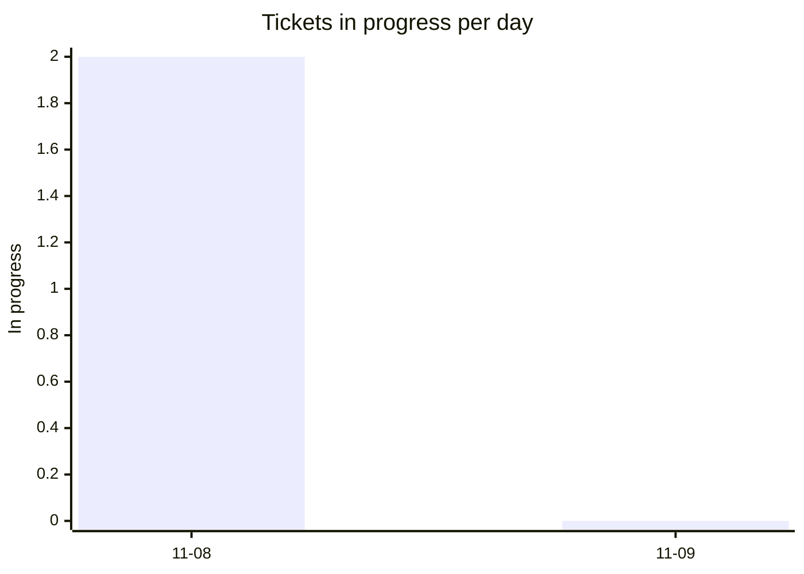
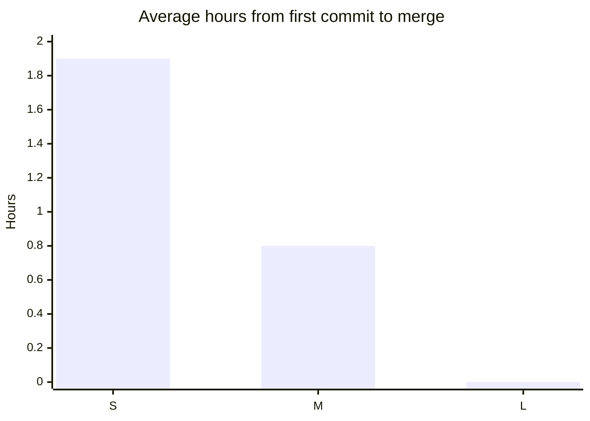
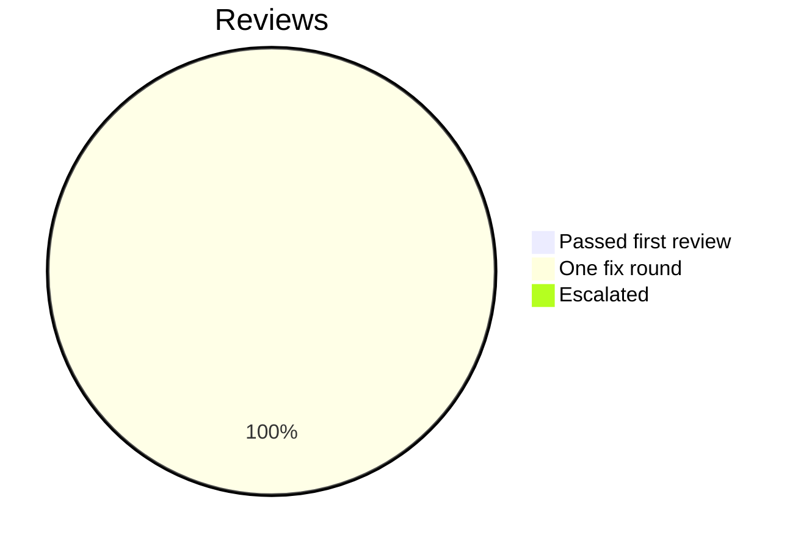

# Retro: M8 Post-release: imports and replies

Generated 2026-11-09T00:00Z by `pnpm retro M8` from GitHub data. Charts and numbers are generated; the sections marked *written* are filled in by the lead.

## At a glance

| Tickets planned | Added | Done | Dropped | Calendar days | Peak parallel | First-pass reviews | Flakes | NOT RUN |
| --- | --- | --- | --- | --- | --- | --- | --- | --- |
| 6 | 0 | 5 | 0 | 2 | 2 | 0% | 0 | 5 |

## Timeline by lane

Times are UTC. Start is the first commit on the ticket's branch, end the merge; tickets in progress run to the generation time. Not started: M8.RT.

## Burn-down

## Parallelism

Most in progress at one moment: 2 (2026-11-08T20:17 UTC).

## Cycle time by size

Average over merged tickets with a size on the board. Not measured: L (no merged L tickets).

## Review outcomes

From the roborev field of each merged ticket's task report: a medium or higher finding fixed before merge is one fix round. Not measured: M8.04 (the report does not say).

## Quality signals

| CI failures | Re-runs | Flakes | Tests NOT RUN | Security findings (high / medium / low) |
| --- | --- | --- | --- | --- |
| 4 | 1 | 0 | 5 | not measured / not measured / not measured |

## Plan versus actual

| | Tickets | Keys |
| --- | --- | --- |
| Planned | 6 | M8.01, M8.02, M8.03, M8.04, M8.05, M8.RT |
| Added mid-milestone | 0 |  |
| Split | not measured | |
| Dropped | 0 |  |
| Done | 5 | M8.01, M8.02, M8.03, M8.04, M8.05 |
| Still open | 1 | M8.RT |

Planned tickets were created by the first commit of the milestone (2026-11-08T20:16 UTC); added ones after it. Splits are not recorded in GitHub data. Dropped means closed as not planned.

## Tokens and cost

Tokens and cost: not measured (no OpenTelemetry data for this milestone).

## What went well *(written)*

- Owner closed G7 on 2026-11-08 ("autoaccept everything") and M8 ran to G8 the same day: Git and transcript imports, archive storage and imports API, archive timelines, the `taskville import` command, archives in the history UI, two spikes, all merged.
- A lead-written design note and importer contract (3f20bb8) let the Git importer, the transcript importer and the foundation run in parallel from one pushed commit; they merged without conflicts.
- Specialist reviews caught real defects before merge: imported evidence that could evict or shadow live evidence, a crafted evidence id reaching archive scope, redaction that could leak a straddling secret or a long `_PASSWORD` key, NUL-unsafe git log framing, a dead history UI after a failed timeline switch.
- The debugger turned two long-running "flakes" into real fixes: the Live tab scroll race (M9.10) and the spool lock double holder caused by a non-atomic `mkdir` on CI (M7.32).
- The owner's mid-milestone request (agent panel readability) shipped alongside M8 as M10.01 to M10.03 without slowing it.

## What hurt *(written)*

- The generator above counts only the six planned tickets; the six added foundation and follow-up tickets (M8.06 to M8.11) are missing from its tables. Real totals: 12 tickets done in M8, plus M10.01 to M10.03 and M9.10, M9.11, M7.30, M7.31, M7.32.
- Every code ticket needed at least one fix round; several red tests had defects that only surfaced in green (unescaped regex, exact-match text assertions, unpolled controlled inputs, missing `agentId`), costing extra round trips.
- Worker roles cannot create new files, so the lead had to write task reports and stubs by hand several times.
- Workers hit the 5-hour usage limit mid-afternoon and stalled until it reset.
- Running four or five workers that each run `pnpm check` and browser suites at once produced load flakes (staging budget, history fidelity, navigator fuzz) that cost reruns.

## Lessons from this milestone *(written)*

Links to the [LESSONS.md](../LESSONS.md) entries recorded during the milestone, plus any new ones from this retro.

- L-231 to L-234 (follow-ups batch and M9.10), plus the M8 entries added with this retro: L-235 (non-atomic `mkdir` locks), L-236 (scope evidence by archive), L-237 (test defects found in green), L-238 (a shared contract file unblocks parallel tickets).

## Changes for the next milestone *(written)*

Each change is either applied now (with a link to the commit or ticket) or proposed to the owner in the gate summary.

- Applied: follow-up tickets filed for review findings deferred at the review cap: #471 (archive seek checkpoints), #473 (transcript hardening lows), #485 (archive retention and evidence cap), #488 (archive playback gaps, bounded markers, picker refresh), #489 (logbook evidence budget, needs-you without a running call), #491 closed by #490, #483 (Codex adapter from S-5).
- Proposed: teach `pnpm retro` to include tickets added to a milestone after its first commit (by key prefix), so added tickets appear in the tables.
- Proposed: give the test-writer and implementer roles permission to create new files under their Owns paths (task reports, new test files), or have the lead pre-create stubs in every brief.
- Proposed: cap concurrent `pnpm check` and browser-suite runs at two across workers to cut load flakes.
