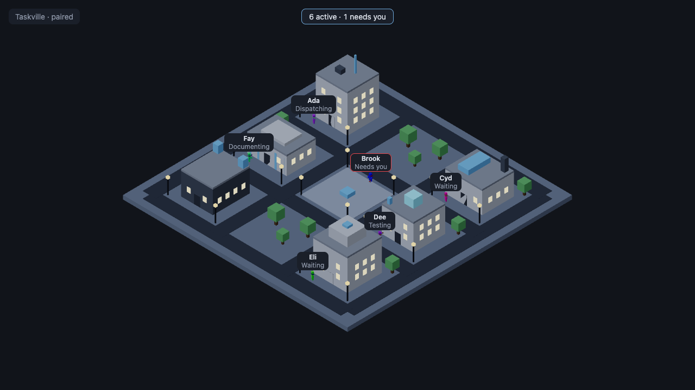

# M3.06: Navigation and presentation state machine (#36)

- **Result:** done (PR and roborev pending the base merge, see Decisions needed)
- **PR:** not opened yet · **roborev:** not run yet (the branch still contains the unmerged M3.01 to M3.05 base)
- **Checks run:**
  - Red phase: `apps/web/test/city/movement/{areas,navigator,models}.test.ts` committed alone in 0e5696d; all three files failed on the missing `src/city/movement` modules.
  - `pnpm --filter @taskville/web test`: 25 files, 176 tests pass (22 new in `test/city/movement/`). `wiring.test.ts` (counts selector, stored overrides) was written after its code and not seen red.
  - `pnpm exec tsc --noEmit -p apps/web/tsconfig.json` clean; `pnpm exec biome check apps/web` clean.
  - `E2E_PORT=4851 E2E_SCREENSHOT=... pnpm --filter @taskville/web test:e2e movement.spec.ts` once: 1 passed (30.8 s). Screenshot: `docs/tasks/M3.06/city.png`.
  - `E2E_PORT=4851 pnpm exec playwright test smoke.spec.ts` once (same build; the e2e engine harness changed): 3 passed.
  - `pnpm check` once: typecheck, lint, 122 files / 2469 tests pass.
- **NOT RUN:** `test:browser` (no browser component test added; the e2e drives the real canvas and overlay), the full e2e suite, perf and fps targets (M3.16), roborev (base not merged).
- **Measurements:** none committed. A throwaway stress run (8 agents, a random area change every 4 s, 300 s of 50 ms frames, not committed) kept walkers at least 0.405 m apart, under 0.45 m in 5 of 6000 frames.
- **Decisions needed:** none. For the lead: the sync loop is mounted for the built-in project `unsorted` (see Wiring); project selection is still open.
- **Review outcome:** pending
- **Lessons:** see the end of this file

## What was built (`apps/web/src/city/movement/`)

Pure TypeScript, unit tested in node:

| File | Role |
| --- | --- |
| `areas.ts` | Activity-to-area table as data (ARCHITECTURE.md 8.3): `DEFAULT_ACTIVITY_AREAS`, `resolveActivityAreas(overrides)` (merges `{ activities, agentTypes }`, ignores unknown keys and areas), `areaFor(table, { activity, agentType, kind })`. Subagent `agent_type` rules come first: `security` before `review`. Activities with no place (`idle`, `waiting`, `handing_off`, `unknown`) keep the current destination. |
| `navigator.ts` | `createNavigator()`: `sync(intents, { place })`, `tick(nowMs)`, `get`, `list`, `prune`, `setReducedMotion`. Deterministic for a given clock (fixed 100 ms substeps). |
| `models.ts` | Store to `AgentView` (M3.05) and `NavIntent`; `agentCounts` for the header. |
| `labels.ts` | Label rows (recorded status plus `onTheWay`) and a small label store. |

React glue: `CityAgents.tsx` (inside the Canvas), `AgentLabels.tsx` (world-labels overlay), `selectors.ts` (header counts over the store), `settings.ts` (stored overrides, reduced-motion preference).

### Navigation rules

- **Paths:** `findPath` (M3.04) between graph nodes. A replan starts from either end of the street segment the walker is on (whichever is cheaper in total), so new work turns a walker around mid-street instead of finishing the old walk.
- **Slots:** reserved at plan time, lowest free index. Changing area releases the old slot at once.
- **Queues:** a full area queues FIFO at spots beside its anchor (2.6 m to either side, 0.8 m off the street, then 0.8 m further out per rank). A freed slot goes to the head of the line; the rest move up.
- **Spacing:** walkers keep to a 0.3 m lane right of the centerline (eased in and out near the ends of a walk), wait for anyone in a 0.7 m corridor ahead, and when two block each other the smaller id goes while the other backs off along its street. After 1.5 s of waiting a walker goes anyway, so nothing deadlocks.
- **Spawn:** new agents appear at the free plaza point nearest their destination (a ring inside the plaza when all five are taken); subagents appear at their parent's building anchor and leave by it. The first snapshot (`place: true`) puts agents straight at their destination: they were already there.
- **Needs you:** an agent at its workstation or in line stays put; one walking goes to the nearest free plaza node (reserved, one agent each) and keeps its slot; when the request clears it walks on.
- **Departing:** agents that finish (or drop out of the store) walk to their spawn point, then report `gone`; `CityAgents` prunes them.
- **Reduced motion:** every walk snaps to its end on the next tick (from `prefers-reduced-motion`, or the `reducedMotion` prop for the settings panel).

### Presentation states

`departing` while leaving; `arriving` on the first walk after appearing; `walking` on any later walk (including toward a safe stop); `stuck` when held for needs-you or when no path exists; `waiting` in a queue; otherwise the rest state from the record (`waiting` for a waiting attention or activity, `idle` for idle, else `working`). `onTheWay` is true only while walking toward work (not when departing or heading to a safe stop). Labels always show the recorded status from `agentLabel`; the state machine only adds the "on the way" mark.

## Wiring (edits outside Owns, declared)

- `apps/web/src/city/index.tsx`: mounts `<CityAgents />` next to `<CityScene />`.
- `apps/web/src/overlays/index.tsx`: registers `agentLabelsOverlay` (`agent-labels`, world-labels slot) and enables it; replaces the zero placeholder `selectors` with `countsSelector(dataStore)` (`active` = agents not finished, `needsYou` from the store); calls `useDataSync("unsorted")` in `OverlayRoot`, the first mount of the M3.02 sync loop.
- `apps/web/e2e/engine.ts`: also writes the throwaway `home` to the pairing-codes file so a test can run `taskville demo start --home`.
- `apps/web/e2e/movement.spec.ts`: new. Pairs, opens `/?debug=movement`, runs `demo start --project unsorted --seed 7 --speed 120 --duration 30m` in process, waits until the six core agents stand at slots, then checks six distinct slots and every pair of standing bots more than 0.6 m apart.

Notes for the lead and other batch 3 tickets:

- `?debug=movement` exposes `window.__taskvilleMovement()`, a read-only copy of the navigator's list, for e2e checks. Nothing else reads the query.
- Overrides for the area table live in `localStorage["taskville.activityAreas"]` (JSON) until the settings panel (M3.15) owns them. Its reduced-motion setting can pass `reducedMotion` to `CityAgents`.
- Label anchors are `agent:<id>` in `worldAnchors`, at head height (`offsetY` from M3.05). Selection (M3.11) can use the same anchors.
- `AgentActivity` is not re-exported by `data/domain.ts`; `models.ts` derives it from `ProjectState["activity"]` rather than editing M3.02's seam.

## Not covered

- Spacing is local and best effort: a walker that has waited 1.5 s passes through, and a needs-you agent held on a plaza node can sit on the north-south route through the plaza.
- The demo's teammates and subagents have no parent slot until their parent has one; they then spawn at the plaza.

## Lessons

- A navigator that owns no clock (`tick(nowMs)` with fixed substeps) made every rule testable with a fake clock in node, including determinism (two runs compared frame by frame).
- Mutual-yield rules need a tie-break that also makes room: "the smaller id goes" alone let the winner walk through the loser; backing the loser off along its own street fixed it.
- Spawning several agents in one sync at the same point puts them on the same path in lockstep, and no "ahead" check can separate two co-located walkers; distinct spawn points did.
- Running the CLI's `run([...], io)` in process from a Playwright spec is a cheap way to drive the real demo producer against the e2e engine, once the harness shares its home.
