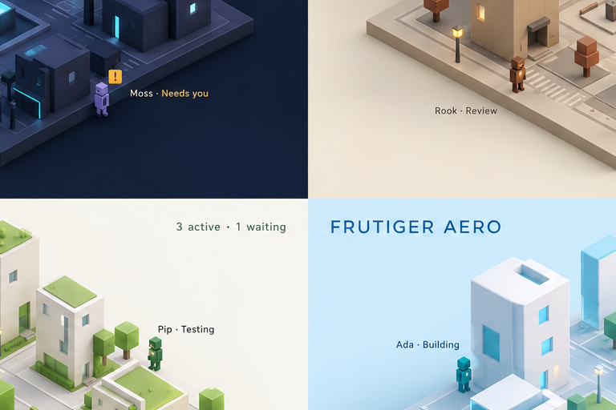
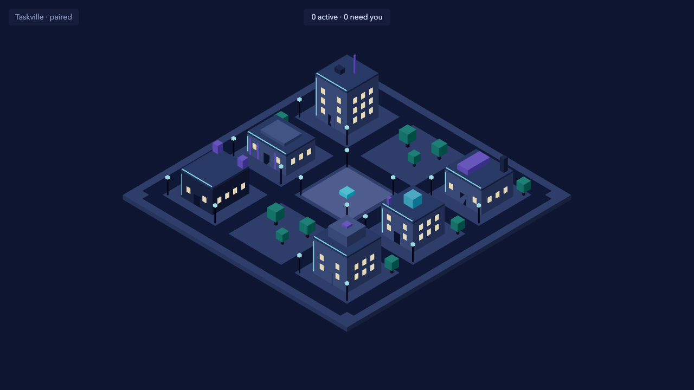

# M3.07: Theme system and cyberpunk theme (#37)

- **Result:** done (PR and roborev pending the base merge, see Decisions needed)
- **PR:** not opened yet · **roborev:** not run yet
- **Checks run:** `pnpm --filter @taskville/web test -- themes` (3 new files, 19 tests; seen failing first, commit e9b73a8) · `pnpm exec tsc --noEmit -p apps/web/tsconfig.json` clean · `pnpm exec biome check` clean · `pnpm check` once (typecheck, biome, 121 files / 2466 tests pass) · `E2E_PORT=4852 E2E_SCREENSHOT=... pnpm --filter @taskville/web test:e2e` once (the scaffold's 3 smoke tests pass; the screenshot comes from it)
- **NOT RUN:** `test:browser` (no component test added; the switching test runs on the stores, no DOM needed), the full e2e suite, perf
- **Measurements:** none
- **Decisions needed:** none
- **Review outcome:** pending
- **Lessons:** see the end of this file

## Screenshot next to the mockup

| Mockup, cyberpunk quadrant (visual reference, not a pixel spec) | Built (cyberpunk, day, 1280x720) |
| --- | --- |
|  |  |

## The theme contract (for M3.08 to M3.10 and M3.12)

Everything is in `apps/web/src/themes/core/contract.ts`. A theme is plain data (`ThemeDefinition`):

- `tokens`: one complete token set, `Record<--tv-*, string>`. Required keys are `REQUIRED_TOKENS`: the DOM tokens (`--tv-scene-bg`, `-surface`, `-text`, `-text-muted`, `-accent`, `-focus`, `-neon`, `-radius`, `-font`) and one `--tv-city-<kebab>` per `CityPalette` entry (`cityToken(key)`). Colors are lowercase `#rrggbb`.
- Both readers use the same resolved set: the controller writes it on `document.documentElement` (DOM reads `var(--tv-*)`), and `ThemedCity` builds the 3D `CityPalette` from that same set (`cityPaletteFromTokens`). A test pins the two together.
- `night`: `Partial<tokens>` overrides for night mode (same keys only). M3.12 drives it with `themeController.setMode("day" | "night")`. Cyberpunk night: deeper sky, dimmer walls, brighter neon and window/lamp light.
- `history`: `{ tint, desaturate }`. While history is shown (`setHistory(true)`) the city palette, the scene background and the neon are pulled toward grey and the tint by `desaturate` (`applyHistoryTint`, `tintHex`). Cyberpunk: `#4aa8e8`, 0.3. The scanline overlay and the "HISTORY" chip are DOM work for the history ticket; `data-history="true"` is set on the root for CSS.
- `accents`: extra boxes on the shared buildings (`ThemeAccent`: area ids or `"all"`, `tone` = palette key or `neon`, `glow` = unlit, center offset from the footprint center, world `y`, sizes). Themes never change footprints, heights, the door, streets or slots. `validateAccents(layout, accents)` enforces: inside the footprint (wall tolerance 0.05 m), above ground, at most building height + 3 m, and clear of the front door (half width 0.7 m, below 1.6 m). Slots and streets lie outside the footprints, so this keeps navigation clear. Build accents from `CITY_LAYOUT` (as cyberpunk does) when they depend on a footprint size.
- `voice`: `{ phrases: {} }`, the quip slot. Empty on purpose; M4.06 fills it with data per state.
- `validateTheme(theme)` returns readable problems (missing or unknown tokens, bad colors, night overrides of unknown tokens, bad tint). Each theme's own test should assert `validateTheme(t)` and `validateAccents(CITY_LAYOUT, t.accents)` are empty, as `test/themes/core/contract.test.ts` does for cyberpunk.

To add a theme: create `themes/<name>/index.ts` exporting a `ThemeDefinition` (import only from `../core/contract.ts` and the layout, never from `../core/index.ts`, to avoid an import cycle), then add one import and one array entry in `themes/core/themes.ts`. The first entry is the default. `ThemeId` already lists all four ids.

## Switching never touches app state

The theme state is its own vanilla store (`createThemeController`, one app-wide instance `themeController`). Switching writes that store and the document root only. A test builds a data store with two agents, selects one, switches theme and mode back and forth, and asserts the data state object is the same reference and the selection is unchanged. Camera is fixed and history position lives with the history ticket; neither is read or written here.

## What the lead must wire

- Settings panel (M3.15) does not import from me. Give it this shape as props, from `useThemeControl()` in `themes/core/react.ts`: `{ themes: {id, name}[], activeId, setTheme(id), mode, setMode(mode) }`. Day/night auto from the clock is M3.12 calling `themeController.setMode`. History tint: whoever owns history calls `themeController.setHistory(flag)`.
- Mounting edit (declared): `apps/web/src/city/index.tsx` renders `<ThemedCity />` instead of `<CityScene />`. `ThemedCity` also attaches the token set to the document root, and owns the scene background (it overrides `SceneRoot`'s one-time `<color attach>` on every theme change). M3.05's agents mount stays beside it.
- `apps/web/src/themes/index.ts` now re-exports the core (`readCssToken` moved to `core/tokens.ts`, same import path for existing callers).
- Known gap for another ticket: `LabelSprite` (M3.05) reads `--tv-text` once when a label canvas is drawn, so a label only picks up a new theme the next time it redraws. Subscribe with `useTheme((s) => s.tokens)` there if live relabeling matters.
- Not built: persisting the chosen theme (localStorage) belongs with the settings panel; `createThemeController` takes `initialThemeId` for it.

## Cyberpunk

Deep navy sky (`#0d1530`), slate-blue buildings, cyan neon (`#35d6ff`) as a vertical strip on each front corner and a line along each front roof edge (12 accents), warm amber windows, cyan lamp heads and plaza mark, violet feature boxes. Radius 4 px for a harder UI edge.

## Lessons

- A theme token contract needs a color rule, not just key names: a test that every color is `#rrggbb` is what lets the 3D side (three.js `Color`) and the tint math take the same values as CSS.
- Keep theme modules free of imports from `core/index.ts` (use `core/contract.ts`): the registry file imports the themes, so the reverse would be a cycle.
