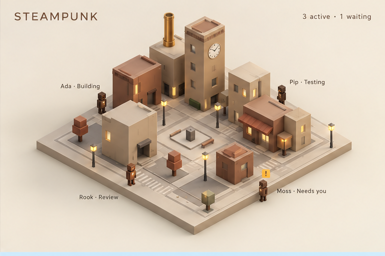
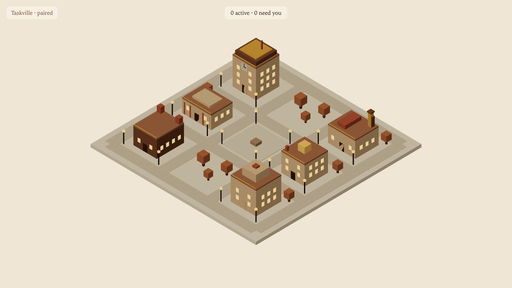

# M3.08: Steampunk theme (#41)

- **Result:** done (PR and roborev pending the base merge, see Decisions needed)
- **PR:** not opened yet · **roborev:** not run yet
- **Checks run:** `pnpm --filter @taskville/web test -- themes` (new `steampunk.test.ts`, 6 tests; seen failing first, commit "Failing test: steampunk theme"; 25 files / 179 tests pass after) · `pnpm exec tsc --noEmit -p apps/web/tsconfig.json` clean · `pnpm exec biome check apps/web/src/themes apps/web/test/themes` clean · `E2E_PORT=4855 E2E_SCREENSHOT=... pnpm --filter @taskville/web test:e2e` once (3 smoke tests pass; the screenshot comes from it) · `pnpm check`: first run 2 test files failed under machine load (not captured, likely the 5 s cli timeouts), a second full run had no failures (flake logged)
- **NOT RUN:** `test:browser` (no component test added), the full e2e suite, perf
- **Measurements:** none
- **Decisions needed:** none
- **Review outcome:** pending
- **Lessons:** see the end of this file

## Screenshot next to the mockup

| Mockup, steampunk quadrant (visual reference, not a pixel spec) | Built (steampunk, day, 1280x720) |
| --- | --- |
|  |  |

The screenshot was taken with steampunk temporarily first in `THEMES` in the working tree (no page hook selects a theme yet); that edit was reverted and is not in the branch.

## What was built

`apps/web/src/themes/steampunk/index.ts`, a plain `ThemeDefinition` on the M3.07 contract:

- Parchment cream sky (`#f0e6d6`), warm tan walls, terracotta/brown roofs and trees, brass (`#c8913a`) as the neon/accent tone, amber window and lamp glow, a serif UI font, radius 8 px. Night: a dusk-brown sky, dimmer walls, warmer gaslight. History tint: sepia `#a8814f`, 0.3.
- Accents (all inside the shared footprints, `validateAccents` empty): a brass band along each front roof edge (6); a clock tower on the tallest building (dispatch): dark crown, brass cap, a clock face and two hands on the front wall, clear of the door; a brass chimney with a dark collar on the workshop's back corner.
- No footprints, heights, door, streets or slots changed.

## Wiring the lead must do

- Registered in `apps/web/src/themes/core/themes.ts` with one import and one array entry, after cyberpunk (outside Owns, allowed by the batch 4 note). Other theme tickets touch the same two lines; the lead resolves the conflict.

## Lessons

- The accent height rule (building height + 3 m) caps a chimney at about 2.9 m above the roof; a taller stack needs a contract change, not a theme tweak.
- Nothing lets a screenshot run pick a theme. A `?theme=` hook or an exposed controller in the settings ticket would make per-theme screenshots reproducible.
