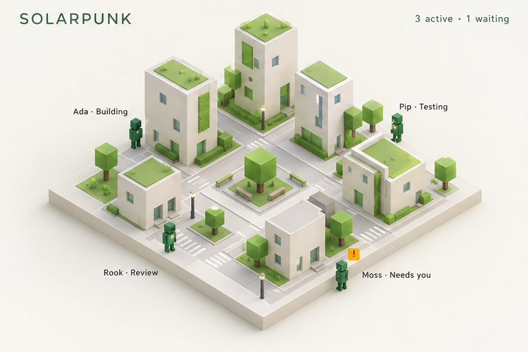
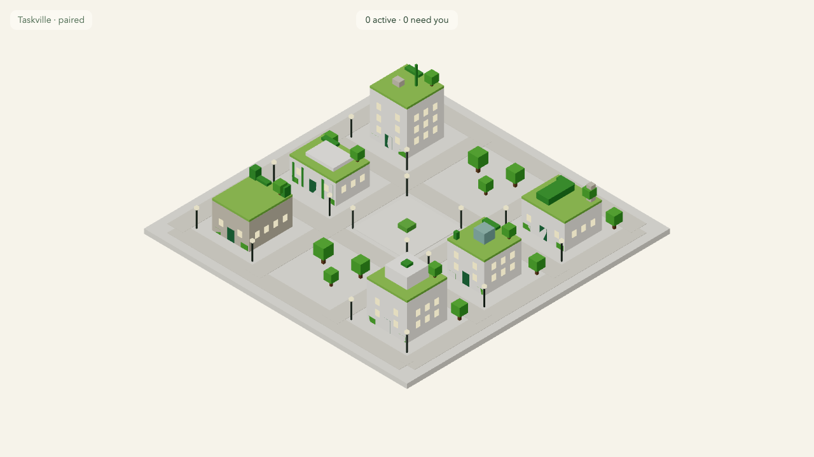

# M3.09: Solarpunk theme (#42)

- **Result:** done (PR and roborev pending the base merge, see Blockers)
- **PR:** not opened yet · **roborev:** not run yet
- **Checks run:** `pnpm --filter @taskville/web test -- themes` (new `test/themes/solarpunk/solarpunk.test.ts`, 5 tests; seen failing first, commit "Failing test: solarpunk theme"; 25 files / 178 tests pass) · `pnpm exec tsc --noEmit -p apps/web/tsconfig.json` clean · `pnpm exec biome check` clean · `E2E_PORT=4856 E2E_SCREENSHOT=... pnpm --filter @taskville/web test:e2e` twice (3 smoke tests pass; screenshot retaken once after brightening the palette) · `pnpm check` once (typecheck, biome, 122 files / 2471 tests pass)
- **NOT RUN:** `test:browser`, the full e2e suite, perf
- **Measurements:** none
- **Decisions needed:** none
- **Review outcome:** pending

## Screenshot next to the mockup

| Mockup, solarpunk quadrant (visual reference, not a pixel spec) | Built (solarpunk, day, 1280x720) |
| --- | --- |
|  |  |

The screenshot was taken with solarpunk temporarily first in `THEMES` (the first entry is the default); that edit is not committed. Cyberpunk stays the default.

## What was built

- `apps/web/src/themes/solarpunk/index.ts`: a `ThemeDefinition` with a warm off-white sky (`#f6f3ea`), white walls (`#fffdf4`), green roofs (`#8cc455`), green trees, dark-green doors, a warm-yellow lamp and window glow, radius 10 px. Night: deep green dusk (`#1b2a22`), dimmer walls and roofs. History tint: warm sand `#c9b37a`, 0.3.
- 5 accents per building (30 in all), all inside the shared footprints: a rooftop tree (trunk and crown) in the back right corner, a rooftop planter along the back edge, and a hedge at each front corner. Hedges sit at least 0.8 m from the center line, so they never cover the door; `validateAccents` passes.
- Registered in `themes/core/themes.ts` with one import and one array entry (after cyberpunk, so cyberpunk stays the default). This file is outside Owns, as the batch 4 note allows; the lead resolves the conflict between themes.

## Notes

- The walls render grey-cream rather than white: the scene's lights (not a theme matter) cap the brightness of a Lambert surface. M3.12 (lighting) can lift this; the palette itself is near white.
- The mockup's vertical vines on tower walls and the benches in the plaza need new geometry or props; not done, the contract only offers boxes on the shared footprints.

## Lessons

- A theme's look is the palette plus the scene's lights; check a theme in the real render once, because a near-white token still reads grey under the shared lights.
- `sips -c` with `--cropOffset` silently left the full image here; a Playwright `clip` screenshot of the file does a reliable crop.
