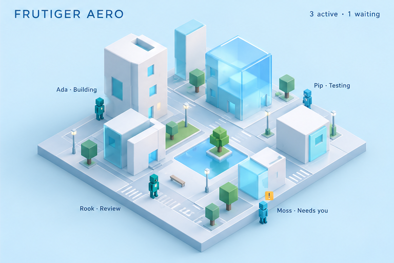
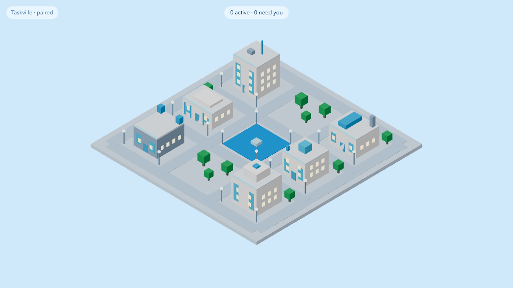

# M3.10: Frutiger Aero theme (#43)

- **Result:** done (PR and roborev pending the base merge, see Blockers)
- **PR:** not opened yet · **roborev:** not run yet
- **Checks run:** `pnpm --filter @taskville/web exec vitest run test/themes/aero` (4 tests; seen failing first, commit "Failing tests: aero theme contract") · `pnpm --filter @taskville/web test` (25 files, 177 tests pass) · `pnpm exec tsc --noEmit -p apps/web/tsconfig.json` clean · `pnpm exec biome check` clean · `pnpm check`: first run failed (the output tail did not show which test, machine under load), rerun once passed (122 files, 2470 tests). Logged as a flake. · `E2E_PORT=4857 E2E_SCREENSHOT=... pnpm --filter @taskville/web test:e2e` once (3 smoke tests pass; screenshot comes from it)
- **NOT RUN:** `test:browser` (no component added), the full e2e suite, perf
- **Measurements:** none
- **Decisions needed:** none
- **Review outcome:** pending
- **Lessons:** see the end of this file

## Screenshot next to the mockup

| Mockup, Frutiger Aero quadrant (visual reference, not a pixel spec) | Built (aero, day, 1280x720) |
| --- | --- |
|  |  |

The screenshot was taken with aero temporarily first in `THEMES` (not committed): the app has no theme picker until M3.15 wires `useThemeControl()`.

## What it is

`apps/web/src/themes/aero/index.ts`, plain data on the M3.07 contract:

- Pale sky-blue scene (`#cfe9fb`), white walls, a bright blue water plaza (`#2fa0f0`) with a pale plaza mark, soft green tree crowns, orange focus color, 14 px radius, Segoe UI/Frutiger font stack.
- Night: dusk blue scene, dimmer walls, glowing glass and water.
- 18 accents from `CITY_LAYOUT`: two cyan glass panels either side of each door (clear of the 0.7 m door half width, height from 0.7 m to roof minus 0.9 m) and a glowing cyan roof-edge line. `validateAccents` returns none.
- History tint `#8fb8d8`, desaturate 0.3.
- Registered in `apps/web/src/themes/core/themes.ts` with one import and one array entry, after cyberpunk (cyberpunk stays the default). Declared for the PR; the lead resolves conflicts with M3.08 and M3.09.

## Gaps

- The mockup's translucent glass volumes and the pond island need geometry or materials the contract does not offer (accents are opaque boxes, one shared plaza). The built city gets the blue-glass feel from palette and panels only.
- Walls render light grey rather than the mockup's white because the scene lighting is shared; lighting is M3.12.

## Lessons

- `git commit -a` skips untracked files: a new theme folder was left out of a commit that already registered it. `git status` before every commit.
- With no theme picker, a theme screenshot needs a temporary default swap; a `?theme=` hook in the app would make this cheap for the other themes.
