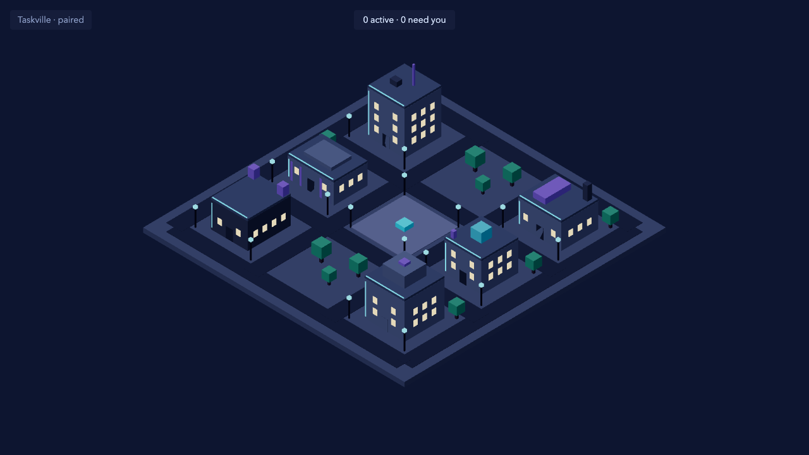
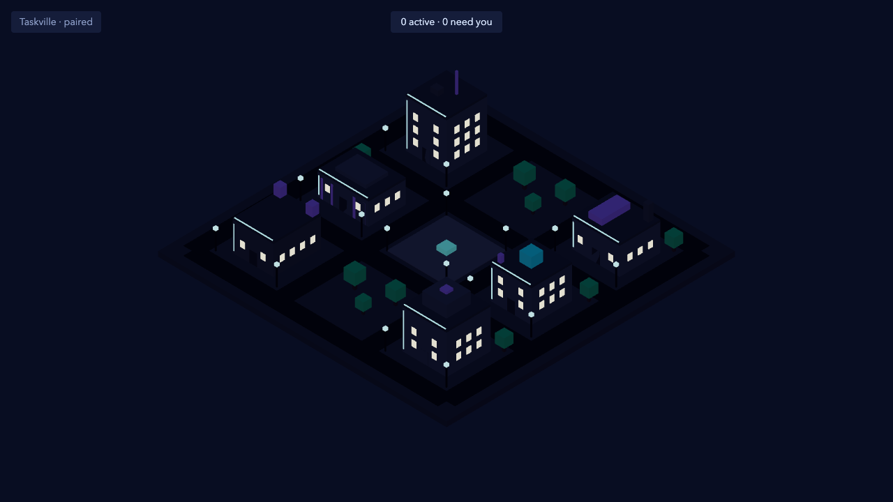
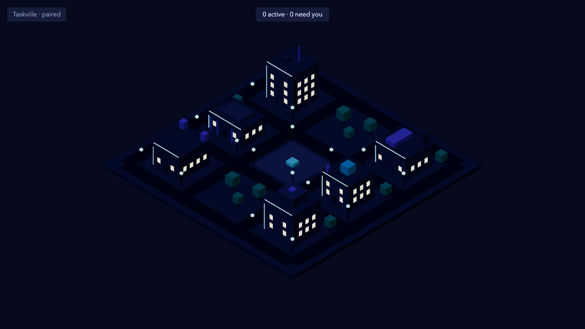

# M3.12: Day and night lighting from local time (#44)

- **Result:** done (PR and roborev pending the base merge)
- **PR:** not opened yet · **roborev:** not run yet
- **Checks run:** `pnpm exec vitest run --root ../.. --project @taskville/web test/city/lighting` (3 files, 25 tests; the phase and controller tests were seen failing first, commit "Failing tests: lighting phase math and controller") · `pnpm exec tsc --noEmit -p apps/web/tsconfig.json` clean · `pnpm exec biome check apps/web` clean · `pnpm --filter @taskville/web test` (27 files, 198 tests) · `pnpm check` once (124 files, 2491 tests pass) · `E2E_PORT=4858 E2E_SCREENSHOT_DIR=docs/tasks/M3.12 pnpm exec playwright test lighting` once (1 test, 3 screenshots)
- **NOT RUN:** `test:browser`, the full e2e suite, perf
- **Measurements:** none
- **Decisions needed:** none
- **Review outcome:** pending
- **Lessons:** see the end of this file

## Screenshots (cyberpunk, 1280x720, browser clock fixed in UTC)

| Noon 12:00 | Dusk 18:45 | Night 23:30 |
| --- | --- | --- |
|  |  |  |

## What was built (`apps/web/src/city/lighting/`)

- `phase.ts`: pure. `localMinutes(instantMs, ianaZone)` (Intl, handles DST, UTC fallback for a bad zone), `phaseAt`, `computeLighting(minutes)`. Fixed day, not solar (no location): dawn 05:30-07:30, day to 17:30, dusk 17:30-19:30, night after. `nightness` 0..1 (smoothstep through dawn and dusk), `mode` flips to "night" at nightness 0.5 (18:30 and 06:30), sun elevation and angle, ambient and sun intensity.
- `controller.ts`: `createLightingController({ theme, now?, timeZone?, initialSetting? })`. Holds setting and injected time, resolves the state, calls `theme.setMode("day" | "night")` only when the mode changes, `tick()`, `start()` (30 s interval, hooks injectable), `subscribe`.
- `skyColors.ts`: pure `lightRig(state, dayTokens, nightTokens)`: sky color is the theme's own day `--tv-scene-bg` blended to its night one (the M3.07 night palette), hemisphere colors, sun color (day, warm at the middle of dusk and dawn, moonlight), and the sun/moon position on one continuous arc.
- `DayNightLighting.tsx`: a hemisphere light, one directional light and the scene background. No post-processing.
- `instance.ts`, `react.ts`, `index.ts`: the app-wide `lightingController`, `useLighting`, `useLightingControl`.

Window emissives and lamps are part of the theme palette, so they come on when the mode flips to night (middle of dusk), using the theme's night `windowGlow` and `lampGlow`. History tint is applied to the sky when `themeController.setHistory(true)`.

## Injected time for history (M6)

`lightingController.setTime(instantMs)` overrides the clock; `setTime(null)` returns to it. The instant is read in the controller's zone. Tested: injected time wins over the clock, in another zone, and clearing it returns to the clock. M6 calls it with the replayed timestamp (and can pass `start=false` to `DayNightLighting` if it wants no clock ticks while replaying).

## Wiring the lead must do

- **Settings panel (M3.15)** does not import from here. Give it `useLightingControl()` from `city/lighting` as props: `{ setting: "cycle" | "always-day" | "always-night", setSetting(setting) }`. `LIGHTING_SETTINGS` lists the three values. Persisting the setting is the settings panel's job; `createLightingController` takes `initialSetting`.
- **Mounting edits outside Owns (declared in the PR):**
  1. `apps/web/src/city/index.tsx`: renders `<DayNightLighting />` after `<ThemedCity />` (order matters: its sky write runs after the theme's own background effect).
  2. `apps/web/src/SceneRoot.tsx`: removed the constant `<ambientLight intensity={1} />` (the lighting owns ambient now).
  3. `apps/web/src/city/buildings/CityScene.tsx`: removed the fixed `<directionalLight>` (lighting owns the sun) and updated its comment.
  4. New `apps/web/e2e/lighting.spec.ts` (one test, makes the three screenshots with `page.clock.setFixedTime` and `timezoneId: "UTC"`).
- `AgentsLayer.browser.test.tsx` has its own lights and is unaffected.

## Notes

- Night intensities (ambient 1.1, sun 0.9 vs day 1.15 and 1.4) were tuned from screenshots: lower values left the cyberpunk walls near black. The cyberpunk night palette is itself dark, so night stays moody with lit windows and lamps. Other themes (M3.08 to M3.10) may want their own night intensities; today they only supply the palette.
- Architecture says "one shared uniform for the emissives". Not done: the window and lamp materials live in `city/buildings` (not mine), so emissives switch with the palette at nightness 0.5 rather than ramping. Ramping them would need those materials exposed.

## Lessons

- A fixed-clock browser (`page.clock.setFixedTime` plus `timezoneId`) makes time-of-day visuals reproducible in e2e without any test hook in the app.
- Ambient and sun lights that live in two other files (`SceneRoot`, `CityScene`) cannot be driven from a lighting folder; a ticket that owns lighting should also own where the lights are declared.
