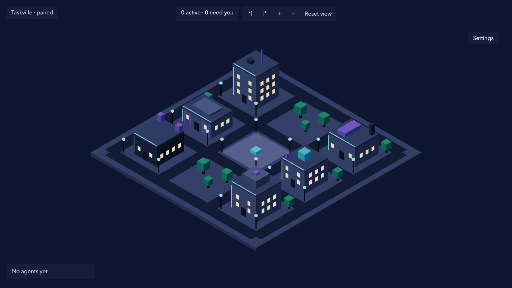
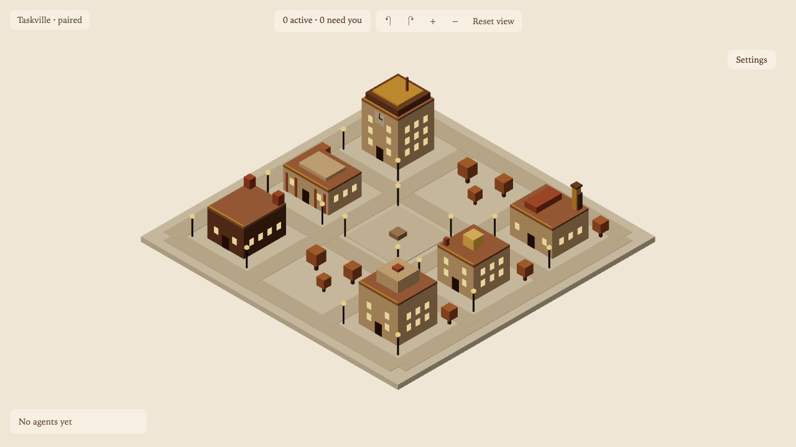
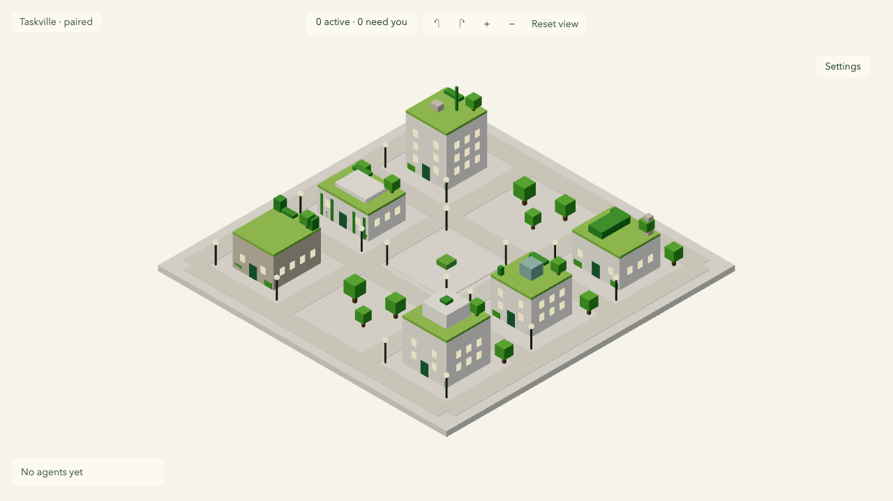
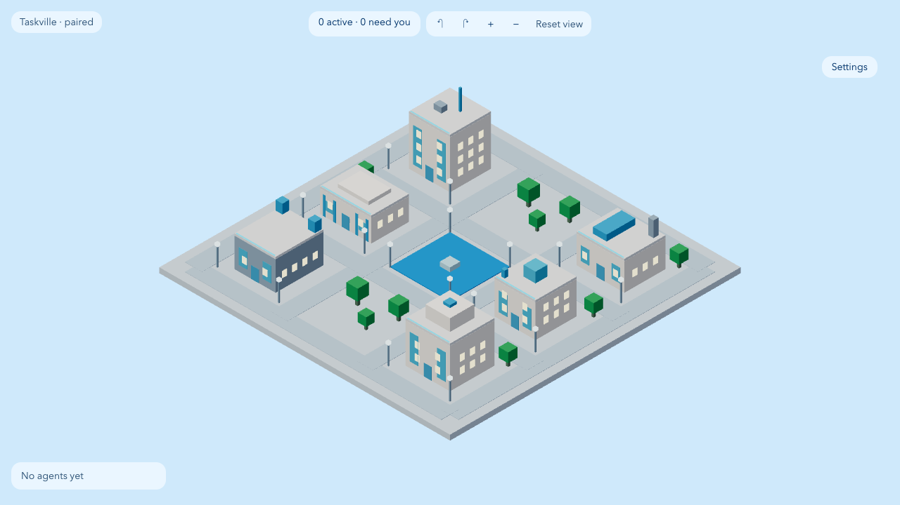

# M3.21: Theme token contrast meets WCAG AA in day and night (#235)

- **Result:** done except root `pnpm check`, which stops at a lint error in the test file (see Blockers)
- **PR:** not opened yet · **roborev:** not run yet
- **Checks run:** `pnpm exec vitest run --project @taskville/web apps/web/test/themes` (seen failing first with 23 misses; 63 tests pass after) · `pnpm exec tsc --noEmit -p apps/web/tsconfig.json` clean · `pnpm exec biome check apps/web/src/themes` clean · `pnpm --filter @taskville/web test` (78 files, 626 tests pass; one earlier run failed and was not captured, rerun passed: flake) · `pnpm --filter @taskville/web test:browser src/themes src/city/agents` (LabelSprite passes; AgentsLayer frame-count and pose tests failed in two runs on different assertions, then `AgentsLayer.browser` alone passed 2 of 2: flake) · `E2E_PORT=4873 ... test:e2e smoke` once per theme for the screenshots (3 tests pass each)
- **NOT RUN:** the `test` stage of root `pnpm check` (the run stops at lint, exit 1), the full e2e suite
- **Decisions needed:** none
- **Review outcome:** pending
- **Lessons:** see the end of this file

## Token changes

Ratios are against `--tv-surface`; for muted the lower of surface and the hovered agent-list row (`--tv-accent` at 25% over the surface). Needs 4.5:1 (focus 3:1).

| Theme, mode | Token | Old | Ratio | New | Ratio |
| --- | --- | --- | --- | --- | --- |
| steampunk day | `--tv-text-muted` | `#8a6a55` | 3.30 | `#6a5241` | 4.60 |
| steampunk day | `--tv-accent` | `#b8742a` | 3.30 | `#975f22` | 4.63 |
| steampunk day | `--tv-focus` | `#d9892b` | 2.43 | `#9d631f` | 4.34 (hovered row 3.14) |
| steampunk night | `--tv-surface` (new override) | `#f7efe2` | - | `#34261d` | - |
| steampunk night | `--tv-text` (new override) | `#4a2f22` | - | `#f3e3cc` | - |
| steampunk night | `--tv-text-muted` (new override) | `#8a6a55` | 3.69 | `#d0bca6` | 4.78 |
| steampunk night | `--tv-focus` (new override, same value) | `#d9892b` | 2.43 | `#d9892b` | above 3 on the dark surface |
| steampunk night | `--tv-accent` (unchanged `#e8a24a`) | `#e8a24a` | 1.90 | `#e8a24a` | above 4.5 on the dark surface |
| solarpunk | `--tv-text-muted` | `#5f7a62` | 3.44 | `#4c624e` | 4.58 |
| solarpunk | `--tv-accent` | `#4f9a3f` | 3.31 | `#428034` | 4.56 |
| solarpunk (day and night) | `--tv-focus` | `#e8a31c` | 2.06 | `#9c6e11` | 4.29 (hovered row 3.12) |
| aero day | `--tv-text-muted` | `#4a7aa8` | 3.16 | `#385c7e` | 4.58 |
| aero day | `--tv-accent` | `#1e90e0` | 3.12 | `#1873b3` | 4.62 |
| aero day | `--tv-focus` | `#ff9f1a` | 1.87 | `#a16410` | 4.40 (hovered row 3.16) |
| aero night | `--tv-accent` (new override) | `#1e90e0` | 3.86 | `#40a2e6` | 4.75 |
| aero night | `--tv-focus` (new override, restores day value) | `#ff9f1a` | - | `#ff9f1a` | above 3 on the dark surface |
| cyberpunk day | `--tv-text-muted` | `#8a9bc4` | 3.32 | `#b8c2db` | 5.17 |
| cyberpunk night | `--tv-text-muted` | `#8a9bc4` | 2.95 | `#b8c2db` | 4.59 |

Focus ring on the hovered agent-list row (accent at 25% over the surface, hovered and keyboard-focused at once) needs 3:1 too, found by roborev. First-pass focus values were `#bf7926` (steampunk day, 2.23 on the hovered row), `#b88114` (solarpunk, 2.34, day and night as night inherits it) and `#c47a14` (aero day, 2.24); they were darkened to the values above, which pass on both the plain surface and the hovered row. Only `--tv-focus` changed; the focus ring is not in the screenshots, so none were retaken.

Steampunk night: a dark surface with matching text and muted keeps the brighter gaslight accent `#e8a24a` (the alternative, a darker night accent, would have dropped the glow). Aero night needed a lighter accent on its dark surface. Cyberpunk is dark in both modes, so its muted got lighter; the hover row, lightened by the cyan accent, was the binding pairing.

## Screenshots (day, 1280x720)

Taken with the default theme id and `dayNight` temporarily swapped in `overlays/settings/store.ts` (reverted, not committed): the app still has no picker reachable from the smoke spec.

| cyberpunk | steampunk | solarpunk | aero |
| --- | --- | --- | --- |
|  |  |  |  |

## Blockers

Root `pnpm check` exits 1 at `biome check .`: `apps/web/test/themes/contrast.test.ts` fails the formatter (the `composite` return array should be one line). It is the test file, so it was not touched here; a test-writer pass (`biome format --write` on that file) clears it. The `fixtures/claude-code/permission/spike-server.mjs` `useTemplate` finding is an info, not an error.

## Lessons

- The smoke screenshot recipe from M3.08 to M3.10 (reorder `THEMES`) no longer selects a theme: the settings store default decides. Swap `DEFAULT_SETTINGS.theme` instead. Four byte-identical screenshots were the tell.
- `E2E_SCREENSHOT` is resolved against `apps/web`, so pass an absolute path.
