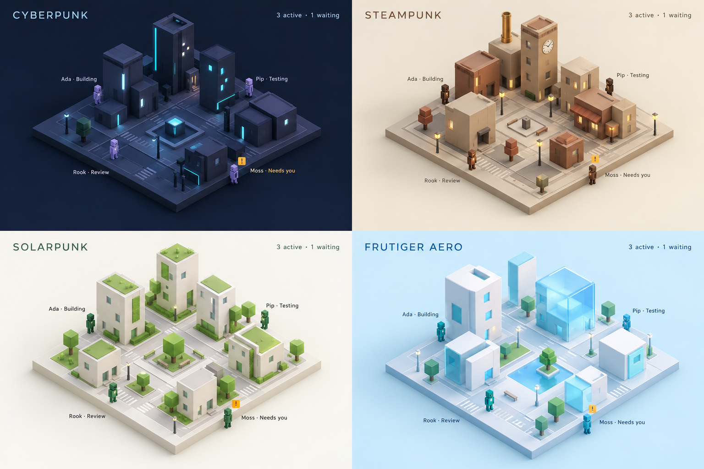
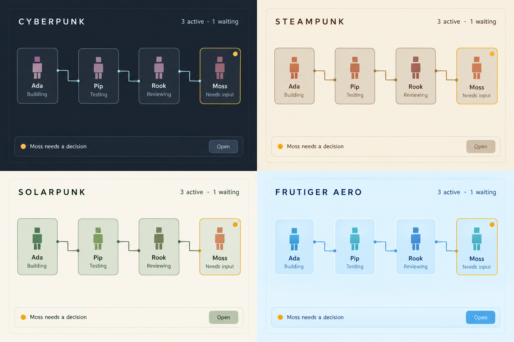
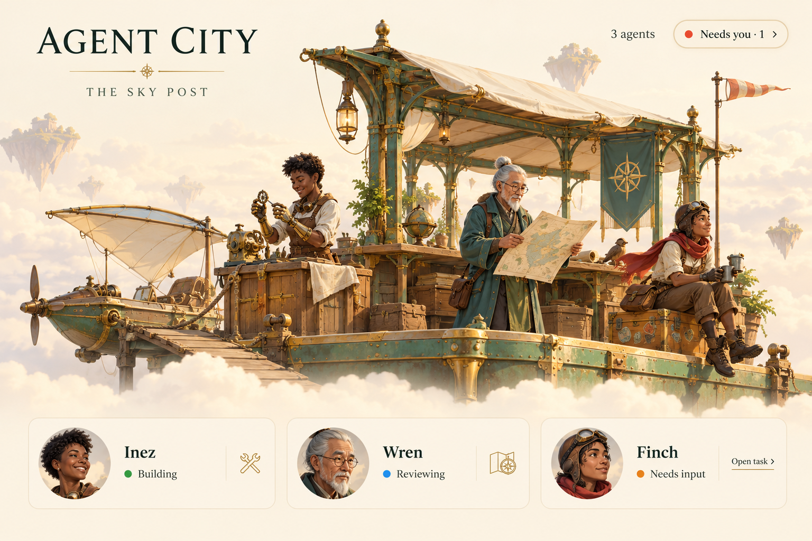
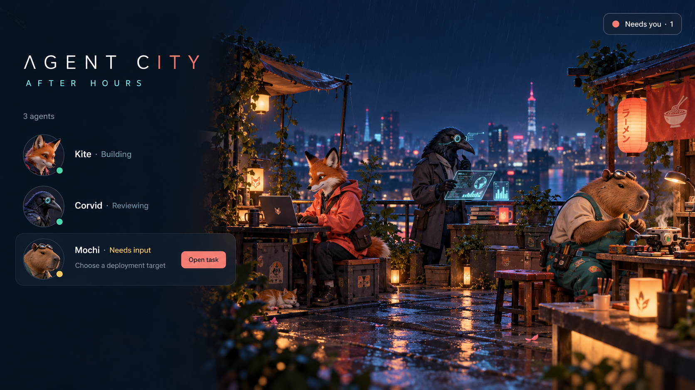
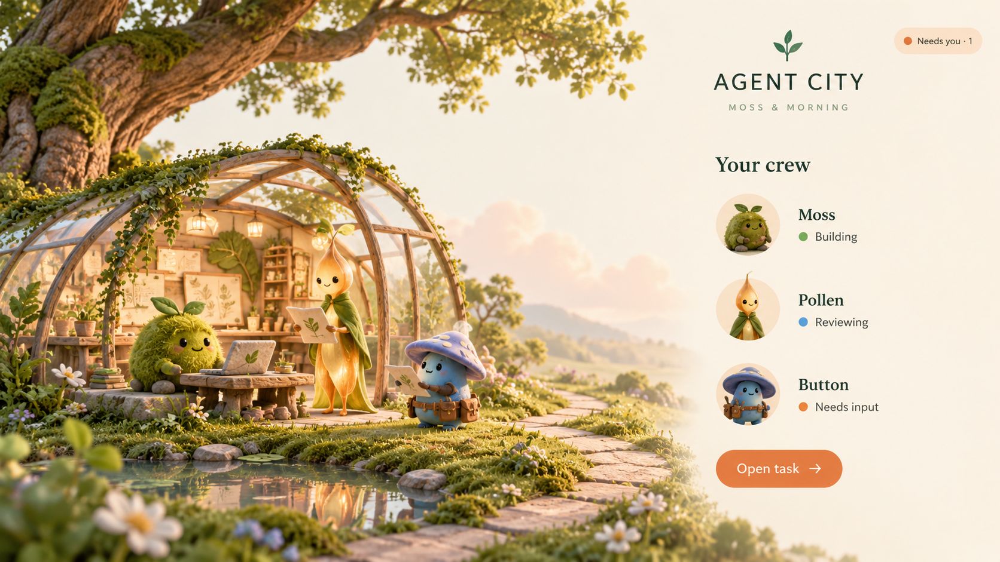
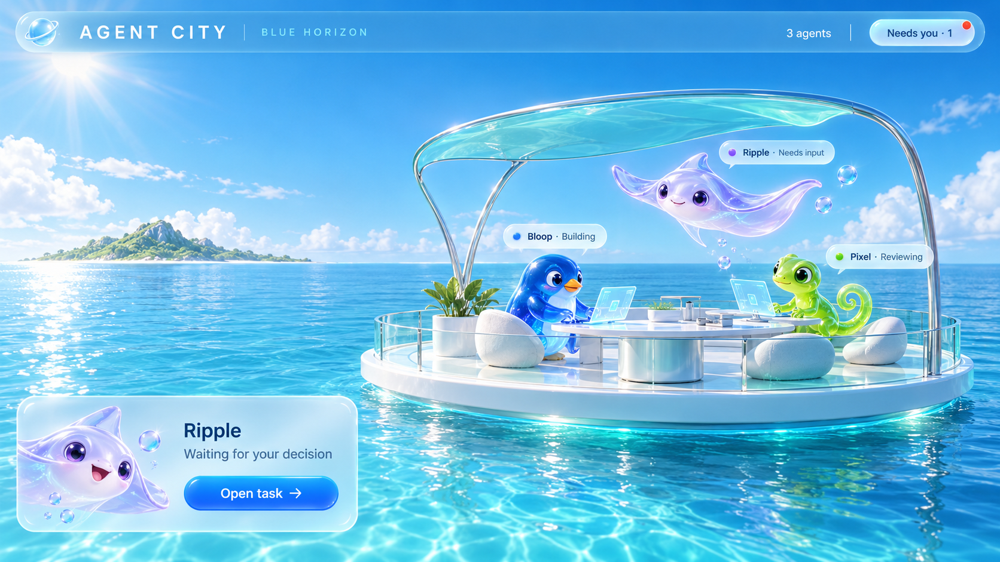
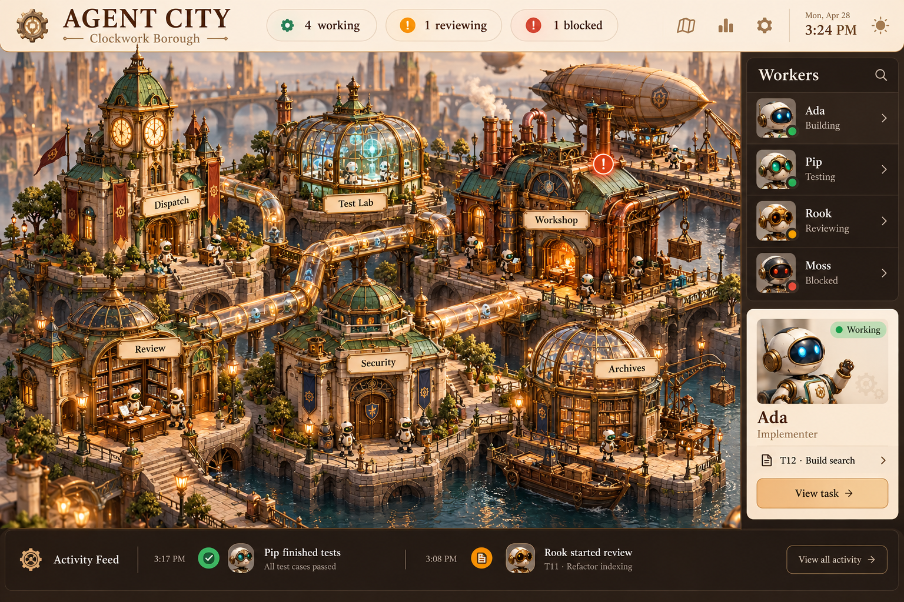
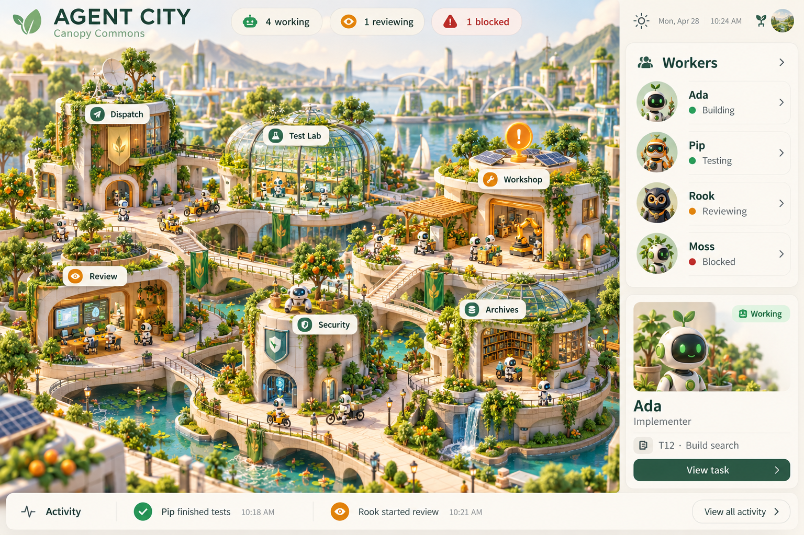
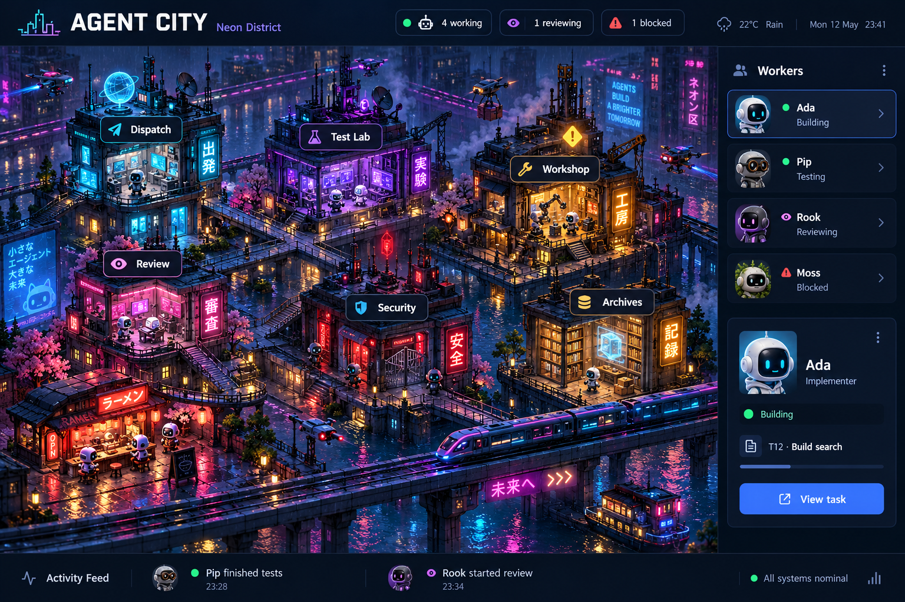
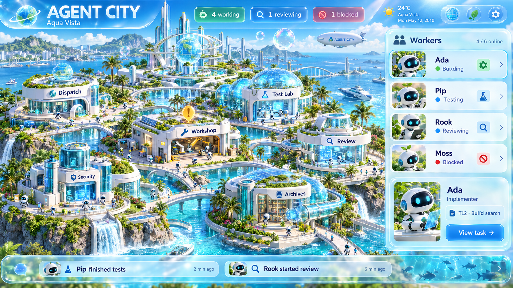

# Taskville UI models

These are generated visual concept mockups from the design conversation. They are reference images, not functional screens or runtime assets. Text and sample statuses in them are illustrative.

## Current direction: minimalist 3D city

Build toward this model: small isometric city, block buildings and agents, sparse status labels, quiet colors, and agent movement along streets. Retain the four themes. Use procedural 3D geometry, not this image as a background.

The city is essential. The flat-node study below is not the requested product. Earlier character and scenery studies are archived for context and should not guide the implementation's complexity.

## Flat node study: superseded

Useful for restraint, spacing, and palette only. The user explicitly clarified that the interface must remain a 3D city.

## Character and scenery studies: superseded

These were too illustrative and character-heavy. Do not implement their human, animal, or botanical avatars.

### Steampunk

### Cyberpunk

### Solarpunk

### Frutiger Aero

## Original detailed cities: superseded

These establish theme vocabulary, but their scenery and dashboard layouts were too busy.

### Steampunk

### Solarpunk

### Cyberpunk

### Frutiger Aero

## Interaction model added after the mockups

The following behaviors are specified in the [architecture](../../ARCHITECTURE.md) (sections 2 and 3) but are not depicted in these static images:

- Live mode is the default. Bots walk between work areas and animate subtly while working.
- A bot that needs you stops, pulses red about once per second, glows to show it is clickable, and pops up built-in quip bubbles such as "Little help here?". The mockups' amber marker is replaced by this red state; amber now means heuristic trouble.
- Clicking a bot that needs you opens an action card: Allow once, Deny, or Open session.
- Subagents are smaller bots that walk out of their parent's building and bring back a result cube. Agent-team teammates are full-size, named, and share a team scarf color; the lead wears a hard hat at Dispatch. Messages between teammates fly as paper envelopes.
- Clicking any agent opens a panel with a live code-level feed (edits, commands, reads). A parent's crew tab lists its subagents and teammates and highlights them in the city.
- Lighting follows the viewer's local time of day, and the cycle can be turned off.
- Small celebrations mark completions, handoffs, and merges. An optional soundscape is off by default.
- History is one click away (clock button), visibly tinted, with a timeline strip and a "Back to live" pill that turns red if something needs you live.
- History is read-only and cannot answer prompts or dispatch commands.
- The headless engine operates without this visual client.
