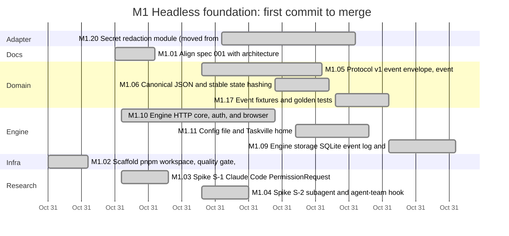
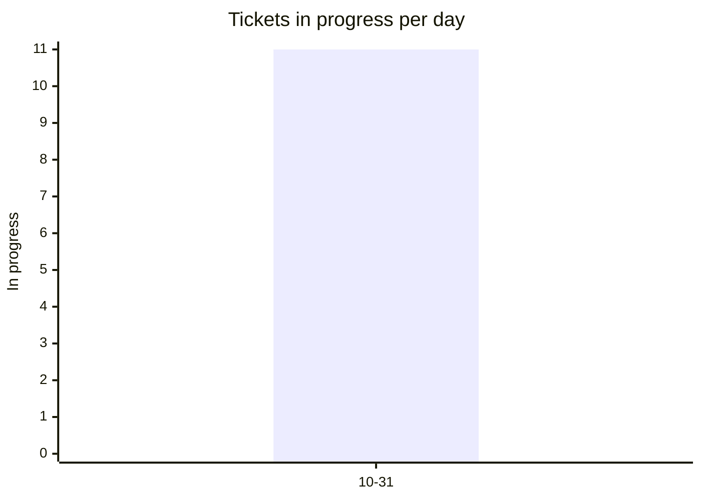
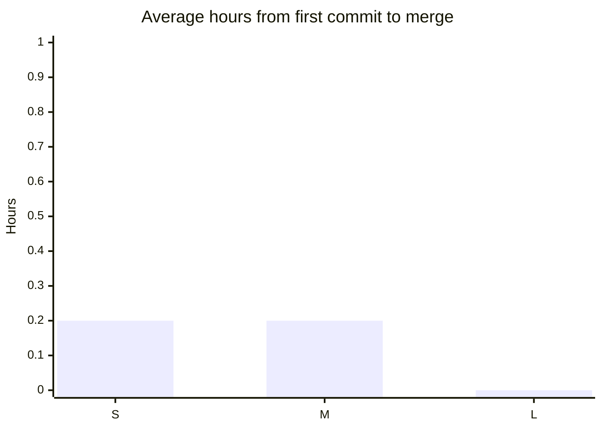
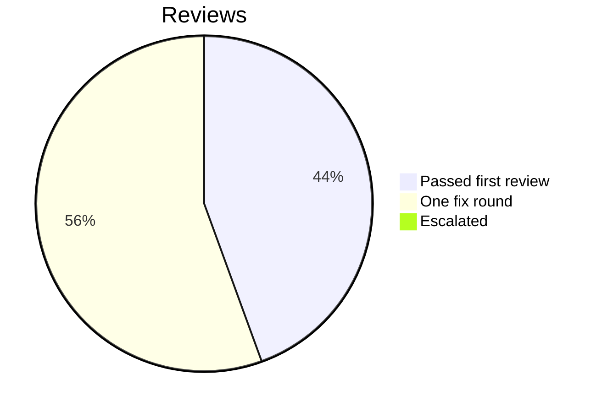

# Retro: M1 Headless foundation

Generated 2026-10-31T02:19Z by `pnpm retro M1` from GitHub data. Charts and numbers are generated; the sections marked *written* are filled in by the lead.

## At a glance

| Tickets planned | Added | Done | Dropped | Calendar days | Peak parallel | First-pass reviews | Flakes | NOT RUN |
| --- | --- | --- | --- | --- | --- | --- | --- | --- |
| 22 | 0 | 11 | 0 | 1 | 11 | 44% | 0 | 11 |

## Timeline by lane



Times are UTC. Start is the first commit on the ticket's branch, end the merge; tickets in progress run to the generation time. Not started: M1.07, M1.08, M1.12, M1.13, M1.14, M1.15, M1.16, M1.18, M1.19, M1.21, M1.RT.

## Burn-down

```mermaid
xychart-beta
  title "Open tickets per day"
  x-axis ["10-31"]
  y-axis "Open tickets" 0 --> 22
  line [11]
  line [22]
```

## Parallelism



Most in progress at one moment: 4 (2026-10-31T01:41 UTC).

## Cycle time by size



Average over merged tickets with a size on the board. Not measured: L (no merged L tickets).

## Review outcomes



From the roborev field of each merged ticket's task report: a medium or higher finding fixed before merge is one fix round. Not measured: M1.10, M1.11 (the report does not say).

## Quality signals

| CI failures | Re-runs | Flakes | Tests NOT RUN | Security findings (high / medium / low) |
| --- | --- | --- | --- | --- |
| 0 | 0 | 0 | 11 | not measured / not measured / not measured |

## Plan versus actual

| | Tickets | Keys |
| --- | --- | --- |
| Planned | 22 | M1.01, M1.02, M1.03, M1.04, M1.05, M1.06, M1.07, M1.08, M1.09, M1.10, M1.11, M1.12, M1.13, M1.14, M1.15, M1.16, M1.17, M1.18, M1.19, M1.20, M1.21, M1.RT |
| Added mid-milestone | 0 |  |
| Split | not measured | |
| Dropped | 0 |  |
| Done | 11 | M1.01, M1.02, M1.03, M1.04, M1.05, M1.06, M1.09, M1.10, M1.11, M1.17, M1.20 |
| Still open | 11 | M1.07, M1.08, M1.12, M1.13, M1.14, M1.15, M1.16, M1.18, M1.19, M1.21, M1.RT |

Planned tickets were created by the first commit of the milestone (2026-10-31T01:15 UTC); added ones after it. Splits are not recorded in GitHub data. Dropped means closed as not planned.

## What went well *(written)*

## What hurt *(written)*

## Lessons from this milestone *(written)*

Links to the [LESSONS.md](../LESSONS.md) entries recorded during the milestone, plus any new ones from this retro.

## Changes for the next milestone *(written)*

Each change is either applied now (with a link to the commit or ticket) or proposed to the owner in the gate summary.
